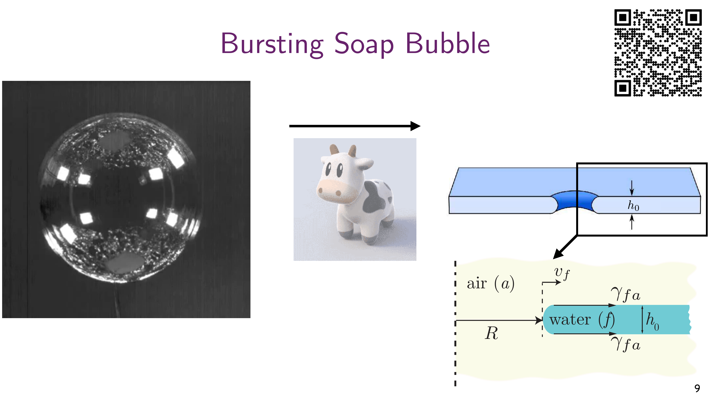
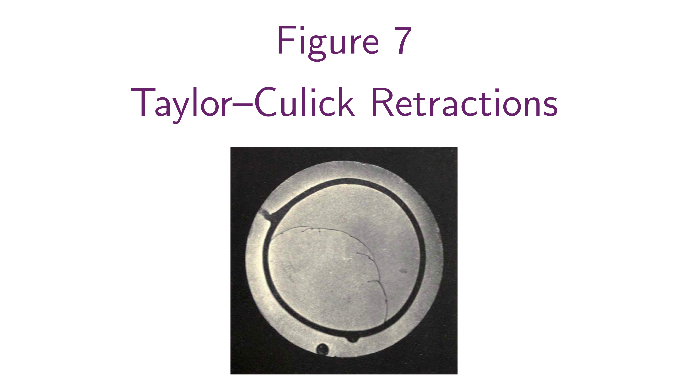
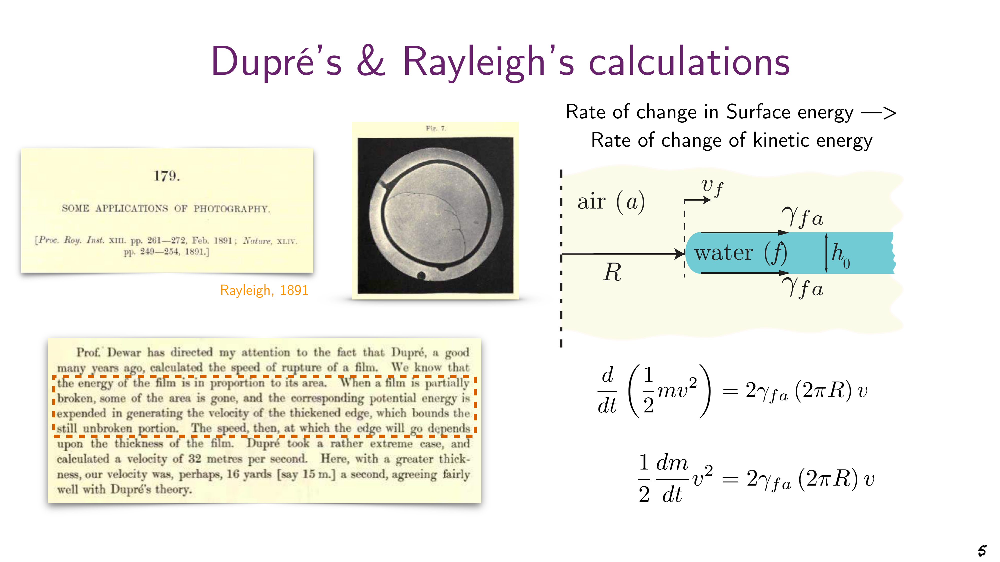
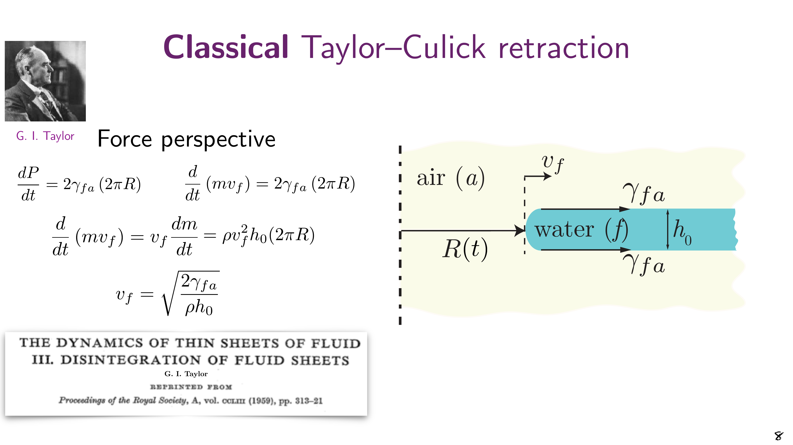
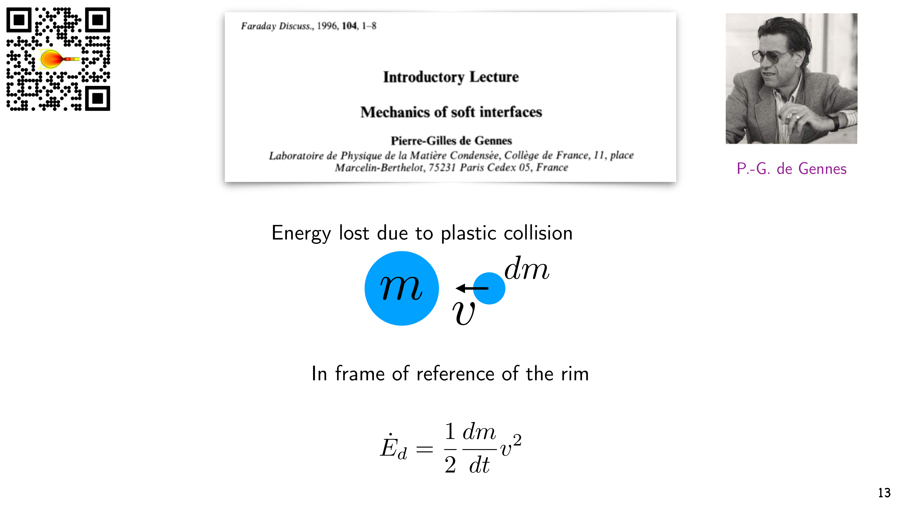
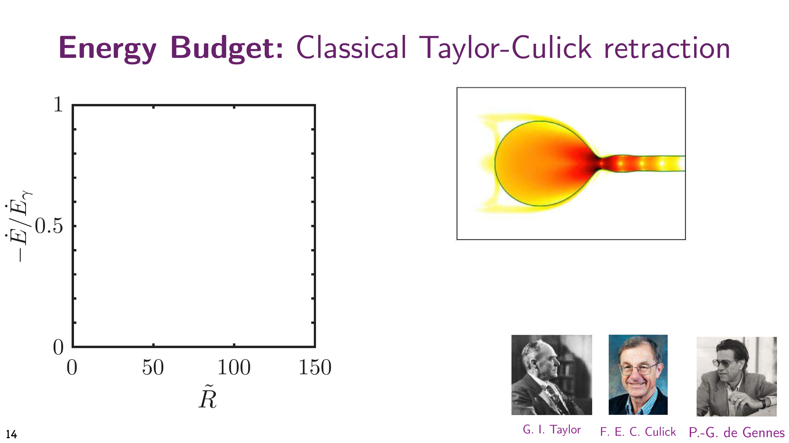
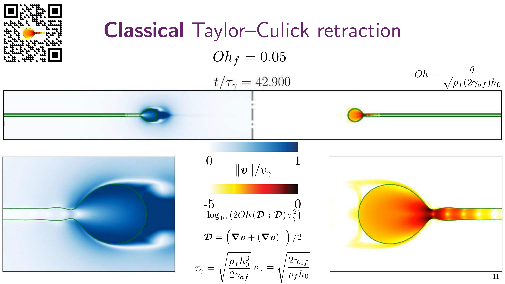
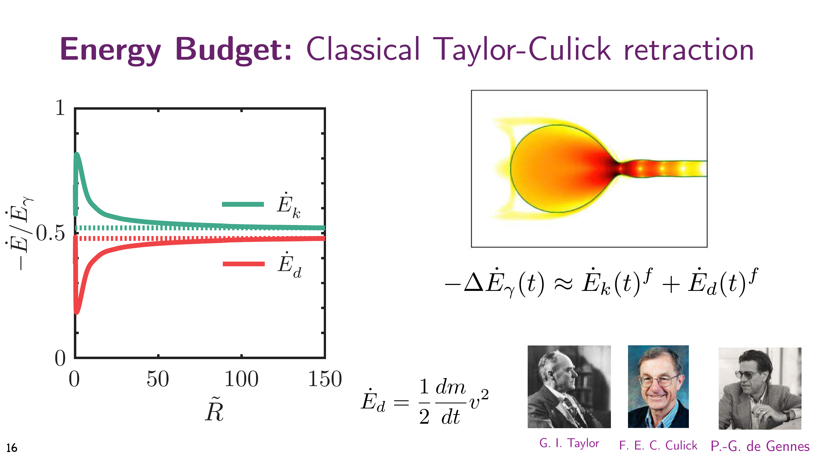
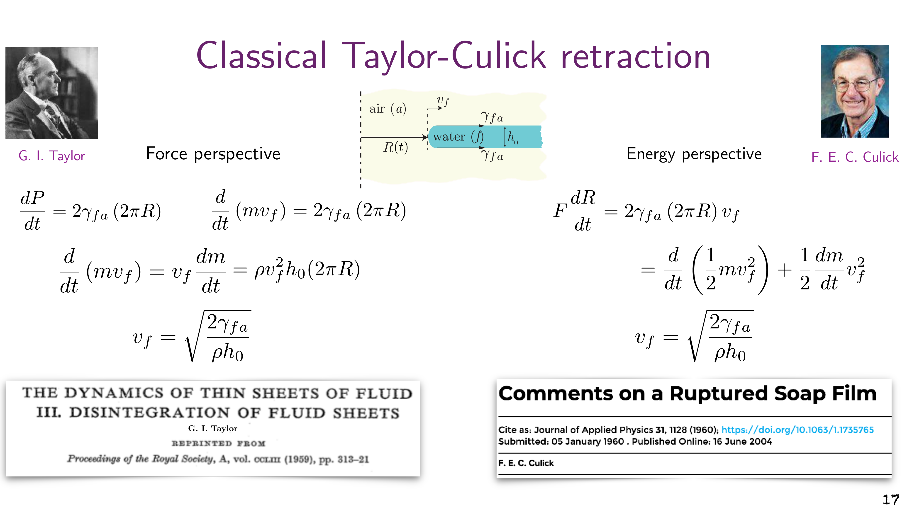
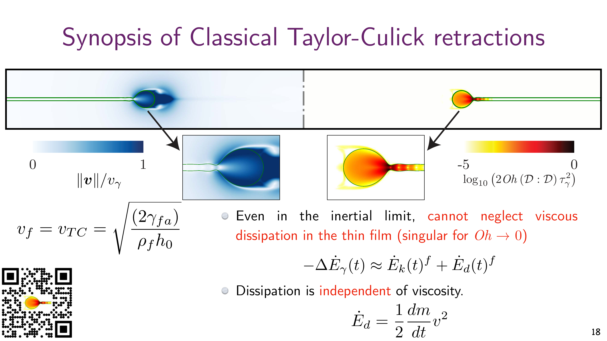

---
tags:
  - lecture
  - soft-matter
  - taylor-culick
  - conservation-laws
  - paradox-resolution
  - fluid-dynamics
lecture-number: 1.5
date: 2025-10-28
status: done ✅
publish: true
---

# Lecture 1.5: The Taylor–Culick Paradox — Where Did the Energy Go?

<!-- BLOG-PDF-LINK-START -->
<!-- PDF-EXPORT-IGNORE-START -->
> [!pdf] PDF version
> [[_Media/PDF/Lecture-Notes/Intro-Soft-Matter/2025/1.5-Taylor-Culick-Paradox.pdf|Download this page as PDF]]
<!-- PDF-EXPORT-IGNORE-END -->
<!-- BLOG-PDF-LINK-END -->

Resolving the Dupré–Rayleigh paradox through proper energy accounting and momentum conservation. This lecture bridges [[1-Intro-Soft-Matter|Lecture 1]]'s introduction to the paradox with a complete resolution.

---

## Introduction: The Unresolved Paradox

In Lecture 1, we encountered a puzzle: when you puncture a soap bubble, the film edge retracts inward with remarkable speed. Yet two seemingly correct physical approaches gave different predictions for this retraction velocity:

$$\text{Dupré–Rayleigh (Energy):} \quad v = \sqrt{\frac{4\gamma_{fa}}{\rho h_0}} \quad \text{(disagreed with experiment)}$$

$$\text{Taylor–Culick (Momentum):} \quad v = \sqrt{\frac{2\gamma_{fa}}{\rho h_0}} \quad \text{(agreed with experiment)}$$

Question: If momentum conservation gives the right answer, why did energy conservation fail? Where did the missing energy go?

This lecture resolves this paradox, which was finally answered convincingly by Pierre-Gilles de Gennes in 1996—more than a century after Rayleigh's original observations.

---

## Historical Context: A Long-Standing Mystery

### Rayleigh's Pioneering Work (1891)

John William Strutt, 2nd Baron Rayleigh, used instantaneous photography to capture the dynamics of liquid jets and interfaces. In a remarkable 1891 paper, he observed breaking jets and proposed an energy-balance argument for the speed of film retraction:

> Rate of surface energy decrease = Rate of kinetic energy increase

Mathematically:
$$\frac{d}{dt}\left(\frac{1}{2}mv^2\right) = 2\gamma_{fa}(2\pi R) v$$

This yielded:
$$v_{\text{Dupre-Rayleigh}} = \sqrt{\frac{4\gamma_{fa}}{\rho h_0}}$$

### A Curious Anomaly

Despite its elegant derivation, Rayleigh's prediction was faster than observed—a factor of $\sqrt{2}$ too fast. For nearly 70 years, this discrepancy puzzled the fluid mechanics community.

---

## The Three Perspectives: Energy, Momentum, and Dissipation

### 1. The Energy Perspective (Dupré & Rayleigh, 1891)

The energy balance assumes that all surface energy released goes into kinetic energy of the rim:

Setup: a circular hole of radius $R(t)$ opens in a flat film of thickness $h_0$, density $\rho$ and surface tension $\gamma_{fa}$ on each of its two faces. The hole grows at speed $v_f = dR/dt > 0$, and the film material it sweeps up collects in a rim at its edge. Let $R_i$ be the initial radius of the hole.

Surface energy released: two faces of area $\pi(R^2 - R_i^2)$ have disappeared, so, neglecting the surface area of the rim itself,
$$E_{released} = 2\pi\gamma_{fa}\left(R^2 - R_i^2\right), \qquad \dot{E}_{released} = 2\gamma_{fa} \cdot 2\pi R \cdot v_f$$

Mass collected in the rim:
$$m = \rho\pi h_0\left(R^2 - R_i^2\right), \qquad \frac{dm}{dt} = \rho \cdot (2\pi R) \cdot h_0 \cdot v_f$$

At constant speed the rim's kinetic energy grows only because its mass grows:
$$\dot{E}_k = \frac{d}{dt}\left(\frac{1}{2}m v_f^2\right) = \frac{1}{2}\frac{dm}{dt}v_f^2$$

If all the released surface energy became kinetic energy of the rim:
$$\frac{1}{2}\rho (2\pi R h_0) v_f^2 \cdot v_f = 4\pi \gamma_{fa} R v_f$$

$$v_f^2 = \frac{4\gamma_{fa}}{\rho h_0}$$

$$\boxed{v_f = \sqrt{\frac{4\gamma_{fa}}{\rho h_0}}} \quad \text{(Dupré–Rayleigh prediction)}$$

---

### 2. The Momentum Perspective (G. I. Taylor, 1959)

G. I. Taylor (1886–1975), one of the greatest fluid mechanicists, approached the problem differently: he used momentum conservation instead of energy.

Newton's second law: Force = Rate of momentum change

Forces on the film:
- Surface tension acts on the perimeter of the film at both interfaces
- Total force: $F = 2\gamma_{fa}(2\pi R)$ (pointing radially outwards, driving the expansion of the hole)

Rate of momentum change:
The rim is pulled radially outwards by surface tension. The material in the rim has momentum $p = mv$.

$$\frac{dp}{dt} = 2\gamma_{fa}(2\pi R)$$

For initially stationary film material captured by the rim:
$$\frac{d}{dt}(mv_f) = 2\gamma_{fa}(2\pi R)$$

This gives:
$$v_f \frac{dm}{dt} + m\frac{dv_f}{dt} = 2\gamma_{fa}(2\pi R)$$

Assuming steady-state ($\frac{dv_f}{dt} = 0$) and $\frac{dm}{dt} = \rho (2\pi R) h_0 v_f$:

$$v_f \cdot \rho (2\pi R) h_0 v_f = 2\gamma_{fa}(2\pi R)$$

$$\rho h_0 v_f^2 = 2\gamma_{fa}$$

$$\boxed{v_f = \sqrt{\frac{2\gamma_{fa}}{\rho h_0}}} \quad \text{(Taylor–Culick prediction)}$$

Remarkable fact: Taylor's prediction agrees with experiments! This immediately suggested that the energy approach was wrong—but why?

---

### 3. The Missing Link: Inelastic Collision (de Gennes, 1996)

Pierre-Gilles de Gennes, a master of soft matter physics (Nobel Prize 1991), provided the decisive resolution in a 1996 *Faraday Discussion* paper:

> [!important] The Key Insight
>
> The film material does not smoothly flow into the retracting rim. Instead, it collides inelastically with the rim, dissipating energy. This is a plastic collision, not an elastic process.

### Energy Budget with Dissipation

When the soap film retracts, the material at the film edge joins the rim. This material transition is inelastic:

- Before collision: the film ahead of the rim is at rest
- After collision: it moves with the rim at $v_f$
- Energy dissipated: each mass element is accelerated from $0$ to $v_f$ in a plastic (perfectly inelastic) collision

The energy dissipation rate from the inelastic collision:

$$\dot{E}_{dissipated} = \frac{1}{2}\frac{dm}{dt}v_f^2$$

In the rim's frame the film arrives at $v_f$ and stops, losing $\frac{1}{2}v_f^2$ per unit mass. Half the surface energy released is dissipated this way; the other half goes into the rim's kinetic energy.

---

## Complete Energy Balance

Let's now account for all energy flows:

Energy released by surface tension:
$$\dot{E}_{released} = 2\gamma_{fa} \cdot 2\pi R \cdot v_f = 4\pi \gamma_{fa} R v_f$$

Energy dissipated (inelastic collision):
$$\dot{E}_{dissipated} = \frac{1}{2}\frac{dm}{dt}v_f^2 = \frac{1}{2}\rho (2\pi R h_0) v_f \cdot v_f^2 = \pi \rho R h_0 v_f^3$$

Energy conservation (with dissipation):
$$\dot{E}_{released} = \dot{E}_{dissipated} + \dot{E}_{kinetic}$$

$$4\pi \gamma_{fa} R v_f = 2\pi \rho R h_0 v_f^3$$

$$2\gamma_{fa} = \rho h_0 v_f^2$$

$$\boxed{v_f = \sqrt{\frac{2\gamma_{fa}}{\rho h_0}}} \quad \text{(Corrected energy prediction!)}$$

---

## Resolving the Apparent Contradiction

The resolution lies in momentum conservation vs. energy conservation:

### Why Momentum Conservation Works

Momentum balance directly applies regardless of dissipation:

$$\text{Force} = \frac{dp}{dt}$$

This is valid whether the process is elastic or inelastic. The surface tension force acts on the film perimeter, and momentum is conserved:

$$v_f = \sqrt{\frac{2\gamma_{fa}}{\rho h_0}} \quad \checkmark$$

### Why the Original Energy Balance Failed

The error in the Dupré–Rayleigh approach was assuming that only kinetic energy matters. 

$$2\gamma_{fa} \cdot 2\pi R \cdot v_f = \frac{d}{dt}\left[\frac{1}{2}m v_f^2\right]$$

But this neglected  dissipation as the film material is "compressed" into the rim. The correct energy balance is:

$$2\gamma_{fa} \cdot 2\pi R \cdot v_f = \frac{d}{dt}\left[\frac{1}{2}m v_f^2\right] + \dot{E}_\text{dissipation}$$

The "missing" energy $\dot{E}_{internal}$ goes into:
- Deforming the fluid from a thin film to the thicker rim
- Viscous dissipation at high shear rates
- Acoustic waves (shock waves in the fluid)

---

## The Ohnesorge Number and Flow Regimes

The dynamics of film retraction depend on the balance between surface tension (driving the flow) and viscosity (resisting it).

Ohnesorge number:
$$Oh = \frac{\eta}{\sqrt{\rho \gamma_{fa} h_0}}$$

where $\eta$ is the dynamic viscosity.

- Low $Oh$ regime: Inertia-dominated, momentum conservation dominates
- High $Oh$ regime: Viscous-dominated, viscous stresses important

The classical Taylor–Culick speed $v_f = \sqrt{2\gamma_{fa}/(\rho h_0)}$ applies in the low-$Oh$ (inertial) regime.

---

## Experimental Validation and Simulations

Modern high-speed imaging and numerical simulations have beautifully confirmed the resolution:

Key observations:
- Bursting films retract at speeds very close to Taylor's prediction
- Velocity field shows strong acceleration from rest to $v_f$
- Dissipation concentrates near the retracting edge (the rim region)
- The flow becomes increasingly complex at high Oh (viscoelastic effects emerge)

Simulations reveal that the velocity profile is not uniform—there's acceleration from the edge into the rim, and stress concentrations that lead to localized dissipation.

---

## Historical Timeline and Key References

| Year | Contributor | Contribution |
|------|---|---|
| 1891 | Rayleigh | First observation and energy-balance prediction |
| 1959 | G. I. Taylor | Momentum-balance approach; predicts $v = \sqrt{2\gamma/(\rho h_0)}$ |
| 1960 | F. E. C. Culick | Independent confirmation; bubble breakup dynamics |
| 1996 | P.-G. de Gennes | Complete resolution via inelastic collision and energy dissipation |

> [!note] On the importance of this problem
> The Taylor–Culick paradox exemplifies a deep principle: momentum conservation is always valid, but energy conservation requires accounting for dissipation mechanisms. This lesson transfers to many soft matter phenomena where interfaces dominate.

---

## Key Takeaways

1. Momentum conservation is robust. The Taylor–Culick speed $v_f = \sqrt{2\gamma_{fa}/(\rho h_0)}$ follows directly from force balance and does not depend on details of energy dissipation.

2. Energy dissipation is not negligible. The naive energy-balance approach fails because it ignores the inelastic collision process—energy is *not* smoothly converted to kinetic energy alone.

3. Multiple equilibrium approaches. For the same physical process, different conservation laws give different perspectives. Momentum is fundamental; energy requires accounting for all sinks.

4. Time and dissipation matter. In soft matter, the rate of process (viscosity, Ohnesorge number) critically determines dynamics. Fast retraction (low Oh) is momentum-dominated; slow retraction (high Oh) is viscous-dominated.

5. Paradoxes resolve through careful accounting. Many apparent contradictions in physics arise from incomplete accounting of energy or momentum sinks/sources. Always ask: "Where did the energy/momentum go?"

---

## Further Reading

### Primary Literature
- G. I. Taylor, *Proc. R. Soc. A*, 253, 313–321 (1959) — Classic momentum-balance derivation
- F. E. C. Culick, *J. Appl. Phys.*, 31, 1128 (1960) — Experimental confirmation
- P.-G. de Gennes, *Faraday Discuss.*, 104, 1–8 (1996) — Energy dissipation and resolution
- N. Savva & J. W. M. Bush, *J. Fluid Mech.*, 626, 211–240 (2009) — Modern computational studies

### Supplementary Materials
- [Dupré–Rayleigh paradox (PDF)](Dupre-Rayleigh-paradox.pdf) — Comprehensive reference document on the paradox resolution

---

## Connection to Lecture 2

This resolution of the Taylor–Culick paradox illustrates the power of conservation laws in fluid mechanics. In Lecture 2, we will develop a systematic framework for:

- Conservation of momentum → Euler and Navier–Stokes equations
- Conservation of energy → Thermodynamics and dissipation
- Continuum mechanics → Coarse-grained descriptions of soft matter

Understanding *why* momentum conservation works (even when energy accounting is subtle) is central to soft matter hydrodynamics.

---

## Homework (Self-Assessed)

> [!check] Reflection Questions
>
> Q1. In the energy-balance approach, why does neglecting dissipation lead to a speed that's $\sqrt{2}$ times faster than observed?
>
> Q2. Explain in words why momentum conservation "just works" even though energy dissipation is important. Why is momentum balance insensitive to the details of how energy is dissipated?
>
> Q3. Consider a highly viscous soap film (large $\eta$, large Ohnesorge number). Would you expect the retraction speed to be faster or slower than Taylor's prediction? Explain your reasoning using scaling arguments.
>
> Q4. Design a thought experiment or simple calculation to estimate the fraction of released surface energy that goes into:
>    - (a) Kinetic energy of the rim
>    - (b) Dissipation (heating, deformation)

---

    <iframe width="560" height="315" src="https://www.youtube-nocookie.com/embed/qnZwoLPgHAc?si=kbBvcmcTmVhpWRn6" 
        title="YouTube video player" frameborder="0" 
        allow="accelerometer; autoplay; clipboard-write; encrypted-media; gyroscope; picture-in-picture; web-share" 
        referrerpolicy="strict-origin-when-cross-origin" allowfullscreen>
    </iframe>

---

**Previous Lecture:** [[1-Intro-Soft-Matter|Lecture 1: Different Faces of Soft Condensed Matter]] 
**Next Lecture:** [[2-What-is-Viscosity|Lecture 2: Viscosity and Momentum Diffusion]] 
**Course Home:** [[0-README|Course Overview]]

> [!significance]- Metadata
> Author:: [Vatsal Sanjay](https://vatsalsanjay.com) 
> Date published:: Oct 28, 2025 
> Date modified:: Oct 16, 2026

> [!link] Back to main website
> [Home](https://comphy-lab.org/), [Team](https://comphy-lab.org/team), [Research](https://comphy-lab.org/research), [Github](https://github.com/comphy-lab)
>
> 📝 [Edit this page on GitHub](https://github.com/comphy-lab/CoMPhy-Lab-Blogs/blob/main/Lecture-Notes/Intro-Soft-Matter/2025/1.5-Taylor-Culick-Paradox.md)

