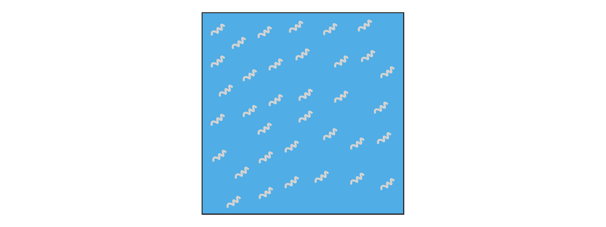
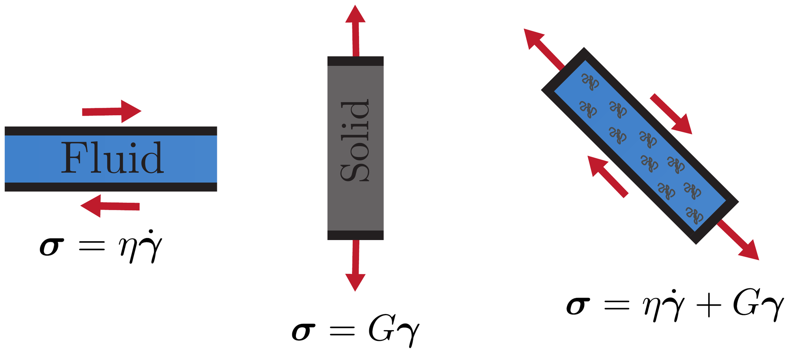
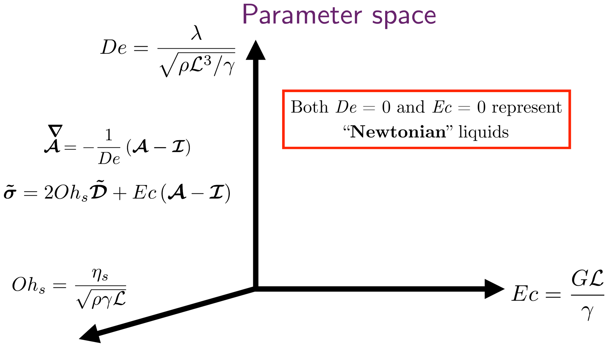

# Lecture 5: Elastic vs Viscous vs Viscoelastic

<!-- BLOG-PDF-LINK-START -->
<!-- PDF-EXPORT-IGNORE-START -->
> [!pdf] PDF version
> [[_Media/PDF/Lecture-Notes/Intro-Soft-Matter/2025/5-Viscoelasticity.pdf|Download this page as PDF]]
<!-- PDF-EXPORT-IGNORE-END -->
<!-- BLOG-PDF-LINK-END -->

> [!tldr] TL;DR
> An elastic solid resists deformation, a viscous liquid resists the rate of deformation, and a viscoelastic material does both; which response wins depends on how fast the material is deformed. Tiny amounts of dissolved polymer change how jets, filaments and films break into droplets, from inkjet printing to coughs and sneezes. To describe such flows we keep Cauchy's momentum equation and add a polymer stress that depends on the conformation tensor $\boldsymbol{\mathcal{A}}$, which measures how stretched the polymers are. In the Oldroyd-B family of models the polymers are stretched by the flow and relax with a single relaxation time $\lambda$. Its limits are a viscous liquid ($\lambda = 0$) and a Kelvin–Voigt solid ($\lambda \to \infty$). The Kelvin–Voigt solid is elastic or purely dissipative depending on its retardation time (solvent viscosity divided by elastic modulus). In dimensionless form, three numbers span the parameter space: the Deborah number $De$ (material memory against flow time), the elastocapillary number $Ec$ (elastic against capillary stress) and the solvent Ohnesorge number $Oh_s$ (viscous against inertio-capillary effects). Both $De = 0$ and $Ec = 0$ give a Newtonian liquid.

## 0) Continuum mechanics across fields

The lecture opened with two images that show the same pattern. In the first, a bubble resting on the surface of a very viscous liquid is punctured at its apex. As the hole opens and the thin film collapses, the film develops a ring of radial wrinkles (Oratis, Bush, Stone & Bird 2020). In the second, a rod pushed into an inflated elastic shell, much like a balloon, produces radial wrinkles around the indenter (Vella, Ajdari, Vaziri & Boudaoud 2011). One material is a liquid and the other a solid, yet they wrinkle in the same way.

In both cases a thin sheet is compressed along the azimuthal direction, and a thin sheet would rather bend out of its plane than shorten within it. For pressurised elastic shells, Vella et al. derived scaling laws for the indentation at which wrinkles first appear and for their number, in terms of the internal pressure and the material properties; an unpressurised shell can instead develop a localised dimple and, at larger indentation, buckle into a polygon. For the viscous bubble, Oratis et al. tilted bubbles sideways and turned them upside down, and showed that gravity is not what drives the collapse: surface tension and the dynamic stress in the compressed liquid film drive both the collapse and the wrinkling.

Continuum mechanics treats both systems with the same momentum balance. Only the constitutive law changes, that is, the relation between stress and deformation. For slow flows, in which inertia is negligible, the governing equations correspond exactly. An incompressible Newtonian liquid, with stress $\boldsymbol{\sigma} = -p\boldsymbol{I} + 2\eta\boldsymbol{\mathcal{D}}$ and $\nabla\cdot\boldsymbol{u} = 0$, obeys the same equations as an incompressible linear elastic solid, with $\boldsymbol{\sigma} = -p\boldsymbol{I} + 2G\boldsymbol{\varepsilon}$ and $\nabla\cdot\boldsymbol{\xi} = 0$. Here $p$ is the pressure, $\boldsymbol{I}$ the identity tensor, $\eta$ the viscosity, $\boldsymbol{u}$ the velocity, $\boldsymbol{\mathcal{D}} = \left(\nabla\boldsymbol{u} + (\nabla\boldsymbol{u})^{T}\right)/2$ the strain-rate tensor, $G$ the shear modulus, $\boldsymbol{\xi}$ the displacement and $\boldsymbol{\varepsilon} = \left(\nabla\boldsymbol{\xi} + (\nabla\boldsymbol{\xi})^{T}\right)/2$ the strain. Velocity replaces displacement, strain rate replaces strain, and viscosity replaces the shear modulus (the Stokes–Rayleigh analogy). A viscous sheet can therefore wrinkle like an elastic one, with stresses set by how fast it deforms rather than by how much.

This lecture is about the materials in between, whose stress depends on both the deformation and its rate.

## 1) Why do we care?

### 1.1 Elastocapillary jets in inkjet printing

An inkjet printhead fires a drop trailed by a long, slender filament. Ideally the filament retracts into a single drop; if it breaks up instead, it leaves satellite droplets that degrade the print and contaminate the printer. Sen et al. (2021) showed that a minute amount of polymer can prevent this. Aqueous solutions of polyethylene oxide (PEO) at concentrations of about $0.003$ wt%, corresponding to a nozzle-based Deborah number of about $3$ (Deborah numbers are defined in §5 and §6), suppress satellite droplets. For given driving conditions there is a window of concentrations: below it satellites still form, and above it the printhead stops jetting. Inside the window the filament retracts faster than the Newtonian Taylor–Culick speed of [[1.5-Taylor-Culick-Paradox|Lecture 1.5]], because polymers stretched during jetting add an elastic tension that pulls the filament back. In the lecture, a video compared water with $0.003\,\%$ and $0.009\,\%$ PEO solutions.

"Elastocapillary" means that elastic and capillary stresses compete. The elastocapillary number $Ec$ of §6 measures that competition.

### 1.2 Mist: how sneezes make droplets

Coughs and sneezes are turbulent, multiphase flows that can carry pathogen-bearing droplets of mucosalivary fluid, and how far the contamination reaches is largely set by droplet size. High-speed imaging at the mouths of healthy subjects (Scharfman, Techet, Bush & Bourouiba 2016) showed that the fluid keeps breaking up after it has left the mouth, through a cascade from sheets to bursting bags to ligaments and finally to droplets. The viscoelasticity of the mucosalivary fluid delays this fragmentation: droplet precursors that form along stretched filaments merge, which changes the drop-size distribution further downstream.

### 1.3 Where do the droplets come from?

Wei & Li (2016) summarise three places where respiratory droplets form (their figure 1):

- **The upper airways (larynx and trachea).** Fast airflow destabilises the liquid that lines the airway wall and tears droplets from it.
- **The oral cavity.** Saliva in the mouth is atomised by the outgoing air.
- **The bronchioles.** Liquid films close the smallest airways during exhalation and rupture when the airways reopen during inhalation.

These sites go with three proposed droplet-size modes: a bronchiolar film-burst mode during normal breathing (diameters up to about $1\,\mu\mathrm{m}$), a laryngeal mode most active during voicing and coughing (about $1\,\mu\mathrm{m}$ and larger), and an oral mode during speech and coughing (about $100\,\mu\mathrm{m}$ and larger).

### 1.4 Coughing as mimicked in the lab

A "cough machine" reproduces the first of these mechanisms (Kant, Pairetti, Saade, Popinet, Zaleski & Lohse 2023). A horizontal channel, $30$ cm long with a $2\,\mathrm{cm} \times 1\,\mathrm{cm}$ rectangular cross-section, stands in for the trachea. Its floor is coated with a thin liquid film, and a valve releases a blast of air from a pressurised tank at free-stream speeds of about $10$–$30$ m/s. The film is lifted into a sheet that inflates into bag-like structures; holes then open and retract across the bags, and the liquid rims bounding these holes break into droplets. A more viscous film stabilises the bags and produces smaller droplets, with the mean size falling by almost a factor of two over the viscosities studied.

Li, Saade, Zaleski, Sen, Kant & Lohse (2025) replaced the Newtonian film with mucosalivary-mimetic PEO solutions. The viscoelastic films still fragment through bags, but the bags inflate further, so their sheets are thinner before they rupture (and, in the simulations, more uniform), and the droplets are smaller. Their simulations use the Oldroyd-B model that we build in §3.

The lecture contrasted two routes from liquid to droplets: **jetting**, in which liquid is drawn into a jet or filament that then breaks up (the inkjet filaments of §1.1, or the Worthington jets of [[6-Sheets-Bubbles-Drops|Lecture 6]]), and **bag-mediated atomisation** of a sheared film, as here. In every example a thin film or filament is stretched and thinned, and its fate depends on whether the liquid resists viscously, elastically or both. To say more we need a constitutive model.

## 2) How do we model polymeric flows?

### 2.1 Momentum balance

We keep the Cauchy momentum equation,

$$\frac{\partial(\rho\boldsymbol{u})}{\partial t} + \nabla\cdot\left(\rho\boldsymbol{u}\boldsymbol{u}\right) = \nabla\cdot\boldsymbol{\sigma},$$

with $\rho$ the density and $\boldsymbol{\sigma}$ the Cauchy stress tensor. Combined with mass conservation, $\partial\rho/\partial t + \nabla\cdot(\rho\boldsymbol{u}) = 0$, this is the equation $\rho\,D\boldsymbol{u}/Dt = \nabla\cdot\boldsymbol{\sigma}$ of [[2.5-Conservation-Laws|Bridge 2.5]], without body forces. Gravity is left out here, and surface tension enters through the boundary condition at the interface. We consider incompressible liquids, $\nabla\cdot\boldsymbol{u} = 0$. The equation holds for any continuum; the material enters only through $\boldsymbol{\sigma}$.

### 2.2 Splitting the stress

*A dilute polymer solution: flexible polymer coils (grey) dispersed in a Newtonian solvent (blue). The solvent contributes a viscous stress; the coils contribute a stress that depends on how stretched they are.*

For a dilute polymer solution we write

$$\boldsymbol{\sigma} = -p\boldsymbol{I} + 2\eta_s\boldsymbol{\mathcal{D}} + \boldsymbol{\sigma}_p\left(\boldsymbol{\mathcal{A}}\right), \qquad \boldsymbol{\mathcal{D}} = \frac{\nabla\boldsymbol{u} + (\nabla\boldsymbol{u})^{T}}{2}.$$

The pressure $p$ enforces incompressibility. The second term is the viscous stress of the solvent, with solvent viscosity $\eta_s$: Newton's law from [[2-What-is-Viscosity|Lecture 2]]. The polymer stress $\boldsymbol{\sigma}_p$ does not depend on the instantaneous strain rate but on the state of the polymers, which is encoded in the conformation tensor $\boldsymbol{\mathcal{A}}$. It is convenient to write

$$\boldsymbol{T} = \boldsymbol{\sigma} + p\boldsymbol{I} = 2\eta_s\boldsymbol{\mathcal{D}} + \boldsymbol{\sigma}_p$$

for the extra stress, the part of the stress that is not pressure. The diagrams in this lecture write this extra stress as $\boldsymbol{\sigma}$; here we keep the two apart.

### 2.3 The conformation tensor: an order parameter for polymer stretch

In the simplest microscopic picture each polymer coil is a dumbbell: two beads joined by an entropic spring, with end-to-end vector $\boldsymbol{R}$. The conformation tensor is the average of $\boldsymbol{R}\boldsymbol{R}$, normalised by its value at rest:

$$\boldsymbol{\mathcal{A}} = \frac{\langle\boldsymbol{R}\boldsymbol{R}\rangle}{\langle R^2\rangle_{\mathrm{eq}}/3}.$$

At rest the coils are isotropic, $\langle\boldsymbol{R}\boldsymbol{R}\rangle = \left(\langle R^2\rangle_{\mathrm{eq}}/3\right)\boldsymbol{I}$, so $\boldsymbol{\mathcal{A}} = \boldsymbol{I}$. The tensor is symmetric and positive definite. Its eigenvectors give the directions along which the polymers are stretched on average, its eigenvalues are the squared stretch ratios along those directions, and $\operatorname{tr}\boldsymbol{\mathcal{A}}/3 = \langle R^2\rangle/\langle R^2\rangle_{\mathrm{eq}}$ is the mean-square stretch. The deviation $\boldsymbol{\mathcal{A}} - \boldsymbol{I}$ therefore plays the role of an order parameter: it vanishes in the relaxed, isotropic state and measures how far the flow has pulled the microstructure away from equilibrium.

For linear (Hookean) entropic springs the polymer stress is linear in $\boldsymbol{\mathcal{A}}$:

$$\boldsymbol{\sigma}_p = G\left(\boldsymbol{\mathcal{A}} - \boldsymbol{I}\right), \qquad G = nk_BT,$$

where $n$ is the number of polymer chains per unit volume and $k_BT$ the thermal energy. This is the same entropic modulus as in [[1-Intro-Soft-Matter|Lecture 1]].

## 3) The Oldroyd-B family of models

*Mechanical analogue of the Oldroyd-B model. The solvent (blue) acts as a dashpot of viscosity $\eta_s$. The polymers (orange) act as a Maxwell element: a dashpot of "polymeric" viscosity $\eta_p$ in series with a spring of elastic modulus $G$. The two branches deform together and their stresses add. The two time scales are the relaxation time $\lambda = \eta_p/G$ and the retardation time $\lambda' = \eta_s/G$.*

The Oldroyd-B model completes the description with an evolution equation for $\boldsymbol{\mathcal{A}}$:

$$\boldsymbol{T} = 2\eta_s\boldsymbol{\mathcal{D}} + G\left(\boldsymbol{\mathcal{A}} - \boldsymbol{I}\right), \qquad \overset{\nabla}{\boldsymbol{\mathcal{A}}} = -\frac{1}{\lambda}\left(\boldsymbol{\mathcal{A}} - \boldsymbol{I}\right).$$

The mechanical analogue has two time scales,

$$\lambda = \frac{\eta_p}{G} \quad \text{(relaxation time)}, \qquad \lambda' = \frac{\eta_s}{G} \quad \text{(retardation time)},$$

so the polymer viscosity is $\eta_p = G\lambda$. The upper-convected derivative is

$$\overset{\nabla}{\boldsymbol{\mathcal{A}}} = \frac{\partial\boldsymbol{\mathcal{A}}}{\partial t} + (\boldsymbol{u}\cdot\nabla)\boldsymbol{\mathcal{A}} - 2\operatorname{Sym}\left(\boldsymbol{\mathcal{A}}\cdot\nabla\boldsymbol{u}\right) = \frac{\partial\boldsymbol{\mathcal{A}}}{\partial t} + (\boldsymbol{u}\cdot\nabla)\boldsymbol{\mathcal{A}} - \boldsymbol{\mathcal{A}}\cdot\nabla\boldsymbol{u} - (\nabla\boldsymbol{u})^{T}\cdot\boldsymbol{\mathcal{A}},$$

with $\operatorname{Sym}(\boldsymbol{X}) = \left(\boldsymbol{X} + \boldsymbol{X}^{T}\right)/2$ and $(\nabla\boldsymbol{u})_{ij} = \partial_i u_j$.

Why this derivative? If the polymers were simply carried by the flow, each end-to-end vector would deform like a material line element, $d\boldsymbol{R}/dt = \boldsymbol{R}\cdot\nabla\boldsymbol{u}$. Then $d\langle\boldsymbol{R}\boldsymbol{R}\rangle/dt = (\nabla\boldsymbol{u})^{T}\cdot\langle\boldsymbol{R}\boldsymbol{R}\rangle + \langle\boldsymbol{R}\boldsymbol{R}\rangle\cdot\nabla\boldsymbol{u}$, which is exactly $\overset{\nabla}{\boldsymbol{\mathcal{A}}} = 0$. The upper-convected derivative is thus the rate of change of $\boldsymbol{\mathcal{A}}$ seen by a material element that moves, rotates and stretches with the flow. The evolution equation says that the flow stretches the polymers as it stretches material lines, while the polymers relax back towards their equilibrium coil, $\boldsymbol{\mathcal{A}} = \boldsymbol{I}$, on the single time scale $\lambda$. Oldroyd (1950) showed how to formulate rheological equations of state that do not depend on the motion of the observer; convected derivatives of this kind are the key ingredient, and "liquid B" of that paper is today's Oldroyd-B model.

In steady simple shear the Oldroyd-B viscosity is $\eta_s + \eta_p$, whatever the shear rate, while a first normal stress difference appears (self-check 5). There is no shear thinning. The model therefore suits Boger fluids, dilute and elastic polymer solutions whose shear viscosity hardly changes with shear rate; most of the PEO solutions of Li et al. (2025) behave this way.

> [!note] Which retardation time?
> The lecture defines $\lambda' = \eta_s/G$, the retardation time of the Kelvin–Voigt limit (§4). For finite $\lambda$, eliminating $\boldsymbol{\mathcal{A}}$ shows that the total extra stress obeys
> $$\boldsymbol{T} + \lambda\overset{\nabla}{\boldsymbol{T}} = 2\left(\eta_s + \eta_p\right)\left(\boldsymbol{\mathcal{D}} + \lambda_r\overset{\nabla}{\boldsymbol{\mathcal{D}}}\right), \qquad \lambda_r = \frac{\lambda\eta_s}{\eta_s + \eta_p} = \frac{\lambda'}{1 + \lambda'/\lambda}.$$
> This $\lambda_r$ is the usual textbook retardation time of the Oldroyd-B model. It reduces to $\lambda'$ when $\lambda \gg \lambda'$, which is the limit in which $\lambda'$ matters below.

## 4) The limits of the Oldroyd-B family

*The limits of the Oldroyd-B family. Left: $\lambda = 0$, a viscous liquid with $\boldsymbol{\mathcal{A}} = \boldsymbol{I}$. Right: $\lambda \to \infty$, a Kelvin–Voigt solid with $\overset{\nabla}{\boldsymbol{\mathcal{A}}} = \boldsymbol{0}$. It is an elastic solid for $\lambda' = 0$ and a purely dissipative system for $\lambda' \to \infty$, in which the polymers are deformed ($\boldsymbol{\mathcal{A}} \neq \boldsymbol{I}$) but carry negligible stress. The stresses in the diagram are extra stresses, $\boldsymbol{T} = \boldsymbol{\sigma} + p\boldsymbol{I}$.*

### 4.1 $\lambda = 0$: viscous liquid

At fixed $G$, $\lambda = 0$ means $\eta_p = G\lambda = 0$. The dashpot in the polymer branch offers no resistance, the spring is never loaded, and the polymers relax instantly: $\boldsymbol{\mathcal{A}} = \boldsymbol{I}$. What remains is a Newtonian liquid,

$$\boldsymbol{T} = 2\eta_s\boldsymbol{\mathcal{D}}.$$

For small but finite $\lambda$, write $\boldsymbol{\mathcal{A}} = \boldsymbol{I} + \lambda\boldsymbol{\mathcal{A}}_1 + \dots$ in the evolution equation. Because $\overset{\nabla}{\boldsymbol{I}} = -\nabla\boldsymbol{u} - (\nabla\boldsymbol{u})^{T} = -2\boldsymbol{\mathcal{D}}$, the leading order gives $\boldsymbol{\mathcal{A}} \approx \boldsymbol{I} + 2\lambda\boldsymbol{\mathcal{D}}$, and the polymer stress becomes $G(\boldsymbol{\mathcal{A}} - \boldsymbol{I}) \approx 2G\lambda\boldsymbol{\mathcal{D}} = 2\eta_p\boldsymbol{\mathcal{D}}$. The polymers simply add a viscosity $\eta_p$, and the liquid is Newtonian with viscosity $\eta_s + \eta_p$, as long as $\lambda$ is short compared with the local deformation time, $\lambda|\nabla\boldsymbol{u}| \ll 1$.

### 4.2 $\lambda \to \infty$: Kelvin–Voigt solid

Now $\eta_p = G\lambda \to \infty$: the dashpot in the polymer branch locks, leaving the spring in parallel with the solvent dashpot. The polymers never relax, $\overset{\nabla}{\boldsymbol{\mathcal{A}}} = \boldsymbol{0}$, and $\boldsymbol{\mathcal{A}}$ simply records the deformation. Starting from a relaxed state ($\boldsymbol{\mathcal{A}} = \boldsymbol{I}$ initially),

$$\boldsymbol{\mathcal{A}} = \boldsymbol{\mathcal{F}}\cdot\boldsymbol{\mathcal{F}}^{T}, \qquad \mathcal{F}_{ij} = \frac{\partial r_i}{\partial R_j},$$

where the deformation gradient $\boldsymbol{\mathcal{F}}$ maps a material point at $\boldsymbol{R}$ in the relaxed reference state to its current position $\boldsymbol{r}$. The polymer stress $G(\boldsymbol{\mathcal{F}}\cdot\boldsymbol{\mathcal{F}}^{T} - \boldsymbol{I})$ is that of a neo-Hookean elastic solid (Snoeijer, Pandey, Herrada & Eggers 2020); for an incompressible material the isotropic part $-G\boldsymbol{I}$ can be absorbed into the pressure. With the solvent in parallel,

$$\boldsymbol{T} = 2\eta_s\boldsymbol{\mathcal{D}} + G\left(\boldsymbol{\mathcal{A}} - \boldsymbol{I}\right), \qquad \overset{\nabla}{\boldsymbol{\mathcal{A}}} = \boldsymbol{0},$$

which is a Kelvin–Voigt solid. Which of the two parallel branches dominates depends on the retardation time $\lambda'$ compared with the time $\tau$ over which the material is deformed:

- **$\lambda' \to 0$ ($\lambda'/\tau \ll 1$): elastic solid**, $\boldsymbol{T} = G(\boldsymbol{\mathcal{A}} - \boldsymbol{I})$. Solvent damping is negligible.
- **$\lambda' \to \infty$ ($\lambda'/\tau \gg 1$): dissipative system**, $\boldsymbol{T} \approx 2\eta_s\boldsymbol{\mathcal{D}}$. The polymers are deformed and $\boldsymbol{\mathcal{A}} \neq \boldsymbol{I}$ keeps recording the deformation, but on this time scale the stress they carry is negligible compared with the viscous stress, and the response looks purely viscous.
- **$\lambda'/\tau$ of order one**: a genuinely viscoelastic solid.

> [!important] Not every viscoelastic material flows
> For any finite $\lambda$ the Oldroyd-B material is a viscoelastic **liquid**: under a constant stress it eventually flows steadily with viscosity $\eta_s + \eta_p$ (§5.1). The Kelvin–Voigt limit is a viscoelastic **solid**: under a constant stress $\sigma_0$ its shear strain saturates at $\sigma_0/G$, and it recovers completely when the stress is removed. A time-dependent response does not by itself mean that a material flows at long times.

## 5) Viscosity + elasticity = viscoelasticity

*Viscosity + elasticity = viscoelasticity. A fluid resists the rate of deformation, a solid resists the deformation itself, and a viscoelastic material does both. The $\gamma$ in the image is the shear strain, written $\gamma_s$ in the text.*

Strip the model down to one dimension. In simple shear, with shear stress $\sigma$, shear strain $\gamma_s$ and shear rate $\dot\gamma_s = d\gamma_s/dt$:

- **Fluid:** $\sigma = \eta\dot\gamma_s$ (Newton). Stress is proportional to the rate of deformation, and the work done is dissipated.
- **Solid:** $\sigma = G\gamma_s$ (Hooke, in shear). Stress is proportional to the deformation, and the work done is stored.
- **Viscoelastic:** $\sigma = \eta\dot\gamma_s + G\gamma_s$.

The cartoon draws the solid being stretched rather than sheared. For uniaxial stretching of an incompressible material the corresponding coefficients are Young's modulus $E = 3G$ for small strains ([[1-Intro-Soft-Matter|Lecture 1]]) and the extensional (Trouton) viscosity $3\eta$.

The combined law is exactly the Kelvin–Voigt limit of §4, with $\eta = \eta_s$. For the simple shear flow $\boldsymbol{u} = (\dot\gamma_s y, 0, 0)$ starting from $\boldsymbol{\mathcal{A}} = \boldsymbol{I}$, the condition $\overset{\nabla}{\boldsymbol{\mathcal{A}}} = \boldsymbol{0}$ gives $\mathcal{A}_{yy} = 1$ and $d\mathcal{A}_{xy}/dt = \dot\gamma_s\mathcal{A}_{yy}$, so $\mathcal{A}_{xy} = \gamma_s$ and

$$T_{xy} = \eta_s\dot\gamma_s + G\gamma_s.$$

This holds at any strain, not only small ones: the neo-Hookean shear stress is linear in $\gamma_s$. What the one-dimensional picture misses are the normal stresses (self-check 4).

### 5.1 Two ways to combine a spring and a dashpot

**Kelvin–Voigt (parallel), $\sigma = G\gamma_s + \eta_s\dot\gamma_s$.** Apply a constant stress $\sigma_0$ from $t = 0$:

$$\gamma_s(t) = \frac{\sigma_0}{G}\left(1 - e^{-t/\lambda'}\right).$$

There is no instantaneous jump in strain, because the dashpot cannot move in zero time. The strain creeps towards $\sigma_0/G$ and stays bounded: a solid. If the stress is removed at $t_1$, the strain decays back to zero as $e^{-(t - t_1)/\lambda'}$. Imposing a sudden strain $\gamma_0$ instead requires an impulsive stress at $t = 0$, after which $\sigma = G\gamma_0$ indefinitely: there is no stress relaxation.

**Maxwell (series), $\dot\gamma_s = \dot\sigma/G + \sigma/\eta_p$.** The spring and dashpot carry the same stress, and their strains add. After a sudden strain $\gamma_0$ the stress relaxes,

$$\sigma(t) = G\gamma_0\,e^{-t/\lambda}, \qquad \lambda = \frac{\eta_p}{G}.$$

Under a constant stress $\sigma_0$ the strain jumps elastically and then grows without bound, $\gamma_s(t) = \sigma_0/G + \sigma_0 t/\eta_p$: a liquid. If the stress is removed at $t_1$, only the elastic part $\sigma_0/G$ is recovered; the viscous part $\sigma_0 t_1/\eta_p$ is permanent.

**Oldroyd-B (solvent dashpot in parallel with a Maxwell element).** Linearised in simple shear, the model gives $\sigma = \eta_s\dot\gamma_s + \sigma_p$ with $\sigma_p + \lambda\dot\sigma_p = \eta_p\dot\gamma_s$.

> [!note] Creep of the full model
> Under a constant stress $\sigma_0$ applied to relaxed polymers at $t = 0$, the linearised model gives
> $$\gamma_s(t) = \frac{\sigma_0 t}{\eta_s + \eta_p} + \frac{\sigma_0}{G}\left(\frac{\eta_p}{\eta_s + \eta_p}\right)^2\left(1 - e^{-t/\lambda_r}\right), \qquad \lambda_r = \frac{\lambda\eta_s}{\eta_s + \eta_p}.$$
> At first the polymers are unstretched and only the solvent resists, so the material starts to shear at the rate $\sigma_0/\eta_s$. At long times it flows steadily with viscosity $\eta_s + \eta_p$: a viscoelastic liquid. As $\eta_s \to 0$ this becomes the Maxwell response; as $\lambda \to \infty$ at fixed $G$ and $\eta_s$, it becomes the Kelvin–Voigt response with $\lambda_r \to \lambda'$.

### 5.2 The time scale decides

The comparison that runs through this lecture is between the relaxation time $\lambda$ and the time $\tau$ over which the flow deforms the material, the Deborah number $De = \lambda/\tau$. Deformed slowly ($De \ll 1$), a Maxwell or Oldroyd-B material flows like a liquid. Deformed quickly ($De \gg 1$), its polymers respond elastically; the full Oldroyd-B response is then solid-like only if solvent damping is also small, $\lambda'/\tau \ll 1$, and otherwise it is a Kelvin–Voigt response with a substantial viscous stress. Reiner (1964) named the number after the prophetess Deborah, whose song says that "the mountains flowed before the Lord": for a material with a finite relaxation time, whether it looks solid or liquid depends on how long you watch it.

## 6) Parameter space

*The parameter space of the dimensionless Oldroyd-B model. The $\tilde{\boldsymbol{\sigma}}$ in the diagram is the dimensionless extra stress $\tilde{\boldsymbol{T}}$.*

For the free-surface flows of [[6-Sheets-Bubbles-Drops|Lecture 6]], take a length scale $\mathcal{L}$ (a film thickness, or a bubble or drop radius), the density $\rho$ and the surface tension $\gamma$. Measure time in units of the inertio-capillary time $\tau_\gamma = \sqrt{\rho\mathcal{L}^3/\gamma}$ and stress in units of the capillary stress $\gamma/\mathcal{L}$. Three dimensionless numbers remain:

$$De = \frac{\lambda}{\sqrt{\rho\mathcal{L}^3/\gamma}}, \qquad Ec = \frac{G\mathcal{L}}{\gamma}, \qquad Oh_s = \frac{\eta_s}{\sqrt{\rho\gamma\mathcal{L}}}.$$

The Deborah number $De$ compares the polymer relaxation time with the inertio-capillary time, the elastocapillary number $Ec$ compares the elastic modulus with the capillary stress, and the solvent Ohnesorge number $Oh_s$ compares viscous with inertio-capillary effects. With tildes marking dimensionless quantities, the model becomes

$$\tilde{\boldsymbol{T}} = 2Oh_s\tilde{\boldsymbol{\mathcal{D}}} + Ec\left(\boldsymbol{\mathcal{A}} - \boldsymbol{I}\right), \qquad \overset{\nabla}{\boldsymbol{\mathcal{A}}} = -\frac{1}{De}\left(\boldsymbol{\mathcal{A}} - \boldsymbol{I}\right),$$

where $\boldsymbol{\mathcal{A}}$ is already dimensionless and the upper-convected derivative is now taken with respect to $\tilde t = t/\tau_\gamma$. The momentum equation becomes $D\tilde{\boldsymbol{u}}/D\tilde t = -\tilde\nabla\tilde p + \tilde\nabla\cdot\tilde{\boldsymbol{T}}$ with no prefactors, and the capillary jump in normal traction across the interface is simply the curvature in units of $1/\mathcal{L}$ (the pressure jump also includes any jump in the extra normal stress).

Two combinations recur:

$$Oh_p = \frac{\eta_p}{\sqrt{\rho\gamma\mathcal{L}}} = Ec\,De, \qquad \frac{\lambda'}{\tau_\gamma} = \frac{Oh_s}{Ec}.$$

The polymeric Ohnesorge number $Oh_p$ measures the viscosity the polymers add, and $Oh_s/Ec$ is the retardation time in units of $\tau_\gamma$. The limits of §4 now sit in this space:

- **$De \to 0$:** viscous liquid. At small $De$ with $Oh_p = Ec\,De$ finite, the liquid is Newtonian with total Ohnesorge number $Oh_s + Oh_p$.
- **$De \to \infty$:** Kelvin–Voigt solid. It is elastic when $Oh_s/Ec \ll 1$ and dissipative when $Oh_s/Ec \gg 1$.
- **$Ec \to 0$:** the polymer stress vanishes whatever $\boldsymbol{\mathcal{A}}$ is, leaving a Newtonian liquid with viscosity $\eta_s$. At large $De$ this is the dissipative limit of §4 seen from the other side, since $\lambda'/\tau_\gamma = Oh_s/Ec \to \infty$.

> [!important] Two routes to a Newtonian liquid
> Both $De = 0$ and $Ec = 0$ represent Newtonian liquids, for different reasons. At $De = 0$ the polymers relax before the flow can stretch them ($\boldsymbol{\mathcal{A}} = \boldsymbol{I}$). At $Ec = 0$ the flow may stretch them ($\boldsymbol{\mathcal{A}} \neq \boldsymbol{I}$), but they carry no stress.

Two cautions. First, $Ec = 0$ means no polymer stress at all, but a small nonzero $Ec$ does not guarantee a small polymer stress: in a strong stretching flow the Oldroyd-B conformation tensor can grow without bound, so $Ec(\boldsymbol{\mathcal{A}} - \boldsymbol{I})$ can become of order one (self-check 7). Second, other flows have other natural time scales; for drop impact, Lecture 6 uses the impact time instead. The logic stays the same: compare the material times $\lambda$ and $\lambda'$ with the flow time, and the modulus $G$ with the stress that drives the flow.

## Summary

1. Viscous and elastic sheets obey the same momentum balance and can show the same patterns; only the constitutive law differs, and for slow flows the two are mathematically equivalent.
2. Small amounts of polymer change how liquids fragment: they suppress satellite droplets in inkjet printing, delay the breakup of sneeze ejecta and make thinner bags and smaller droplets in a cough machine.
3. Polymeric flows are modelled by adding a polymer stress $G(\boldsymbol{\mathcal{A}} - \boldsymbol{I})$ to the Newtonian stress, where the conformation tensor $\boldsymbol{\mathcal{A}}$ ($= \boldsymbol{I}$ at rest) measures polymer stretch. In the Oldroyd-B model it obeys $\overset{\nabla}{\boldsymbol{\mathcal{A}}} = -(\boldsymbol{\mathcal{A}} - \boldsymbol{I})/\lambda$, with $\eta_p = G\lambda$ and retardation time $\lambda' = \eta_s/G$.
4. Limits: $\lambda = 0$ gives a viscous liquid; $\lambda \to \infty$ gives a Kelvin–Voigt solid, which is an elastic solid for $\lambda' \to 0$ and a purely dissipative system for $\lambda' \to \infty$. For finite $\lambda$ the material is a viscoelastic liquid; the Kelvin–Voigt solid is a viscoelastic solid.
5. In one dimension, $\sigma = \eta\dot\gamma_s + G\gamma_s$ is the Kelvin–Voigt solid. It creeps to $\sigma_0/G$ without an initial jump, whereas a Maxwell element relaxes stress and flows.
6. In dimensionless form, $De$, $Ec$ and $Oh_s$ span the parameter space, with $Oh_p = Ec\,De$ and $\lambda'/\tau_\gamma = Oh_s/Ec$. Both $De = 0$ and $Ec = 0$ give Newtonian liquids.

## Self-check questions

1. Show that $\partial(\rho\boldsymbol{u})/\partial t + \nabla\cdot(\rho\boldsymbol{u}\boldsymbol{u}) = \nabla\cdot\boldsymbol{\sigma}$ and $\rho\,D\boldsymbol{u}/Dt = \nabla\cdot\boldsymbol{\sigma}$ are equivalent. Which conservation law do you need?
2. Show that if every end-to-end vector deforms like a material line element, $d\boldsymbol{R}/dt = \boldsymbol{R}\cdot\nabla\boldsymbol{u}$, then $\overset{\nabla}{\boldsymbol{\mathcal{A}}} = 0$. Use $d\boldsymbol{\mathcal{F}}/dt = (\nabla\boldsymbol{u})^{T}\cdot\boldsymbol{\mathcal{F}}$ to show that $\boldsymbol{\mathcal{A}} = \boldsymbol{\mathcal{F}}\cdot\boldsymbol{\mathcal{F}}^{T}$ in the limit $\lambda \to \infty$.
3. Expand the Oldroyd-B equation for small $\lambda$ to show that $\boldsymbol{\mathcal{A}} \approx \boldsymbol{I} + 2\lambda\boldsymbol{\mathcal{D}}$, and hence that the polymers add a viscosity $\eta_p = G\lambda$.
4. In the Kelvin–Voigt limit, find all components of $\boldsymbol{\mathcal{A}}$ for a simple shear of amount $\gamma_s$, and show that the first normal stress difference is $N_1 = T_{xx} - T_{yy} = G\gamma_s^2$. What does the scalar law $\sigma = \eta\dot\gamma_s + G\gamma_s$ miss?
5. For finite $\lambda$ in steady simple shear at rate $\dot\gamma_s$, show that $\mathcal{A}_{xy} = \lambda\dot\gamma_s$ and $\mathcal{A}_{xx} = 1 + 2(\lambda\dot\gamma_s)^2$, that the shear viscosity is $\eta_s + \eta_p$, and that $N_1 = 2\eta_p\lambda\dot\gamma_s^2$. Does the Oldroyd-B liquid shear-thin?
6. A constant stress $\sigma_0$ is applied for $0 < t < t_1$ and then removed. Sketch $\gamma_s(t)$ for a Maxwell element and for a Kelvin–Voigt solid. Which one shows an instantaneous strain jump, and which one recovers completely?
7. For a $0.10$ wt% PEO solution, Li et al. (2025) report $\lambda = 0.41$ ms, a plateau viscosity of $1.4$ mPa·s (against $0.9$ mPa·s for the solvent), $\rho = 993$ kg/m³ and $\gamma = 62$ mN/m, for films of thickness $1$ mm. Assuming an Oldroyd-B liquid with $\eta_s = 0.9$ mPa·s and $\mathcal{L} = 1$ mm, estimate $\eta_p$, $G$, $De$, $Ec$, $Oh_s$ and $Oh_p$. Then show that in uniaxial extension at rate $\dot\varepsilon$, $\mathcal{A}_{zz}$ grows exponentially when $\lambda\dot\varepsilon > 1/2$. Why might the polymers matter in a thinning bag even though $Ec \ll 1$?

## References

1. A. T. Oratis, J. W. M. Bush, H. A. Stone & J. C. Bird, A new wrinkle on liquid sheets: Turning the mechanism of viscous bubble collapse upside down, *Science* **369**, 685–688 (2020). [doi:10.1126/science.aba0593](https://doi.org/10.1126/science.aba0593)
2. D. Vella, A. Ajdari, A. Vaziri & A. Boudaoud, Wrinkling of pressurized elastic shells, *Phys. Rev. Lett.* **107**, 174301 (2011). [doi:10.1103/PhysRevLett.107.174301](https://doi.org/10.1103/PhysRevLett.107.174301)
3. U. Sen, C. Datt, T. Segers, H. Wijshoff, J. H. Snoeijer, M. Versluis & D. Lohse, The retraction of jetted slender viscoelastic liquid filaments, *J. Fluid Mech.* **929**, A25 (2021). [doi:10.1017/jfm.2021.855](https://doi.org/10.1017/jfm.2021.855)
4. B. E. Scharfman, A. H. Techet, J. W. M. Bush & L. Bourouiba, Visualization of sneeze ejecta: steps of fluid fragmentation leading to respiratory droplets, *Exp. Fluids* **57**, 24 (2016). [doi:10.1007/s00348-015-2078-4](https://doi.org/10.1007/s00348-015-2078-4)
5. J. Wei & Y. Li, Airborne spread of infectious agents in the indoor environment, *Am. J. Infect. Control* **44**, S102–S108 (2016). [doi:10.1016/j.ajic.2016.06.003](https://doi.org/10.1016/j.ajic.2016.06.003)
6. P. Kant, C. Pairetti, Y. Saade, S. Popinet, S. Zaleski & D. Lohse, Bag-mediated film atomization in a cough machine, *Phys. Rev. Fluids* **8**, 074802 (2023). [doi:10.1103/PhysRevFluids.8.074802](https://doi.org/10.1103/PhysRevFluids.8.074802)
7. M. Li, Y. Saade, S. Zaleski, U. Sen, P. Kant & D. Lohse, Viscoelasticity reduces the droplet size in mucosalivary film fragmentation during intense respiratory events, *Phys. Rev. Fluids* **10**, 084001 (2025). [doi:10.1103/zlgy-36dk](https://doi.org/10.1103/zlgy-36dk); preprint [arXiv:2502.05105](https://arxiv.org/abs/2502.05105)
8. J. G. Oldroyd, On the formulation of rheological equations of state, *Proc. R. Soc. Lond. A* **200**, 523–541 (1950). [doi:10.1098/rspa.1950.0035](https://doi.org/10.1098/rspa.1950.0035)
9. J. H. Snoeijer, A. Pandey, M. A. Herrada & J. Eggers, The relationship between viscoelasticity and elasticity, *Proc. R. Soc. A* **476**, 20200419 (2020). [doi:10.1098/rspa.2020.0419](https://doi.org/10.1098/rspa.2020.0419)
10. M. Reiner, The Deborah number, *Phys. Today* **17**, 62 (1964). [doi:10.1063/1.3051374](https://doi.org/10.1063/1.3051374)
11. A. Morozov & S. E. Spagnolie, Introduction to complex fluids, in *Complex Fluids in Biological Systems*, ed. S. E. Spagnolie, pp. 3–52 (Springer, New York, 2015). [doi:10.1007/978-1-4939-2065-5_1](https://doi.org/10.1007/978-1-4939-2065-5_1) (further reading)

---

**Previous Lecture:** [[4-Soft-Matter-Singularities|Lecture 4: Soft Matter Singularities]] 
**Next Lecture:** [[6-Sheets-Bubbles-Drops|Lecture 6: Sheets, Bubbles and Drops]] 
**Course Home:** [[0-README|Course Overview]]

> [!significance]- Metadata
> Author:: [Vatsal Sanjay](https://vatsalsanjay.com) 
> Date published:: Jul 19, 2026 
> Date modified:: Oct 16, 2026

> [!link] Back to main website
> [Home](https://comphy-lab.org/), [Team](https://comphy-lab.org/team), [Research](https://comphy-lab.org/research), [Github](https://github.com/comphy-lab)
>
> 📝 [Edit this page on GitHub](https://github.com/comphy-lab/CoMPhy-Lab-Blogs/blob/main/Lecture-Notes/Intro-Soft-Matter/2025/5-Viscoelasticity.md)
