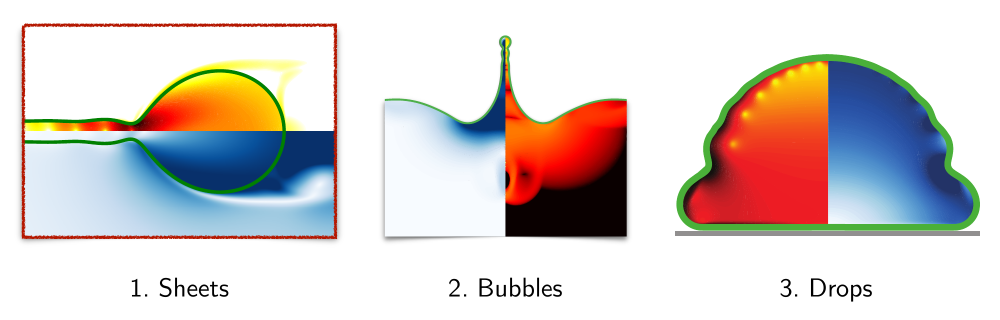
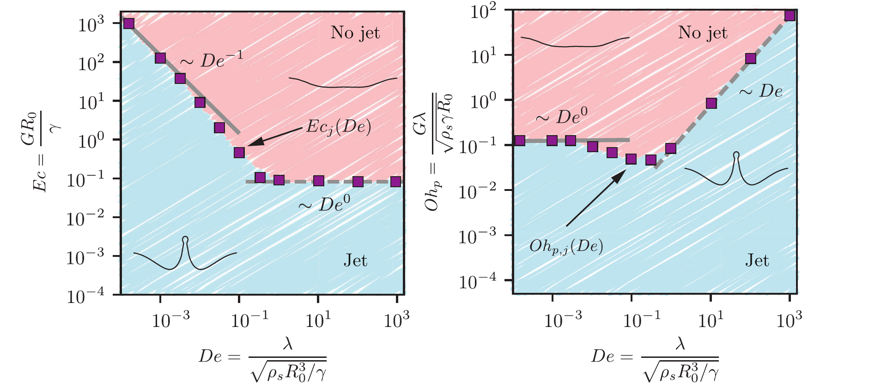
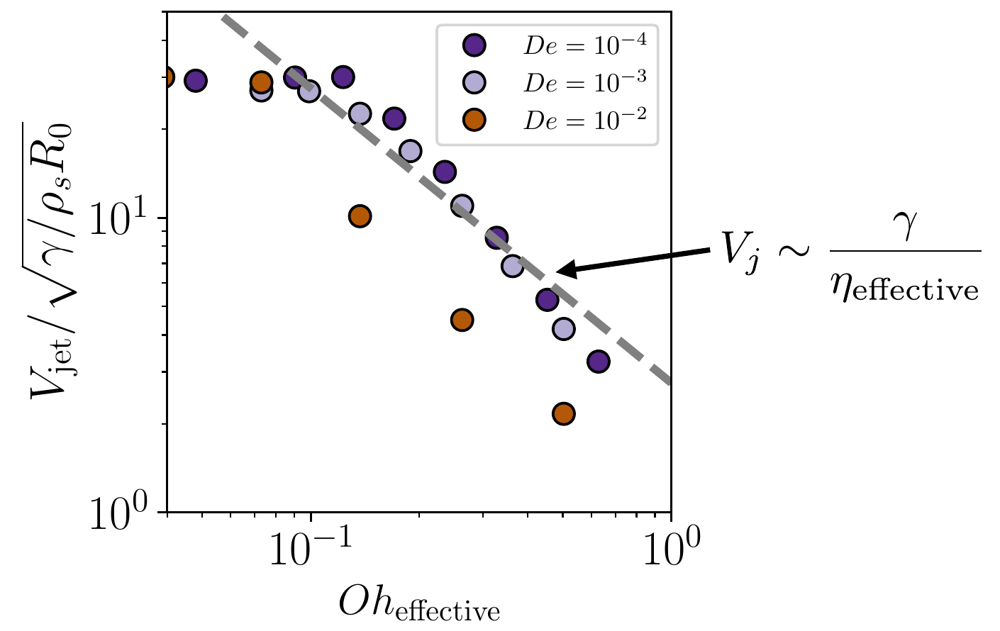
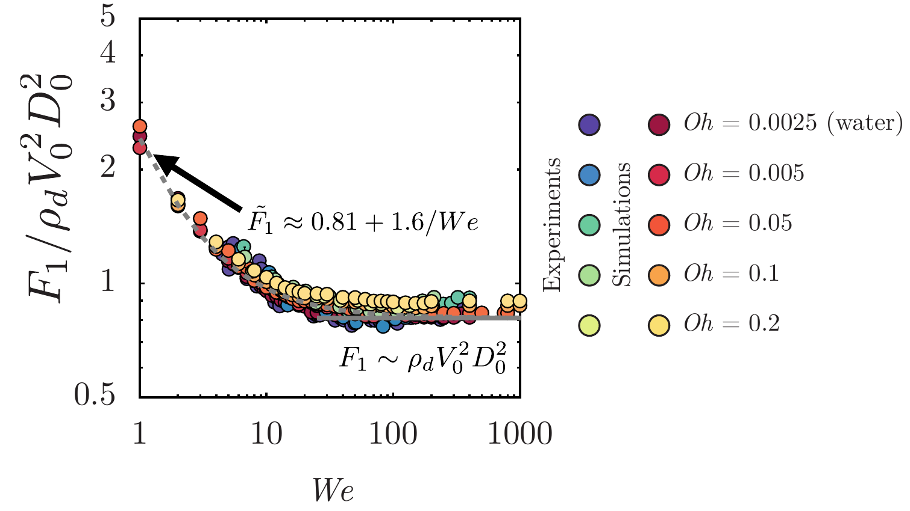
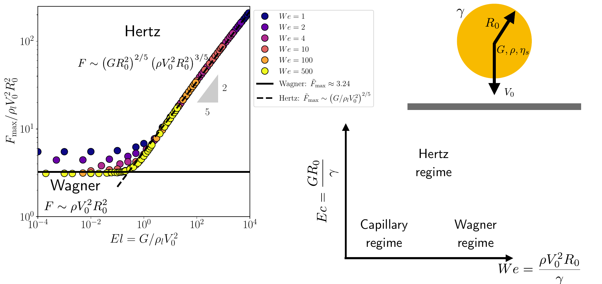
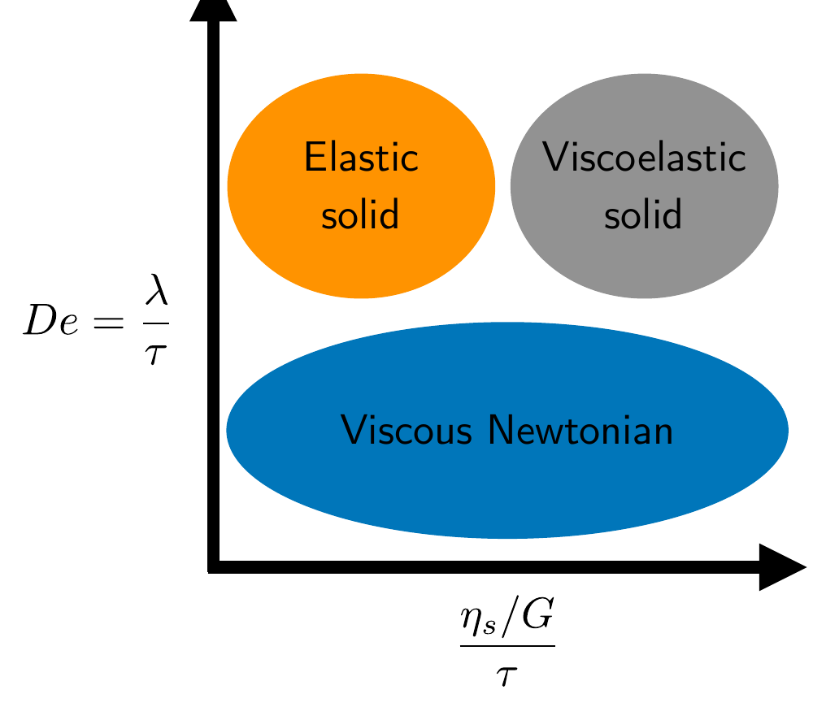

# Lecture 6: Elastic, Viscous and Viscoelastic in Action — Sheets, Bubbles and Drops

<!-- BLOG-PDF-LINK-START -->
<!-- PDF-EXPORT-IGNORE-START -->
> [!pdf] PDF version
> [[_Media/PDF/Lecture-Notes/Intro-Soft-Matter/2025/6-Sheets-Bubbles-Drops.pdf|Download this page as PDF]]
<!-- PDF-EXPORT-IGNORE-END -->
<!-- BLOG-PDF-LINK-END -->

> [!tldr] TL;DR
> [[5-Viscoelasticity|Lecture 5]] gave us one constitutive model, the Oldroyd-B family, whose limits are a viscous liquid, an elastic solid and a Kelvin–Voigt solid. This lecture puts it to work on three free-surface flows from current research: a retracting liquid sheet, a bursting bubble and an impacting drop. We compare material memory and stiffness through the Deborah number $De$ (how long the material remembers its deformation, compared with how fast the flow is) and the elastocapillary number $Ec$ (how stiff the material is, compared with surface tension), while the solvent Ohnesorge number $Oh_s$ measures viscous effects. Drop impact adds the Weber number $We$, which compares the incoming inertia with surface tension. The recurring question is which stress wins: capillary, viscous or elastic.

*The three examples of this lecture, from direct numerical simulations: a liquid sheet retracting into a rim, a bursting bubble launching a Worthington jet, and a drop spreading on a surface.*

## 0) Recap: one model, three limits

In a dilute polymer solution the stress has a solvent part and a polymer part:

$$\boldsymbol{\sigma} = -p\boldsymbol{I} + 2\eta_s\boldsymbol{\mathcal{D}} + G\left(\boldsymbol{\mathcal{A}} - \boldsymbol{I}\right), \qquad \overset{\nabla}{\boldsymbol{\mathcal{A}}} = -\frac{1}{\lambda}\left(\boldsymbol{\mathcal{A}} - \boldsymbol{I}\right)$$

Here $p$ is the pressure, $\eta_s$ the solvent viscosity, $\boldsymbol{\mathcal{D}} = \left(\nabla\boldsymbol{u} + (\nabla\boldsymbol{u})^{T}\right)/2$ the strain-rate tensor, $G$ the elastic modulus of the polymer network, $\lambda$ its relaxation time and $\boldsymbol{\mathcal{A}}$ the conformation tensor, which measures how stretched the polymers are on average ($\boldsymbol{\mathcal{A}} = \boldsymbol{I}$ at rest). The upper-convected derivative

$$\overset{\nabla}{\boldsymbol{\mathcal{A}}} = \frac{\partial\boldsymbol{\mathcal{A}}}{\partial t} + (\boldsymbol{u}\cdot\nabla)\boldsymbol{\mathcal{A}} - \boldsymbol{\mathcal{A}}\cdot\nabla\boldsymbol{u} - (\nabla\boldsymbol{u})^{T}\cdot\boldsymbol{\mathcal{A}},$$

with $(\nabla\boldsymbol{u})_{ij} = \partial_i u_j$, is the rate of change of $\boldsymbol{\mathcal{A}}$ seen by a material element that moves, rotates and stretches with the flow. The polymer viscosity is $\eta_p = G\lambda$.

The limits of the model taught in Lecture 5 are:

- $\lambda \to 0$: the polymers relax instantly, $\boldsymbol{\mathcal{A}} = \boldsymbol{I}$, and the material is a viscous (Newtonian) liquid. Keeping the first correction, $\boldsymbol{\mathcal{A}} \approx \boldsymbol{I} + 2\lambda\boldsymbol{\mathcal{D}}$, so the polymers simply add a viscosity $\eta_p = G\lambda$. We use this in §2.
- $\lambda \to \infty$: the polymers never relax, $\overset{\nabla}{\boldsymbol{\mathcal{A}}} = 0$, and $\boldsymbol{\mathcal{A}}$ just records the deformation. Starting from a relaxed reference state ($\boldsymbol{\mathcal{A}}_0 = \boldsymbol{I}$), $\boldsymbol{\mathcal{A}} = \boldsymbol{\mathcal{F}}\cdot\boldsymbol{\mathcal{F}}^{T}$, where $\mathcal{F}_{ij} = \partial r_i/\partial R_j$ is the deformation gradient. The polymer stress $G(\boldsymbol{\mathcal{A}} - \boldsymbol{I})$ is then that of an elastic solid, in parallel with the solvent's viscous stress: a Kelvin–Voigt solid. Over a deformation time $\tau$, solvent damping is negligible when $\eta_s/(G\tau) \ll 1$, and the response is then purely elastic.

### Dimensionless groups

Take a length scale $\mathcal{L}$ (the sheet thickness $h_0$, or the bubble or drop radius $R_0$), density $\rho$ and surface tension $\gamma$. Measuring time in units of the inertio-capillary time $\tau_\gamma = \sqrt{\rho\mathcal{L}^3/\gamma}$ and stress in units of $\gamma/\mathcal{L}$ leaves three numbers:

$$De = \frac{\lambda}{\sqrt{\rho\mathcal{L}^3/\gamma}}, \qquad Ec = \frac{G\mathcal{L}}{\gamma}, \qquad Oh_s = \frac{\eta_s}{\sqrt{\rho\gamma\mathcal{L}}},$$

and, writing $\boldsymbol{T} = \boldsymbol{\sigma} + p\boldsymbol{I}$ for the extra stress (the stress apart from pressure), the model becomes

$$\tilde{\boldsymbol{T}} = 2Oh_s\tilde{\boldsymbol{\mathcal{D}}} + Ec\left(\boldsymbol{\mathcal{A}} - \boldsymbol{I}\right), \qquad \overset{\nabla}{\boldsymbol{\mathcal{A}}} = -\frac{1}{De}\left(\boldsymbol{\mathcal{A}} - \boldsymbol{I}\right).$$

The Deborah number $De$ compares the material's memory with the flow time; the elastocapillary number $Ec$ compares the elastic stress with the capillary stress; the Ohnesorge number $Oh_s$ compares viscous with inertio-capillary effects.

> [!important] Two routes to a Newtonian liquid
> Both $De = 0$ and $Ec = 0$ give a Newtonian liquid, for different reasons. At $De = 0$ the polymers relax before they can be stretched ($\boldsymbol{\mathcal{A}} = \boldsymbol{I}$). At $Ec = 0$ the polymers can be stretched as much as you like, but they carry no stress.

## 1) Sheets: retracting films

### 1.1 The Newtonian case

A punctured soap film retracts into a growing rim (see the [high-speed video of a popped soap bubble](https://fyfluiddynamics.com/2011/10/high-speed-video-of-a-soap-bubble-being-popped/)). As we saw in [[1.5-Taylor-Culick-Paradox|Lecture 1.5]], the rim moves at the Taylor–Culick speed

$$v_{TC} = \sqrt{\frac{2\gamma_{fa}}{\rho_f h_0}},$$

with $\gamma_{fa}$ the surface tension of one film–air interface, $\rho_f$ the film density and $h_0$ its thickness. Following the slides, the film Ohnesorge number is $Oh_{\mathrm{film}} = \eta/\sqrt{2\rho_f\gamma_{fa}h_0}$; the factor two counts the two interfaces, so this is the Ohnesorge number of Lecture 1.5 divided by $\sqrt{2}$.

Simulations make the energy budget visible. Of the surface energy released, $-\Delta\dot{E}_\gamma$, about half goes into the kinetic energy of the rim and half is dissipated:

$$-\Delta\dot{E}_\gamma \approx \dot{E}_k + \dot{E}_d, \qquad \dot{E}_d = \frac{1}{2}\frac{dm}{dt}\,v^2.$$

The dissipation is concentrated in the neck where the film joins the rim, and its rate does not depend on the viscosity. Even as $Oh_{\mathrm{film}} \to 0$ we cannot neglect viscous dissipation in the thin film: a vanishing viscosity still dissipates a finite amount of energy, because the velocity gradients sharpen as the viscosity drops. This "dissipative anomaly" is the mathematical version of de Gennes's inelastic-collision argument. The same simulation framework is used to study films retracting in viscous surroundings (Sanjay, Sen, Kant & Lohse 2022).

### 1.2 What if the film is viscoelastic?

The "Friday afternoon experiment" in [[1-Intro-Soft-Matter|Lecture 1]] showed that a polymeric film ruptures differently depending on how quickly it is blown (Tammaro *et al.* 2018): the timescale of the process matters. To isolate the role of elasticity, take the limit $De \to \infty$, in which the polymers never relax. At $Ec = 0$ the film still behaves as a viscous liquid. As $Ec$ grows, elastic stresses build up as the film is swept into the rim.

What resists the opening? Picture a circular hole of radius $r_{\mathrm{tip}}(t)$ opening in the sheet. The material collected into the rim is stretched in two ways:

- **Vertically**, as the rim thickens (normal stress $\bar\sigma_{zz}$).
- **Azimuthally**, because each material ring is carried from its original radius $R$ out to a larger radius $r$. This is a hoop stretch $r/R > 1$, and it produces a tensile hoop stress $\sigma_{\theta\theta}$.

*Stretching in the rim of an opening hole. Side view: the rim thickens, stretching the polymers vertically. Top view: material carried outwards from its original radius is stretched around the hole. Overbars denote thickness-averaged stresses, and $r_0$ is the hole radius ($r_{\mathrm{tip}}$ in the text).*

Only the hoop stress acts on the radial motion of the rim. With $\sigma_{\theta\theta}$ the polymeric hoop stress and $\gamma$ the surface tension of each face of the sheet, the momentum balance of the rim reads

$$\frac{d}{dt}\left(\rho h_0 \pi r_{\mathrm{tip}}^2\frac{dr_{\mathrm{tip}}}{dt}\right) = \left(2\pi r_{\mathrm{tip}}\right)2\gamma - F_{\mathrm{hoop}},$$

$$F_{\mathrm{hoop}} = 2\pi\int_{r_{\mathrm{tip}}}^{\infty}\int_0^{h(r)}\sigma_{\theta\theta}\,dz\,dr.$$

The left-hand side is the rate of change of the rim's momentum (its mass $\rho h_0\pi r_{\mathrm{tip}}^2$ assumes the hole is much larger than its initial size); capillarity pulls with $2\gamma$ per unit length of the rim, and the hoop tension of the stretched sheet pulls back.

To evaluate $\sigma_{\theta\theta}$ in the elastic limit we need the deformation, which is set by kinematics alone (Snoeijer, Pandey, Herrada & Eggers 2020). A material point at $\boldsymbol{R} = (R, Z)$ in the undeformed sheet is mapped to $\boldsymbol{r} = (r, z)$. If the vertical stretching is homogeneous ($Z/H = z/h(r)$, with $H$ and $h$ the undeformed and deformed local thicknesses) and shear-free, volume conservation fixes the map from the thickness profile $h(r)$. For a neo-Hookean (Oldroyd-B elastic-limit) material, $\boldsymbol{\sigma}_p = G(\boldsymbol{\mathcal{A}} - \boldsymbol{I})$ with $\boldsymbol{\mathcal{A}} = \boldsymbol{\mathcal{F}}\cdot\boldsymbol{\mathcal{F}}^{T}$ and $\boldsymbol{\mathcal{F}} = \partial\boldsymbol{r}/\partial\boldsymbol{R}$, so the hoop stress is

$$\sigma_{\theta\theta} = G\left(\frac{r^2}{R^2} - 1\right).$$

The hoop stretch is largest for the material that has travelled furthest, which sits next to the rim. The hoop tension is therefore concentrated near the tip and grows as the hole opens. Comparing the modulus $G$ with the capillary stress $\gamma/h_0$ gives $Ec = Gh_0/\gamma$. For stretches of order one, this suggests strong elastic resistance once $Ec$ is of order one, possibly enough to stop the hole from opening.

We can go one step further. Suppose all the swept-up material sits in a thin rim at $r \approx r_{\mathrm{tip}}$, and the sheet outside it is unstretched. A ring that started at radius $R$, between the initial hole radius $\tilde{R}_0$ and $r_{\mathrm{tip}}$, now carries $\sigma_{\theta\theta} = G(r_{\mathrm{tip}}^2/R^2 - 1)$, and its volume $2\pi R h_0\,dR$ sets its share of the rim's cross-section. Summing over the rim,

$$F_{\mathrm{hoop}} = 2\pi G h_0 r_{\mathrm{tip}}\left[\ln\frac{r_{\mathrm{tip}}}{\tilde{R}_0} - \frac{1}{2}\left(1 - \frac{\tilde{R}_0^2}{r_{\mathrm{tip}}^2}\right)\right] \approx 2\pi G h_0 r_{\mathrm{tip}}\ln\frac{r_{\mathrm{tip}}}{\tilde{R}_0} \qquad (r_{\mathrm{tip}} \gg \tilde{R}_0).$$

To leading order, the ratio of this elastic resistance to the capillary pull $4\pi\gamma r_{\mathrm{tip}}$ is $(Ec/2)\ln(r_{\mathrm{tip}}/\tilde{R}_0)$. It grows only logarithmically as the hole opens, but it grows without bound. The two forces balance at a radius set by $\ln(r_{\mathrm{tip}}/\tilde{R}_0) \approx 2/Ec$, which grows exponentially as $Ec$ decreases: stiff sheets are held back at small radii, soft sheets only at very large ones. This is a quasi-static force balance. It ignores the rim's inertia, which can carry the rim past the balance, and the stretched sheet just outside the rim, so it predicts neither the stopping time nor the actual maximum radius; it gives trends rather than numbers.

### 1.3 What the simulations show

Our direct numerical simulations (not yet published) solve the elastic limit $De \to \infty$ for $10^{-3} \le Ec \le 100$, alongside a Newtonian reference sheet, with lengths measured in units of $h_0$ and times in units of $\tau_\gamma = \sqrt{\rho h_0^3/\gamma}$.

*Opening of a hole in an elastic sheet. Left: tip speed $v_{\mathrm{tip}}$, scaled by the Taylor–Culick speed $\sqrt{2\gamma/\rho h_0}$. Right: hole radius $r_{\mathrm{tip}}/h_0$. Times are in units of $\sqrt{\rho h_0^3/\gamma}$. The black curve is the Newtonian sheet ($Ec = 0$, $De = 0$); the others are elastic sheets ($De \to \infty$) with $Ec$ from 0.01 to 1.*

- **Newtonian sheet** ($Ec = 0$): the rim reaches the Taylor–Culick speed, and the hole grows linearly in time.
- **Soft sheets** ($Ec \le 0.25$): the rim never reaches $v_{TC}$ and then slows gradually; at $t = 300\,\tau_\gamma$ it moves at about $0.9$, $0.8$ and $0.7\,v_{TC}$ for $Ec = 0.01$, $0.1$ and $0.25$.
- **Stiffer sheets**: at $Ec = 0.5$ the rim has almost stopped by $t = 300\,\tau_\gamma$. At $Ec = 1$ it overshoots, recoils slightly and stops within about $50\,\tau_\gamma$, at $r_{\mathrm{tip}} \approx 6h_0$.

This is the trend of the hoop-force estimate: stiffer sheets stop sooner, and softer sheets keep slowing down.

*Rim thickness $h_j$. Left: $h_j/h_0$ against time for the cases above. Right: the final rim thickness against $Ec = Gh_0/\gamma$; the dashed line has slope $-1/3$.*

The rim thickness tells a second story. A Newtonian rim keeps collecting liquid and thickening ($h_j \approx 14h_0$ at $t = 300\,\tau_\gamma$). An elastic rim stops thickening at a height that decreases with $Ec$: about $5.9h_0$ at $Ec = 0.01$ and $2.7h_0$ at $Ec = 0.1$. For $Ec \ge 1$ hardly any rim forms. Thickening the rim from $h_0$ to $h_j$ stretches its polymers vertically by $h_j/h_0$, and the stretch stops when the vertical elastic stress balances the capillary pressure in the rim:

$$\frac{\gamma}{h_j} \sim \bar{\sigma}_{zz} \approx G\left(\frac{h_j}{h_0}\right)^2 \quad\Rightarrow\quad \frac{h_j}{h_0} \sim Ec^{-1/3},$$

which the simulations follow for $Ec \lesssim 0.1$.

## 2) Bubbles: Worthington jets in viscoelastic liquids

### 2.1 Champagne and Worthington jets

A bubble that reaches a free surface bursts. After its cap ruptures, the open cavity collapses and capillary waves converge towards its base. Depending on the bubble size and the liquid properties, this focusing can produce an upward Worthington jet that breaks into droplets. In a glass of champagne these droplets carry the aroma above the glass (Ghabache, Liger-Belair, Antkowiak & Séon 2016). The same process launches aerosol droplets from the sea and from contaminated liquids. So what does a small amount of dissolved polymer do to the jet and its droplets?

The question is not new. Cheny & Walters (1996) compared the Worthington jets that rise after an impact on a liquid pool. For a Newtonian liquid the jet reached about 20 cm; for a Boger fluid (a dilute, elastic polymer solution of nearly constant viscosity) under the same conditions it reached only about 2 cm. They noted: "There is clearly much food for thought here, not least for those who attempt to simulate theoretically the flow behaviour of dilute polymer solutions."

### 2.2 To jet or not to jet

Direct numerical simulations of bursting bubbles in an Oldroyd-B liquid (Dixit, Oratis, Zinelis, Lohse & Sanjay 2025) map out when a jet forms. Here $\mathcal{L} = R_0$, the bubble radius, and $\rho_s$ is the liquid density (for a dilute solution, that of the solvent).

*Jet versus no jet for a bursting bubble in a viscoelastic liquid. Left: in the plane of the Deborah number $De$ and the elastocapillary number $Ec$. Right: the same boundary in terms of the polymeric Ohnesorge number $Oh_p = G\lambda/\sqrt{\rho_s\gamma R_0}$. Squares mark the simulated boundary; the shaded regions are the jet (blue) and no-jet (pink) regimes. Adapted from Dixit et al. (2025).*

The two panels show the same boundary, because

$$Oh_p = \frac{\eta_p}{\sqrt{\rho_s\gamma R_0}} = \frac{G\lambda}{\sqrt{\rho_s\gamma R_0}} = Ec\,De.$$

Read the map in two halves. The thresholds below describe the limiting branches of this parameter cut; their values are approximate, not universal.

- **Small $De$ (fast relaxation).** The polymers relax faster than the cavity collapses, so they act only as extra viscosity $\eta_p = G\lambda$. The jet disappears once the polymeric Ohnesorge number exceeds about $0.1$, that is $Oh_{p,j} \sim De^0$, which in the $Ec$–$De$ plane is the line $Ec_j \sim De^{-1}$.
- **Large $De$ (slow relaxation).** The polymers keep their stretch during the collapse and act elastically. Now the elastic stress itself must be small enough: the jet disappears for $Ec$ above about $0.1$ ($Ec_j \sim De^0$), which in the other panel is $Oh_{p,j} \sim De$.

Within the jet regime the paper also separates jets that release droplets from jets that do not; for some intermediate values of $Ec$ and $De$ the droplets are smaller than in a Newtonian liquid.

### 2.3 Why the polymers act as viscosity at small $De$

A slender jet obeys a one-dimensional momentum balance (Shi, Brenner & Nagel 1994; Driessen, Jeurissen, Wijshoff, Toschi & Lohse 2013). For the axial velocity $v(z,t)$ and local radius $h(z,t)$,

$$\frac{\partial v}{\partial t} + v\frac{\partial v}{\partial z} = -\frac{\gamma}{\rho}\frac{\partial\kappa}{\partial z} + \frac{1}{\rho h^2}\frac{\partial}{\partial z}\left[h^2\left(3\eta_s\frac{\partial v}{\partial z} + G\left(\mathcal{A}_{zz} - \mathcal{A}_{rr}\right)\right)\right],$$

with $\kappa$ the interface curvature. The bracket is the tensile stress difference in the jet: the solvent contributes $3\eta_s\,\partial v/\partial z$ and the polymers $G(\mathcal{A}_{zz} - \mathcal{A}_{rr})$.

Integrating over the jet, the momentum $p_j = \int_0^{L_j}\rho v h^2\,dz$ of a jet of length $L_j$ changes, in this simplified control-volume argument, through the tensile stress at its base; capillary and momentum-flux contributions at the ends are set aside. When the polymers relax quickly compared with the local deformation, $\mathcal{A}_{zz} - 1 \approx 2\lambda\,\partial v/\partial z$ and $\mathcal{A}_{rr} - 1 \approx -\lambda\,\partial v/\partial z$, so the polymer contribution is $3G\lambda\,\partial v/\partial z$. The base stress is then $\eta_{\mathrm{eff}}\,\partial v/\partial z$ with an effective extensional viscosity $\eta_{\mathrm{eff}} = 3(\eta_s + G\lambda)$: solvent and polymers both carry the Trouton factor three.

Balancing the jet's momentum flux against this stress gives $\rho V_j^2 \sim \eta_{\mathrm{eff}} V_j/\delta_j$, with $V_j$ the jet speed and $\delta_j$ the length scale at the jet base. If the jet Weber number $We_j = \rho V_j^2\delta_j/\gamma$ stays roughly constant across the cases compared, eliminating $\delta_j$ gives

$$V_j \sim We_j\,\frac{\gamma}{\eta_{\mathrm{eff}}} \propto \frac{\gamma}{\eta_{\mathrm{eff}}}.$$

A constant $We_j$ is an extra scaling assumption, not something the balance itself guarantees.

*Jet speed $V_{\mathrm{jet}}$ (in units of $\sqrt{\gamma/\rho_s R_0}$) against an effective Ohnesorge number, for three small Deborah numbers, from the simulations of §2.2. As plotted in the lecture, $Oh_{\mathrm{eff}} = (3\eta_s + 2G\lambda)/\sqrt{\rho_s\gamma R_0}$, which keeps only the axial polymer stress; the full result above, $3(\eta_s + G\lambda)$, differs only in the polymer weighting. At $De = 10^{-4}$ and $10^{-3}$ the data follow the inverse-viscosity trend (dashed line) over much of the range; at $De = 10^{-2}$ they fall clearly below it.*

### 2.4 Intermezzo: yield stress

Toothpaste and peanut butter hold their shape until pushed hard enough: they have a yield stress $\tau_y$. The bubbling mud pots of Yellowstone (video in [[1-Intro-Soft-Matter|Lecture 1]]) are a yield-stress free-surface flow.

A convenient model is Saramito's elastoviscoplastic extension of Oldroyd-B (Saramito 2007). Write the polymer stress as $\boldsymbol{\sigma}_p = G(\boldsymbol{\mathcal{A}} - \boldsymbol{I})$, its deviatoric part as $\boldsymbol{\sigma}_p^d = \boldsymbol{\sigma}_p - \tfrac{1}{3}\operatorname{tr}(\boldsymbol{\sigma}_p)\boldsymbol{I}$, and the equivalent shear stress as $q_p = \sqrt{\boldsymbol{\sigma}_p^d : \boldsymbol{\sigma}_p^d/2}$. The polymer stress relaxes only once $q_p$ exceeds the yield stress:

$$\overset{\nabla}{\boldsymbol{\mathcal{A}}} = -\frac{K}{\lambda}\left(\boldsymbol{\mathcal{A}} - \boldsymbol{I}\right), \qquad K = \begin{cases} 0, & q_p \leq \tau_y,\\ 1 - \tau_y/q_p, & q_p > \tau_y. \end{cases}$$

- Below the yield stress ($K = 0$, so $\overset{\nabla}{\boldsymbol{\mathcal{A}}} = 0$) the material is a Kelvin–Voigt solid.
- Far above it ($K \to 1$) it is a viscoelastic Oldroyd-B liquid.

The new dimensionless group is the plastocapillary number $\mathcal{J} = \tau_y R_0/\gamma$.

When elasticity can be neglected we recover the Bingham viscoplastic model (Eugene C. Bingham, 1878–1945). With $\boldsymbol{\tau}$ the deviatoric extra stress, the norm $\|\boldsymbol{X}\| = \sqrt{\boldsymbol{X}:\boldsymbol{X}/2}$ and $Oh = \eta/\sqrt{\rho\gamma R_0}$ built on the plastic viscosity $\eta$, the dimensionless model is

$$\begin{cases} \boldsymbol{\mathcal{D}} = \boldsymbol{0}, & \|\boldsymbol{\tau}\| \leq \mathcal{J},\\[4pt] \boldsymbol{\tau} = 2\left(Oh + \dfrac{\mathcal{J}}{2\|\boldsymbol{\mathcal{D}}\|}\right)\boldsymbol{\mathcal{D}}, & \|\boldsymbol{\tau}\| > \mathcal{J}. \end{cases}$$

For a bursting bubble in a viscoplastic medium, $\mathcal{J} \to 0$ recovers the Newtonian case, with capillary waves and a jet. As $\mathcal{J}$ grows, the driving stresses fall below the yield stress before the cavity has relaxed, and the surface freezes into a non-flat final shape instead of becoming flat again (Sanjay, Lohse & Jalaal 2021). With elasticity included as well (Balasubramanian, Sanjay, Jalaal, Vinuesa & Tammisola 2024), elastic relaxation has a non-monotonic effect on the jet, and plasticity matters mainly when relaxation is fast.

## 3) Drops: impact forces from Wagner to Hertz

### 3.1 Liquid drops and elastic beads

A water drop in space bounces off a hydrophobic paddle almost like a ball ([liquid ping-pong on the ISS](https://www.youtube.com/watch?v=TLbhrMCM4_0)). So how different are a liquid drop and an elastic bead hitting a wall? Consider a sphere of radius $R_0$ and density $\rho$ arriving at speed $V_0$, on the impact time $\tau_i = R_0/V_0$.

| | Liquid drop: $\boldsymbol{T} = 2\eta\boldsymbol{\mathcal{D}}$ | Soft solid: $\boldsymbol{T} = 2\eta\boldsymbol{\mathcal{D}} + G(\boldsymbol{\mathcal{A}} - \boldsymbol{I})$ |
|---|---|---|
| Contact (foot) radius | $r_{\mathrm{foot}} \simeq \sqrt{3V_0R_0t}$ (early-time Wagner) | $r_{\mathrm{foot}} = \sqrt{R_0\delta(t)} \simeq \sqrt{V_0R_0t}$ at very early times (Hertz) |
| Peak force | $F \sim \rho V_0^2R_0^2$ | $F \sim \left(GR_0^2\right)^{2/5}\left(\rho V_0^2R_0^2\right)^{3/5}$ |

**Wagner (liquids).** In the early inertial stage the displaced free surface enlarges the contact region: Wagner theory gives $r_{\mathrm{foot}}^2 \simeq 3R_0V_0t$, against $2R_0V_0t$ for the geometric intersection of an undeformed sphere with the wall. The force comes from bringing liquid to rest in this fast-growing foot. At large $We$ and small viscosity only inertia enters, so the first force peak scales as $\rho V_0^2R_0^2$.

**Hertz (elastic solids).** A sphere compressed by $\delta(t)$, with contact radius $\sqrt{R_0\delta}$, stores elastic energy $\sim G R_0^{1/2}\delta^{5/2}$. Setting this equal to the kinetic energy $\sim \rho R_0^3V_0^2$ gives the maximum compression $\delta \sim R_0(\rho V_0^2/G)^{2/5}$. The contact force $\sim GR_0^{1/2}\delta^{3/2}$ then gives the scaling in the table.

### 3.2 Liquid drops: the first force peak

Force measurements on drops hitting a superhydrophobic surface show two peaks: one at impact and one when the drop jumps off, as a Worthington jet forms inside it (Zhang, Sanjay *et al.* 2022). The first peak follows inertial scaling:

*First force peak $F_1$, scaled by $\rho_d V_0^2 D_0^2$, against the Weber number $We = \rho_d V_0^2 D_0/\gamma$, where $\rho_d = \rho$ is the drop density and $D_0 = 2R_0$ the drop diameter. Experiments and simulations span $Oh = \eta/\sqrt{\rho_d\gamma D_0} = 0.0025$ (water) to $0.2$. The data approximately collapse onto $\tilde F_1 \approx 0.81 + 1.6/We$, with modest viscosity-dependent departures (Zhang, Sanjay et al. 2022; Sanjay et al. 2025).*

The first peak barely depends on viscosity: it stays the same for liquids up to about a hundred times more viscous than water (Sanjay, Zhang, Lv & Lohse 2025). Only for much more viscous drops does dissipation take over. In terms of the radius, which we use from here on, the peak force is $F_{\max}/(\rho V_0^2R_0^2) \approx 3.24 + 3.2/We$ with $We = \rho V_0^2R_0/\gamma$. At large $We$ this tends to the Wagner value $3.24$; at small $We$ capillarity adds to it. A unified scaling theory for both the impact force and the maximum spreading diameter is given by Sanjay & Lohse (2025).

### 3.3 From liquid drops to elastic beads

Now give the drop an elastic modulus $G$. For impact the natural memory number is the Weissenberg number $Wi = \lambda/\tau_i = \lambda V_0/R_0$, related to the capillary-time Deborah number by $Wi = De\sqrt{We}$ (with $We = \rho V_0^2R_0/\gamma$). In the infinite-memory limit $Wi \to \infty$, and at fixed solvent Ohnesorge number, the force is set by $We$ and $Ec = GR_0/\gamma$, or equivalently by $We$ and the elasticity number $El = G/(\rho V_0^2) = Ec/We$ (Jana, Kolinski, Lohse & Sanjay 2026).

*Left: peak impact force against the elasticity number $El = G/\rho V_0^2$ at $Oh = 0.01$, for Weber numbers from 1 to 500. At small $El$ the large-$We$ curves approach the Wagner plateau, while smaller $We$ keep a capillary contribution; at large $El$ the curves approach the Hertz scaling $\tilde F_{\max} \propto El^{2/5}$. Right: the resulting regime map in the plane of $We$ and $Ec = GR_0/\gamma$, with capillary, Wagner and Hertz regimes. Simulations as in Jana et al. (2026).*

- For $El \lesssim 0.1$ the sphere behaves like a liquid drop: Wagner, $F_{\max} \approx 3.24\,\rho V_0^2R_0^2$, plus a capillary correction at small $We$.
- For $El \gtrsim 1$ it behaves like an elastic bead: Hertz, $F_{\max} \propto \rho V_0^2R_0^2\,El^{2/5}$. Hertz's contact theory for an incompressible elastic sphere gives the prefactor $\tfrac{16}{3}\left(\tfrac{5\pi}{16}\right)^{3/5} \approx 5.3$; the simulations give $5.25$.
- The transition from Wagner to Hertz is smooth, and the force curve changes shape with it: a stiff sphere gives a single, nearly symmetric force pulse, as a bouncing elastic ball does.

Sweeping the relaxation time from zero to infinity takes the same sphere continuously from a liquid drop with no memory to an elastic bead with permanent memory.

## Summary

*Where the three behaviours live, in terms of the Deborah number $De = \lambda/\tau$ (relaxation time over flow time) and the retardation time $\eta_s/G$ over the flow time $\tau$.*

1. One model, the Oldroyd-B family, covers viscous liquids ($De \to 0$), elastic solids ($De \to \infty$, $\eta_s/(G\tau) \ll 1$) and viscoelastic Kelvin–Voigt solids ($De \to \infty$, $\eta_s/(G\tau)$ of order one or larger).
2. Sheets: viscous dissipation in a retracting film stays finite as the viscosity vanishes. Elasticity adds a hoop stress that slows the opening; in simulations the hole stops at $Ec = 1$, and the saturated rim thickness follows $h_j/h_0 \sim Ec^{-1/3}$ for $Ec \lesssim 0.1$, approaching one for large $Ec$.
3. Bubbles: polymers can suppress the Worthington jet. For the parameter cut shown, the jet stops at roughly $Oh_p = Ec\,De \gtrsim 0.1$ at small $De$, where the polymers act as extra viscosity, and at roughly $Ec \gtrsim 0.1$ at large $De$, where they act elastically. A yield stress can freeze the cavity before it relaxes.
4. Drops: the impact force goes from Wagner, $F \sim \rho V_0^2R_0^2$, to Hertz, $F \sim (GR_0^2)^{2/5}(\rho V_0^2R_0^2)^{3/5}$, as the elasticity number $El = G/\rho V_0^2$ crosses one.

## Self-check questions

1. Show that $Oh_p = Ec\,De$. Use this to explain why the jet/no-jet boundary looks like $Ec_j \sim De^{-1}$ at small $De$ but like $Oh_{p,j} \sim De$ at large $De$.
2. In the Kelvin–Voigt limit ($\lambda \to \infty$), what is $\boldsymbol{\mathcal{A}}$ for a simple shear of amount $\gamma_s$, and what is the resulting shear stress?
3. Derive the Hertz scaling $F_{\max} \sim (GR_0^2)^{2/5}(\rho V_0^2R_0^2)^{3/5}$ from an energy balance, and show that the Wagner and Hertz forces are equal when $El = G/\rho V_0^2$ is of order one.
4. Why is the first force peak of a low-viscosity drop insensitive to viscosity? Compare the impact time $R_0/V_0$ with the time for viscous effects to diffuse across the drop.
5. Estimate when elasticity can halt the opening of a hole in a sheet by comparing the elastic stress $G$ with the capillary stress $\gamma/h_0$. Then derive the thin-rim hoop force $F_{\mathrm{hoop}}$ of §1.2 and the rim-thickness law $h_j/h_0 \sim Ec^{-1/3}$ of §1.3.

## References

1. D. Tammaro, R. Pasquino, M. M. Villone, G. D'Avino, V. Ferraro, E. Di Maio, A. Langella, N. Grizzuti & P. L. Maffettone, Elasticity in bubble rupture, *Langmuir* **34**, 5646–5654 (2018). [doi:10.1021/acs.langmuir.8b00520](https://doi.org/10.1021/acs.langmuir.8b00520)
2. V. Sanjay, U. Sen, P. Kant & D. Lohse, Taylor–Culick retractions and the influence of the surroundings, *J. Fluid Mech.* **948**, A14 (2022). [doi:10.1017/jfm.2022.671](https://doi.org/10.1017/jfm.2022.671)
3. J. H. Snoeijer, A. Pandey, M. A. Herrada & J. Eggers, The relationship between viscoelasticity and elasticity, *Proc. R. Soc. A* **476**, 20200419 (2020). [doi:10.1098/rspa.2020.0419](https://doi.org/10.1098/rspa.2020.0419)
4. E. Ghabache, G. Liger-Belair, A. Antkowiak & T. Séon, Evaporation of droplets in a Champagne wine aerosol, *Sci. Rep.* **6**, 25148 (2016). [doi:10.1038/srep25148](https://doi.org/10.1038/srep25148)
5. J. M. Cheny & K. Walters, Extravagant viscoelastic effects in the Worthington jet experiment, *J. Non-Newtonian Fluid Mech.* **67**, 125–135 (1996). [doi:10.1016/S0377-0257(96)01473-5](https://doi.org/10.1016/S0377-0257(96)01473-5)
6. A. K. Dixit, A. Oratis, K. Zinelis, D. Lohse & V. Sanjay, Viscoelastic Worthington jets and droplets produced by bursting bubbles, *J. Fluid Mech.* **1010**, A2 (2025). [doi:10.1017/jfm.2025.237](https://doi.org/10.1017/jfm.2025.237)
7. X. D. Shi, M. P. Brenner & S. R. Nagel, A cascade of structure in a drop falling from a faucet, *Science* **265**, 219–222 (1994). [doi:10.1126/science.265.5169.219](https://doi.org/10.1126/science.265.5169.219)
8. T. Driessen, R. Jeurissen, H. Wijshoff, F. Toschi & D. Lohse, Stability of viscous long liquid filaments, *Phys. Fluids* **25**, 062109 (2013). [doi:10.1063/1.4811849](https://doi.org/10.1063/1.4811849)
9. P. Saramito, A new constitutive equation for elastoviscoplastic fluid flows, *J. Non-Newtonian Fluid Mech.* **145**, 1–14 (2007). [doi:10.1016/j.jnnfm.2007.04.004](https://doi.org/10.1016/j.jnnfm.2007.04.004)
10. V. Sanjay, D. Lohse & M. Jalaal, Bursting bubble in a viscoplastic medium, *J. Fluid Mech.* **922**, A2 (2021). [doi:10.1017/jfm.2021.489](https://doi.org/10.1017/jfm.2021.489)
11. A. G. Balasubramanian, V. Sanjay, M. Jalaal, R. Vinuesa & O. Tammisola, Bursting bubble in an elastoviscoplastic medium, *J. Fluid Mech.* **1001**, A9 (2024). [doi:10.1017/jfm.2024.1073](https://doi.org/10.1017/jfm.2024.1073)
12. B. Zhang, V. Sanjay, S. Shi, Y. Zhao, C. Lv, X.-Q. Feng & D. Lohse, Impact forces of water drops falling on superhydrophobic surfaces, *Phys. Rev. Lett.* **129**, 104501 (2022). [doi:10.1103/PhysRevLett.129.104501](https://doi.org/10.1103/PhysRevLett.129.104501)
13. V. Sanjay, B. Zhang, C. Lv & D. Lohse, The role of viscosity on drop impact forces on non-wetting surfaces, *J. Fluid Mech.* **1004**, A6 (2025). [doi:10.1017/jfm.2024.982](https://doi.org/10.1017/jfm.2024.982)
14. V. Sanjay & D. Lohse, Unifying theory of scaling in drop impact: forces and maximum spreading diameter, *Phys. Rev. Lett.* **134**, 104003 (2025). [doi:10.1103/PhysRevLett.134.104003](https://doi.org/10.1103/PhysRevLett.134.104003)
15. S. Jana, J. Kolinski, D. Lohse & V. Sanjay, Impacting spheres: from liquid drops to elastic beads, *Soft Matter* **22**, 2226–2236 (2026). [doi:10.1039/D5SM01078K](https://doi.org/10.1039/D5SM01078K)

---

**Previous Lecture:** [[5-Viscoelasticity|Lecture 5: Elastic vs Viscous vs Viscoelastic]] 
**Next Lecture:** [[7-8-Student-Presentations|Lectures 7-8: Student Presentations]] 
**Course Home:** [[0-README|Course Overview]]

> [!significance]- Metadata
> Author:: [Vatsal Sanjay](https://vatsalsanjay.com) 
> Date published:: Jul 19, 2026 
> Date modified:: Oct 16, 2026

> [!link] Back to main website
> [Home](https://comphy-lab.org/), [Team](https://comphy-lab.org/team), [Research](https://comphy-lab.org/research), [Github](https://github.com/comphy-lab)
>
> 📝 [Edit this page on GitHub](https://github.com/comphy-lab/CoMPhy-Lab-Blogs/blob/main/Lecture-Notes/Intro-Soft-Matter/2025/6-Sheets-Bubbles-Drops.md)
