---
tags:
  - lecture
  - soft-matter
  - instabilities
  - fluid-dynamics
status: done ✅
publish: true
---

# Soft Matter Instabilities

<!-- BLOG-PDF-LINK-START -->
<!-- PDF-EXPORT-IGNORE-START -->
> [!pdf] PDF version
> [[_Media/PDF/Lecture-Notes/Intro-Soft-Matter/Instabilities.pdf|Download this page as PDF]]
<!-- PDF-EXPORT-IGNORE-END -->
<!-- BLOG-PDF-LINK-END -->

## 0) Why talk about instability?

Patterns are everywhere: dunes and ripples, icicle ribs, dew beads on spider webs, hexagonal cracks in drying mud. Their regularity—despite messy materials—signals robust mechanisms. In fluids (and soft solids), instabilities often set the pattern scale and shape by amplifying tiny disturbances into organized structures. Our goal today is to recognize those mechanisms and the forces that select length and time scales.

---

## 1) Stability in one picture

Think of a bead in a landscape: at the bottom of a well (stable), on a flat shelf (neutral), or on a hilltop (unstable). 

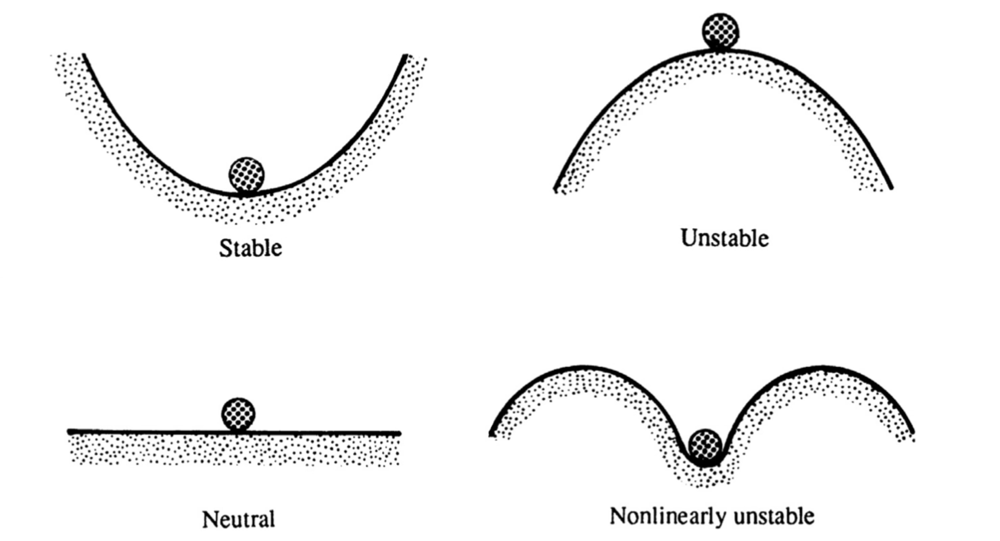

A “standing pencil” fails in practice because the slightest perturbation makes it fall—no physical system is perfectly disturbance‑free. We use this picture to interpret flows: _stable_ states damp disturbances; _unstable_ ones amplify them; _neutral_ ones neither grow nor decay until nonlinearities tip them.

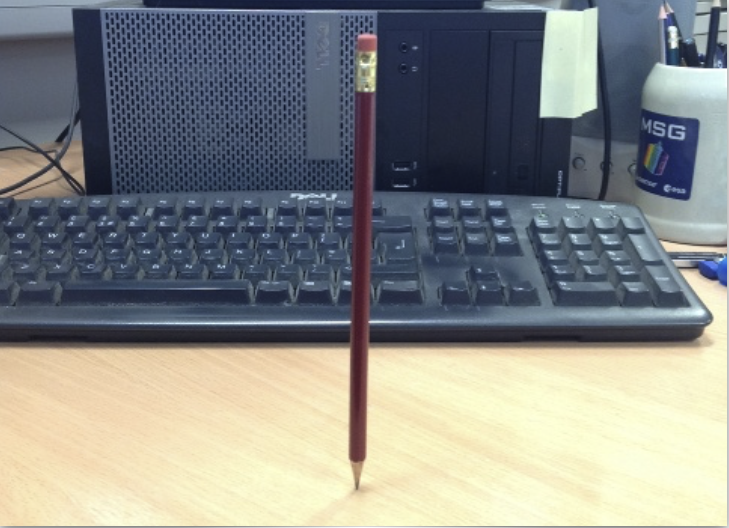

Where do disturbances come from? Ambient vibrations, thermal fluctuations, surface roughness, composition heterogeneity, or imposed forcing (e.g. vibration). Even when continuum hypotheses hold (Knudsen number small), the flow “feels” these small perturbations; if the base state cannot damp them, patterns emerge.

---

## 2) Linear stability of a bead

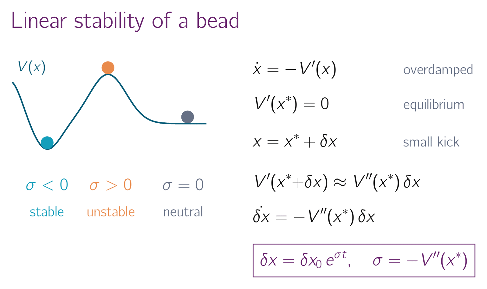

The pencil has a quantitative version. Put a bead in a landscape $V(x)$ and let it move through honey, so that friction dominates inertia and the velocity is proportional to the force:

$$\zeta\,\dot x = -V'(x).$$

Choose units with $\zeta = 1$. The equilibria are the points where the force vanishes, $V'(x^*) = 0$: the bottom of a well, the top of a hill, anywhere on a flat stretch. All of them are exact solutions. The question is which ones we would ever see.

Follow Maxwell and displace the bead by a small amount, $x = x^* + \delta x$. Taylor-expand the force about $x^*$:

$$V'(x^* + \delta x) = V'(x^*) + V''(x^*)\,\delta x + \tfrac12 V'''(x^*)\,\delta x^2 + \dots$$

The first term is zero because $x^*$ is an equilibrium, and the $\delta x^2$ term is negligible when $\delta x$ is small enough. That is all *linearisation* means: keep terms up to first order in the disturbance. What remains is

$$\frac{d\,\delta x}{dt} = -V''(x^*)\,\delta x \quad\Rightarrow\quad \delta x = \delta x_0\, e^{\sigma t}, \qquad \sigma = -V''(x^*).$$

$\sigma$ is the growth rate, and $1/|\sigma|$ is the time over which a kick grows or dies. The size of the kick, $\delta x_0$, only sets the prefactor: stability is a property of the state, not of the kick. Read off the signs.

- **Well**, $V'' > 0$: $\sigma < 0$, every kick decays. Stable.
- **Hilltop**, $V'' < 0$: $\sigma > 0$, the kick grows until $\delta x$ is no longer small and the linear theory stops applying. The bead then rolls into a neighbouring well. Linear theory tells you *that* it leaves and how fast, not where it ends up. This is the pencil.
- **Flat stretch**, $V'' = 0$: $\sigma = 0$. To linear order nothing happens, and the next term in the Taylor series decides. This case returns twice: at the onset of an instability (below) and at a critical point (in [[Lecture-Notes/Intro-Soft-Matter/Singularities|Singularities]]).

With inertia, $m\ddot x = -V'(x)$ gives $\sigma^2 = -V''/m$: the same sign criterion, but in the well the bead oscillates instead of creeping back.

> [!important] The recipe
> 1. Find a base state that satisfies the equations exactly.
> 2. Add an infinitesimal disturbance.
> 3. Keep only the terms linear in it.
> 4. Look for exponential solutions and read off the sign of the growth rate.
>
> For a liquid jet the "bead position" becomes the radius at each point along the jet, and $\sigma$ depends on the wavelength. For a magnet it is the magnetisation; for a pinching neck it is a whole similarity profile. The steps do not change.

## 3) Push the bead: response, soft wells and a flat well

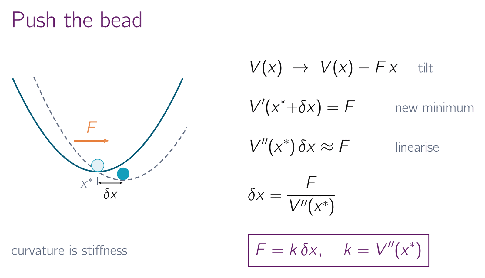

Now change the question. Instead of asking whether a kick grows, ask how far the bead moves if we push it steadily. A constant force $F$ adds the potential energy $-Fx$, which tilts the landscape. The minimum shifts, and the bead creeps to the new equilibrium, where the tilted slope vanishes: $V'(x^* + \delta x) = F$. The same Taylor step, valid while the push is small, gives $V''(x^*)\,\delta x = F$, so

$$\delta x = \frac{F}{V''(x^*)}.$$

The displacement is proportional to the force: linear response. This is Hooke's law, $F = k\,\delta x$, with spring constant $k = V''(x^*)$; the curvature of the landscape *is* the stiffness. The coefficient $1/V''$ is the response function (a compliance; for a magnet it will be the susceptibility). Stability ($V'' > 0$) and a finite response are the same statement: linear stability and linear response are two faces of one second derivative.

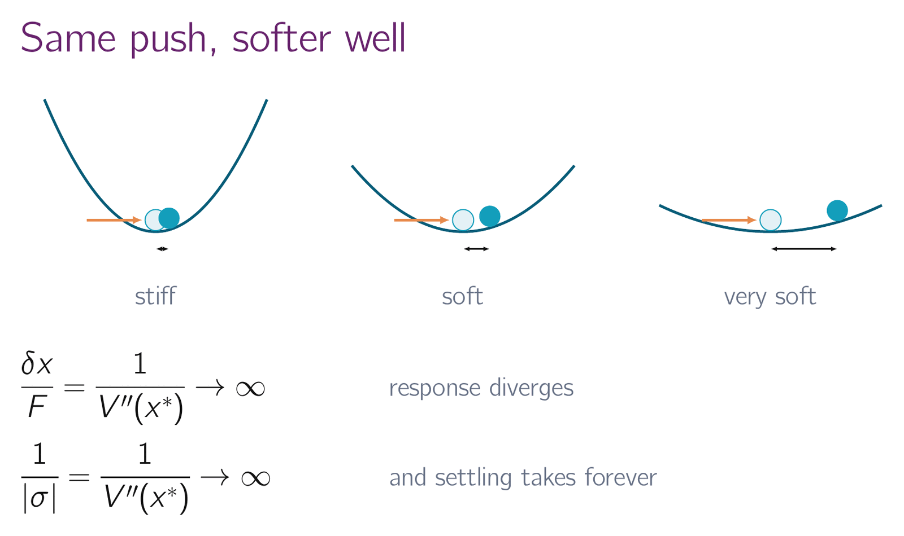

Apply the same push to wells of decreasing curvature. The stiff well barely moves; halving the curvature doubles the displacement. As the well flattens, $V'' \to 0$, the response per unit force at vanishing force, $d\,\delta x/dF$ at $F = 0$, diverges: a tiny push produces a large change. The range of forces over which the response stays linear shrinks at the same time. The same curvature sets the relaxation time. After a kick, $\delta x$ decays as $e^{-V'' t}$, so the settling time $1/|\sigma| = 1/V''$ diverges too. Soft systems are both easily pushed and slow. Near a transition this is called *critical slowing down*. A diverging response as a parameter is tuned is our first singularity; [[Lecture-Notes/Intro-Soft-Matter/Singularities|Singularities]] returns to it for a magnet.

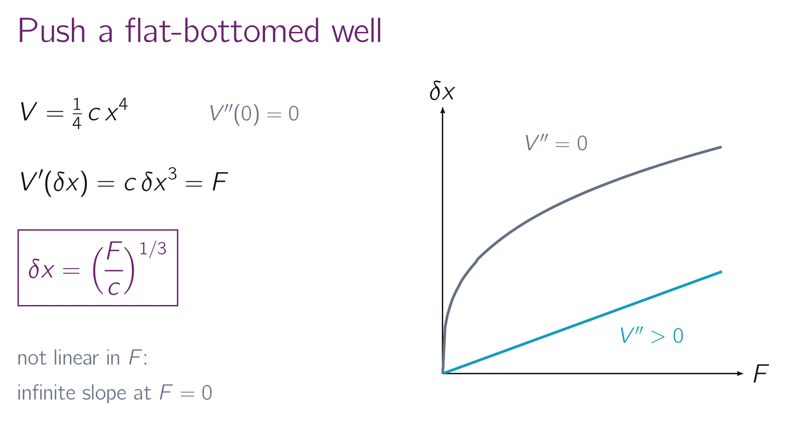

Exactly at the flat point linear theory fails, not the physics. Take the simplest flat-bottomed well, $V = cx^4/4$, with $V''(0) = 0$. The linear term vanishes, so the next approximation keeps the first higher-order term that survives: the restoring force is $-c\,\delta x^3$, so the push is balanced when $c\,\delta x^3 = F$, and

$$\delta x = \left(\frac{F}{c}\right)^{1/3}.$$

The response is finite but not proportional to $F$, with an infinite slope at $F = 0$. The same law appears for a magnet at its critical temperature in mean-field theory, where the magnetisation grows as the cube root of the applied field.

---

## 4) What to identify in any instability

1. Base state: the simplest flow/interface we’d like to hold (a cylinder of liquid, a flat film, two fluids sliding past each other).
2. Competing forces: inertia, viscosity, gravity, surface tension, and sometimes elasticity (soft matter).
3. Positive feedback: does a perturbation increase the driving (pressure, buoyancy, shear) faster than restoring forces (surface tension, viscosity, elasticity) can oppose it?
4. Advection vs absolute growth: disturbances can be swept away while growing (_convective_) or grow in place and contaminate the whole domain (_absolute_). We’ll use this language qualitatively in experiments.
    

Rule of thumb: the same effect (surface tension, elasticity, gravity) that stabilizes short wavelengths often leaves a window of longer wavelengths free to grow—yielding a _most unstable_ wavelength that sets the pattern spacing.

In words of James Clerk Maxwell

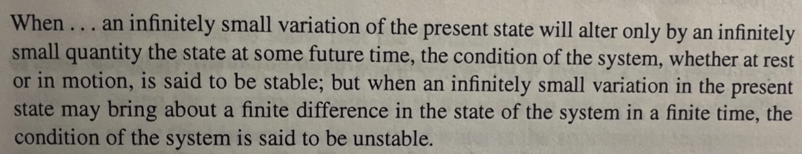

---

## 5) Core examples you can recognize in the lab

### (i) Rayleigh–Plateau (cylindrical thread → droplets)

Mechanism. A small bulge on a liquid thread lowers capillary pressure locally; liquid is drawn from the necks toward the bulge, further enlarging it—positive feedback. Surface tension itself is the _driver_ (seeking to reduce area) yet also damps very short ripples, so a fastest‑growing wavelength emerges and sets droplet spacing. In inviscid limits, that spacing is order‑ten radii (qualitative memory worth keeping).

What to look for. When a faucet runs as a thin jet, you see a regular drop train because this instability picks a wavelength/time scale of breakup (slow dripping is a different, pendant-drop process; see section 6).

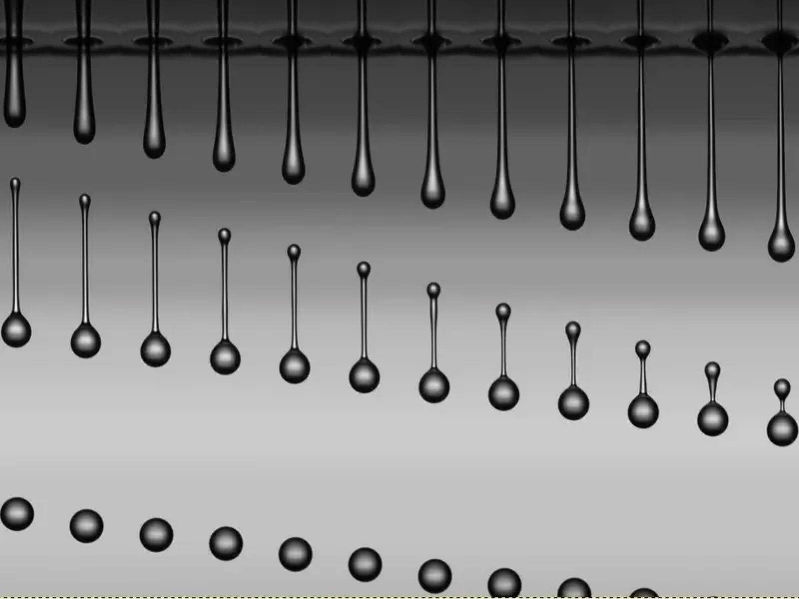
Cressey, D. 365 days: Images of the year. Nature 516, 304–309 (2014) - image taken at [Physics of Fluids Department, University of Twente](https://pof.tnw.utwente.nl/).

    <iframe width="560" height="315" src="https://www.youtube-nocookie.com/embed/-DckWNwE7R4?si=zzm8G3ju3MI3qM7p&amp;start=90" 
        title="YouTube video player" frameborder="0" 
        allow="accelerometer; autoplay; clipboard-write; encrypted-media; gyroscope; picture-in-picture; web-share" 
        referrerpolicy="strict-origin-when-cross-origin" allowfullscreen>
    </iframe>

### (ii) Kelvin–Helmholtz (shear across an interface → billows)

Mechanism. Two fluids sliding past each other create a vorticity sheet at the interface. A ripple tilts that sheet and rolls it up into billows; shear feeding exceeds restoring forces. Surface tension and density contrast stabilize short waves and set a threshold for onset and a preferred scale.

What to look for. In counter‑flowing layers (or the “flag flapping” movie on your slide set), once the interfacial shear is large enough, coherent vortical waves appear and then pair/roll up.

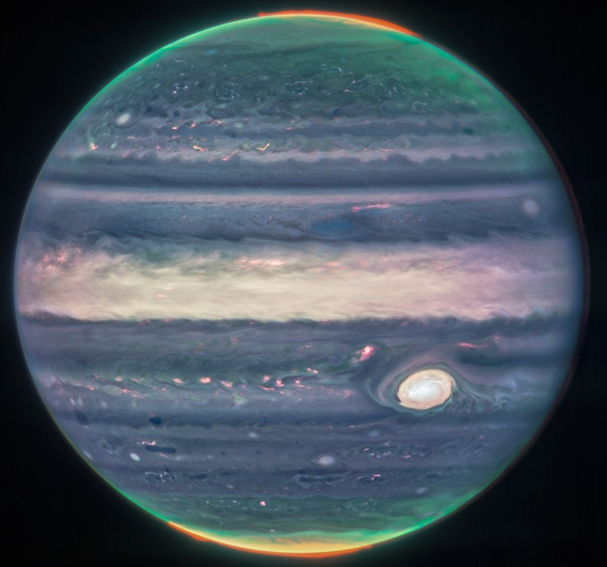

### (iii) Rayleigh–Taylor (heavy‑over‑light → spikes & bubbles)

Mechanism. Gravity pulls a heavy fluid down through a light one; a downward dent increases the hydrostatic pressure drop there and accelerates further—positive feedback. Surface tension stabilizes short waves; the competition picks a dominant wavelength. Thin‑film variants (heavy film above air) yield honeycomb/hexagonal hole patterns.

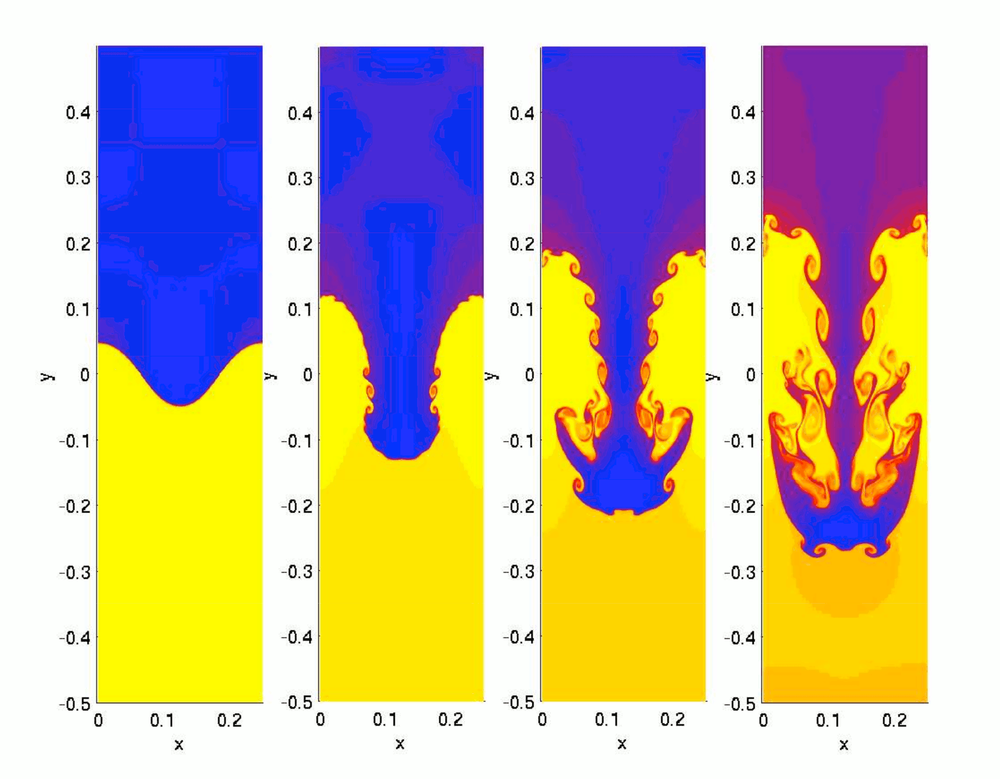
Image by Shengtai Li, Hui Li - "Parallel AMR Code for Compressible MHD or HD Equations", Attribution, <a href="https://commons.wikimedia.org/w/index.php?curid=6513545">Link</a>

### (iv) Faraday waves (vertical vibration → subharmonic surface patterns)

Mechanism. Parametric forcing periodically modulates the effective gravity; the flat surface becomes unstable to standing waves at half the drive frequency. Hexagons/stripes are common near onset. Use this as a canonical example of parametric (not spontaneous) instability and _pattern selection near threshold_.

    <iframe width="560" height="315" src="https://www.youtube-nocookie.com/embed/0d_D6yvXAFo?si=oLZxGjb-EvhSI2Wi" 
        title="YouTube video player" frameborder="0" 
        allow="accelerometer; autoplay; clipboard-write; encrypted-media; gyroscope; picture-in-picture; web-share" 
        referrerpolicy="strict-origin-when-cross-origin" allowfullscreen>
    </iframe>

### (v) Rayleigh–Bénard–Marangoni (heated film → rolls/hexagons)

Mechanism. Heating from below (buoyancy) or surface‑tension gradients along a free surface (Marangoni) drive cellular convection. Thin layers emphasize Marangoni; thicker ones emphasize buoyancy, flipping flow directions inside the cells. Amplitude/envelope equations near onset rationalize which planforms (rolls, hexagons) persist.

    <iframe width="560" height="315" src="https://www.youtube-nocookie.com/embed/v2vMXmuC818" 
        title="YouTube video player" frameborder="0" 
        allow="accelerometer; autoplay; clipboard-write; encrypted-media; gyroscope; picture-in-picture; web-share" 
        referrerpolicy="strict-origin-when-cross-origin" allowfullscreen>
    </iframe>

The same experiment as the oil layer is made thicker, from 0.14 cm to 0.49 cm (50 cSt silicone oil seeded with copper pigment, on a hot aluminium plate; description in German). The cells grow with the layer depth.

    <iframe width="560" height="315" src="https://www.youtube-nocookie.com/embed/9Ru_bjW3eL8" 
        title="YouTube video player" frameborder="0" 
        allow="accelerometer; autoplay; clipboard-write; encrypted-media; gyroscope; picture-in-picture; web-share" 
        referrerpolicy="strict-origin-when-cross-origin" allowfullscreen>
    </iframe>

### (vi) Saffman–Taylor (viscous fingering in Hele‑Shaw cells)

Mechanism. A less viscous fluid pushing a more viscous one creates a pressure‑gradient focusing at finger tips (“tip effect”). Any protrusion experiences larger local pressure gradient and advances faster—runaway growth—while surface tension blunts the tip and limits short waves. Capillary number ($Ca = \eta U/\gamma$) summarizes the competition; channel geometry further selects finger width and number. In radial injection, secondary instabilities (tip‑splitting/side‑branching) govern the branching morphology.

    <iframe width="560" height="315" src="https://www.youtube-nocookie.com/embed/9Flsy0sc_cg?si=n0tpcsNHr-7JgXkG" 
        title="YouTube video player" frameborder="0" 
        allow="accelerometer; autoplay; clipboard-write; encrypted-media; gyroscope; picture-in-picture; web-share" 
        referrerpolicy="strict-origin-when-cross-origin" allowfullscreen>
    </iframe>

### (vii) Viscous coiling & “fluid mechanical sewing machine”

Mechanism. A falling viscous thread buckles and coils from a balance of gravity, bending, stretching, and surface tension; on a moving belt the contact‑point dynamics introduce memory and rich states (coils, meanders, W‑patterns). Linear stability alone is insufficient—nonlinear, geometry‑driven dynamics dominate far from threshold.

    <iframe width="560" height="315" src="https://www.youtube-nocookie.com/embed/5SpnabbGRQo?si=eUdxJPld0RVSWR_G" 
        title="YouTube video player" frameborder="0" 
        allow="accelerometer; autoplay; clipboard-write; encrypted-media; gyroscope; picture-in-picture; web-share" 
        referrerpolicy="strict-origin-when-cross-origin" allowfullscreen>
    </iframe>

---

## 6) Plateau and Rayleigh: why a thread breaks, and at what spacing

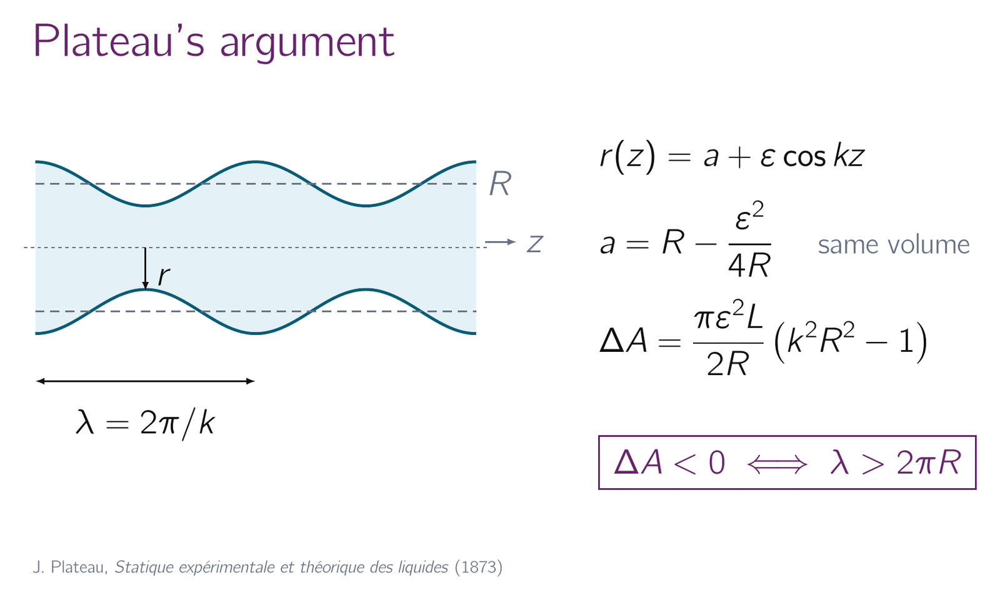

**Plateau's energy argument (1873).** Which shapes lower the surface energy of a liquid cylinder of radius $R$? Perturb the radius with a varicose (sausage) mode, $r(z) = a + \varepsilon\cos kz$, of wavelength $\lambda = 2\pi/k$. The volume is fixed. Over a length $L$ containing a whole number of wavelengths, $V = \pi L\,(a^2 + \varepsilon^2/2) = \pi R^2 L$, so to second order $a = R - \varepsilon^2/(4R)$: the mean radius shrinks slightly, because the bulges hold more liquid than the necks lose. The surface area is

$$A = \int 2\pi r\sqrt{1 + r'^2}\,dz \approx 2\pi L a + \frac{\pi}{2} R\,\varepsilon^2 k^2 L,$$

and inserting $a$ gives

$$\Delta A = \frac{\pi\varepsilon^2 L}{2R}\left(k^2R^2 - 1\right).$$

Two effects compete: the shrinking mean radius lowers the area, the corrugation adds area. For $kR < 1$, i.e. $\lambda > 2\pi R$ (a wavelength longer than the circumference), the area decreases. In this direction the surface energy $\gamma A$ is a hilltop, $V'' < 0$ in the language of the bead, and every long enough wave can grow.

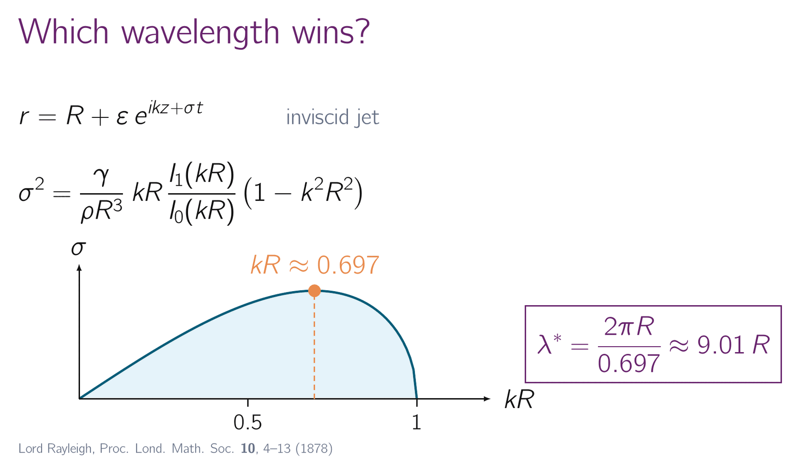

**Rayleigh's growth rate (1878).** Plateau says which modes can grow, not how fast. Rayleigh wrote the disturbance as a normal mode, $r = R + \varepsilon\,e^{ikz + \sigma t}$, and solved the linearised inviscid flow inside the jet. Each wavenumber is its own bead, with its own growth rate:

$$\sigma^2 = \frac{\gamma}{\rho R^3}\,kR\,\frac{I_1(kR)}{I_0(kR)}\left(1 - k^2R^2\right),$$

where $I_0$ and $I_1$ are modified Bessel functions (they carry the flow inside the cylinder), $\gamma$ is the surface tension and $\rho$ the density. $\sigma^2 > 0$ exactly when $0 < kR < 1$, Plateau's criterion. The growth rate vanishes at $k = 0$ (very long waves have to move liquid very far) and at $kR = 1$, and peaks at $kR \approx 0.697$ with

$$\sigma^* \approx 0.343\sqrt{\frac{\gamma}{\rho R^3}}, \qquad \lambda^* = \frac{2\pi R}{0.697} \approx 9.01\,R.$$

For a nearly cylindrical jet left to itself, the fastest mode outruns all the others exponentially and sets the drop spacing: about 4.5 diameters. This holds when the jet is long enough for that mode to dominate; a pendant drop at a slowly dripping faucet detaches without first forming such a jet, and an inkjet printer imposes its own wavelength by vibrating the nozzle. For water with $R = 1$ mm the capillary time is $\sqrt{\rho R^3/\gamma} \approx 3.7$ ms, so $1/\sigma^* \approx 11$ ms. Viscosity slows the growth and moves the maximum to longer waves, but keeps the threshold $kR = 1$.

Linear theory ends here: it says the corrugation grows, not how the thread detaches. The detachment is a finite-time singularity, and [[Lecture-Notes/Intro-Soft-Matter/Singularities|Singularities]] picks up the story exactly at this point.

---

## 7) How to “predict” without doing heavy math

1. Force balance & scales. Ask which pair of effects compete: inertia vs capillarity (Weber number), viscous vs capillarity (capillary number), inertia vs viscosity (Reynolds number), gravity vs capillarity (Bond number), elasticity vs capillarity (elastocapillary mumber) or inertia in soft materials (elasticity number). These dimensionless groups flag likely instabilities and the direction of selection.
2. Dispersion‑curve picture (qualitative). Most interfacial problems have a “bell‑shaped” growth‑rate vs wavelength: short waves stabilized by surface tension/viscosity, long waves limited by the finite driving (e.g. pressure or gravity). The peak sets the emergent spacing observed in your videos/demos. (Keep this as a mental model.)

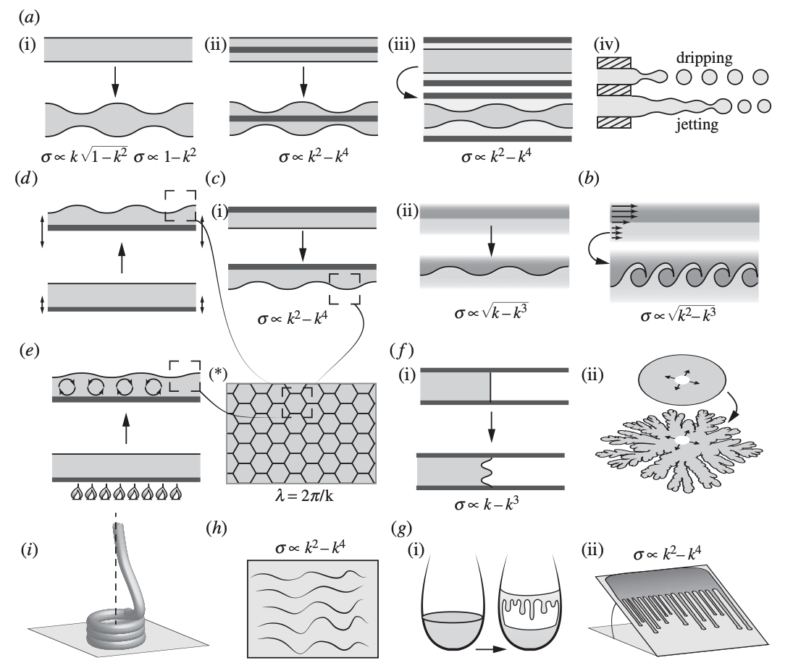
Sketch of the interfacial instabilities discussed in F. Gallaire & P-T. Brun, Philos. Trans. R. Soc. A, 375:2093, 20160155 (2017). DOI: [10.1098/rsta.2016.0155](https://doi.org/10.1098/rsta.2016.0155)
The dispersion relation, $\sigma$ is the growth rate and $k$ the wave vector, is provided when available. (a(i)–a(iv)) Plateau–Rayleigh instability, (b) Kelvin–Helmoltz instability, (c(i),c(ii)) Rayleigh–Taylor instability in two-phase flows and in a thin layer, (d) Faraday waves arising in a bath subject to periodic oscillatory forcing, (e) Rayleigh–Bénard–Marangoni instability obtained when heating up a thin layer of fluid, (\*) hexagonal tilling, (f(i),f (ii)) plane and radial Saffman–Taylor instability in a Hele–Shaw cell, (g(i),g(ii)) capillary ridge instability and wine tears, (h) Kapitza waves and (i) viscous coiling, with the last three being examples of instabilities found in everyday life. (c(ii)),(d) and (e) typically arrange in patterns such as shown in (\*). Taken from F. Gallaire & P-T. Brun, Philos. Trans. R. Soc. A, 375:2093, 20160155 (2017). DOI: [10.1098/rsta.2016.0155](https://doi.org/10.1098/rsta.2016.0155)

- Convective vs absolute. If a disturbance amplifies but is advected away, we get localized activity; if it grows in place, patterns fill the domain. This informs whether we expect clean, global patterns or drifting, patchy ones in experiments.   

    <iframe width="560" height="315" src="https://www.youtube-nocookie.com/embed/jh5MVUnpMyc?si=wrU4njN7wngA78C1" 
        title="YouTube video player" frameborder="0" 
        allow="accelerometer; autoplay; clipboard-write; encrypted-media; gyroscope; picture-in-picture; web-share" 
        referrerpolicy="strict-origin-when-cross-origin" allowfullscreen>
    </iframe>

---

## 8) Just past onset: growth, then saturation

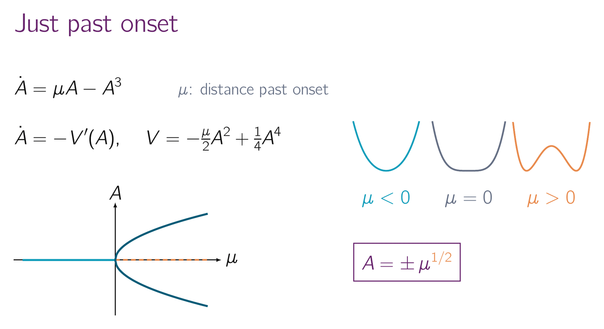

Linear theory predicts exponential growth forever, which is clearly wrong: something stops it. The cleanest example to try at home is a plastic ruler squeezed between the palms (Euler buckling). Below a critical load $P_c$ it stays straight; above it, it bows sideways by an amplitude $A$.

Take the bowing as a single mode whose motion is overdamped, like the bead in honey (without damping the straight ruler would still become unstable above $P_c$, but with a growth rate proportional to $\sqrt{P - P_c}$, and it would oscillate about a buckled shape instead of settling into it). Near the threshold the growth rate is small and changes sign: $\sigma \approx \mu$, with $\mu \propto P - P_c$ the distance past onset. Symmetry decides the form of the next term. Bowing left is the same as bowing right, so the equation must be unchanged under $A \to -A$. That forbids $A^2$, and the first allowed nonlinear term is $A^3$; symmetry does not fix its sign. When its sign is negative, rescaling $A$ and $t$ gives the amplitude (Landau) equation

$$\frac{dA}{dt} = \mu A - A^3.$$

This is the normal form of a *supercritical* pitchfork for a single overdamped mode: any such system with this symmetry and a negative cubic coefficient reduces to it near onset. With a positive cubic coefficient (a *subcritical* bifurcation) the cubic does not stop the growth, and either higher-order terms or a jump to a distant state take over.

**Read it as a flow on a line.** Where $dA/dt > 0$, $A$ increases; where it is negative, $A$ decreases. The fixed points are $A = 0$ and $A = \pm\sqrt{\mu}$. Linearising about them is the bead recipe again: $A = A^* + \delta A$ gives $\sigma = \mu - 3A^{*2}$. At $A^* = 0$, $\sigma = \mu$, unstable for $\mu > 0$. At $A^* = \pm\sqrt\mu$, $\sigma = -2\mu$, stable. For $\mu < 0$ only $A = 0$ exists, and it is stable.

**Or as a bead in a landscape.** $dA/dt = -V'(A)$ with $V(A) = -\mu A^2/2 + A^4/4$. For $\mu < 0$ there is one well at $A = 0$; at $\mu = 0$ the bottom is flat (the $V'' = 0$ case above); for $\mu > 0$ the middle becomes a hilltop and two wells appear. Plotting the equilibria against $\mu$ gives the *pitchfork*. Which branch is chosen, $+\sqrt\mu$ or $-\sqrt\mu$, is decided by the noise in the initial condition: spontaneous symmetry breaking. The ruler buckles left or right with equal probability. The saturated amplitude grows as

$$A^* = \pm\mu^{1/2}.$$

The exponent $1/2$ comes from balancing $\mu A$ against $A^3$; it is not a material property. It returns as the mean-field exponent $\beta = 1/2$ of a magnet.

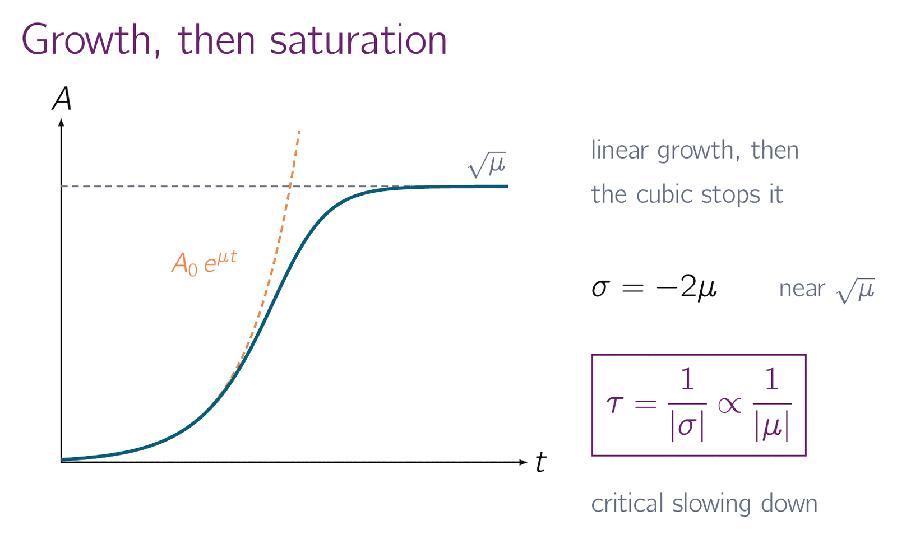

**In time.** For $\mu > 0$ and a small seed, $0 < |A_0| \ll \sqrt\mu$, the exact solution is

$$A(t) = \frac{A_0\, e^{\mu t}}{\left[1 + (A_0^2/\mu)\left(e^{2\mu t} - 1\right)\right]^{1/2}}.$$

Early on it cannot be told apart from the linear prediction $A_0 e^{\mu t}$; then the cubic catches up and $A$ levels off at $\sqrt\mu$ (or $-\sqrt\mu$ if $A_0 < 0$). This is the generic life story of an instability: noise, exponential growth of the fastest mode, nonlinear saturation. Near the saturated state perturbations decay at rate $2\mu$, so the time to settle, $\tau \propto 1/|\mu|$, diverges at onset from either side. Onset therefore already has two divergences in the parameter $\mu$, the response and the relaxation time, exactly as for the soft well.

## 9) When linear theory fails: the transition to turbulence

Reynolds (1883) injected dye on the axis of a pipe. At low flow rate it stays a thin line; at high flow rate it suddenly mixes across the pipe. Linear stability theory famously fails here: pipe flow is linearly stable at every Reynolds number studied, yet it turns turbulent around $Re \approx 2000$. Finite-amplitude disturbances do it. The flow is stable to small pushes, not to large ones: nonlinearly unstable.

---

## 10) From “avoid” to “use”: harnessing instabilities

Engineers used to fear instabilities as failure modes. Soft‑matter physics repurposes them as fabrication tools: microfluidic emulsification (controlled Rayleigh–Plateau), capillarity‑guided assembly of nanopillars (elastocapillary coalescence), and other self‑organization pathways. The mindset shift is to select initial/boundary conditions so the _natural_ instability builds the desired pattern. The inverse problem—choosing those conditions up‑front—is still an open research space. See: P-T. Brun, Shape formation in interfacial flows, Phys. Rev. Fluids, 9:11, 110501 (2024). [DOI: 10.1103/PhysRevFluids.9.110501](https://doi.org/10.1103/PhysRevFluids.9.110501)

---

## Further reading

1. **J. Plateau**, *Statique expérimentale et théorique des liquides soumis aux seules forces moléculaires* (Gauthier-Villars, Paris, 1873). – The energy argument for the capillary instability of a cylinder.
2. **Lord Rayleigh**, On the instability of jets, Proc. Lond. Math. Soc., 10, 4–13 (1878). – The dispersion relation and the fastest-growing wavelength.
3. **J. Eggers & E. Villermaux**, Physics of liquid jets, Rep. Prog. Phys., 71, 036601 (2008). [DOI: 10.1088/0034-4885/71/3/036601](https://doi.org/10.1088/0034-4885/71/3/036601).
4. **S. H. Strogatz**, *Nonlinear Dynamics and Chaos* (Westview Press, 2nd ed., 2015). – Flows on a line, fixed points and bifurcations, at the level of these notes.

---

> [!significance]- Metadata
> Author:: [Vatsal Sanjay](https://vatsalsanjay.com) 

> [!link] Back to main website
> [Home](https://comphy-lab.org/), [Team](https://comphy-lab.org/team), [Research](https://comphy-lab.org/research), [Github](https://github.com/comphy-lab)
>
> 📝 [Edit this page on GitHub](https://github.com/comphy-lab/CoMPhy-Lab-Blogs/blob/main/Lecture-Notes/Intro-Soft-Matter/Instabilities.md)