---
tags:
  - lecture
  - soft-matter
  - singularities
  - fluid-dynamics
status: done ✅
publish: true
---

# Soft Matter Singularities

<!-- BLOG-PDF-LINK-START -->
<!-- PDF-EXPORT-IGNORE-START -->
> [!pdf] PDF version
> [[_Media/PDF/Lecture-Notes/Intro-Soft-Matter/Singularities.pdf|Download this page as PDF]]
<!-- PDF-EXPORT-IGNORE-END -->
<!-- BLOG-PDF-LINK-END -->

> [!tldr] TL;DR
> A singularity is when a smooth physical process “blows up” — something finite becomes infinite in a finite time or at a finite place.

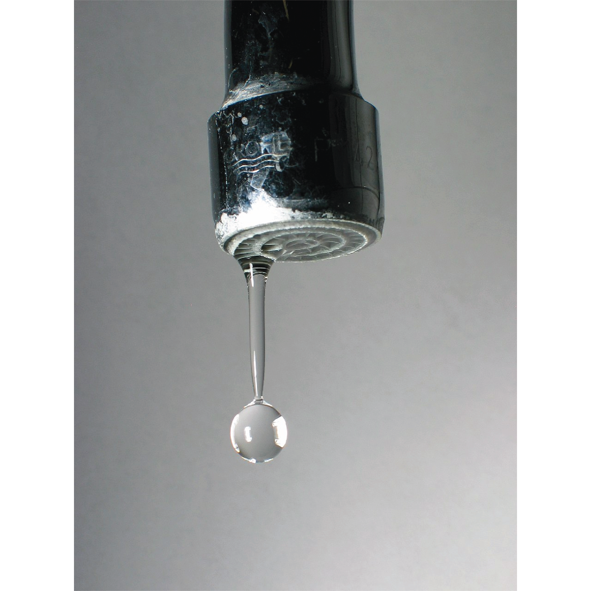
*A water droplet detaching from a faucet forms a thinning neck that will pinch off. Just before separation, the neck radius shrinks rapidly and the curvature (and capillary pressure) blows up. The pinch-off singularity produces one main drop and often a tiny satellite drop left behind.[^dripping-image]*

## 0) What is a singularity in soft matter?

A singularity is when a smooth physical process “blows up” — some quantity that is normally finite becomes effectively infinite in a finite time or at a finite location. In soft matter flows, singularities often signal dramatic events: a droplet pinches off, a bubble collapses, or a moving contact line generates enormous stresses. These singular moments are fascinating because they mark the breakdown of our usual approximations (continuum equations, smooth interfaces), yet they often exhibit universal behavior (independent of initial details). Understanding singularities helps us see where and why our fluid or material model needs new physics (like microscopic cutoffs), and how nature resolves the apparent paradox of infinities in a real system.

This lecture builds on earlier ones: the film rupture energy paradox in [[Lecture-Notes/Intro-Soft-Matter/Taylor-Culick-Paradox|the Taylor–Culick paradox]] hinted that proper momentum accounting resolves infinities; the no-slip condition from [[Lecture-Notes/Intro-Soft-Matter/Viscosity|viscosity]] will be central to our discussion of moving contact lines; and the capillary instability of a thread in [[Lecture-Notes/Intro-Soft-Matter/Instabilities|instabilities]] ends in a singular pinch-off. Now we zoom in on those finite-time, “life or death” moments of soft matter systems.

## 1) The simplest blow-up: $du/dt = u^2$

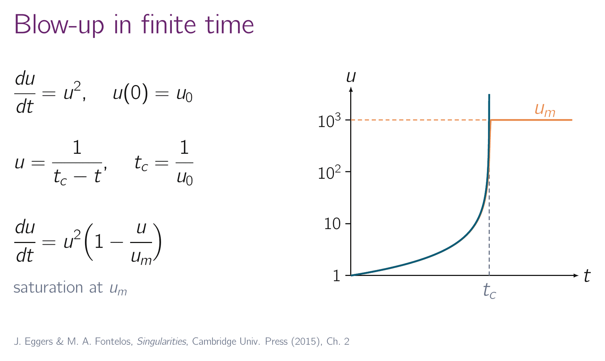

Before any fluid, the simplest equation whose solution stops existing in finite time:[^ef2015]

$$\frac{du}{dt} = u^2, \qquad u(0) = u_0 > 0.$$

Separate the variables: $-1/u = t - 1/u_0$, so

$$u = \frac{1}{t_c - t}, \qquad t_c = \frac{1}{u_0}.$$

Compare linear instability, $du/dt = \sigma u$: exponential growth never reaches infinity in finite time. Here the growth rate ($u$ itself) grows with the quantity, so it runs away. The initial condition survives only in the blow-up time $t_c$; the exponent $-1$ is set by the equation. The reason for the power law is that near $t_c$ the only time scale left is $t_c - t$ itself. For $du/dt = u^p$ with $p > 1$ the same argument gives $u \propto (t_c - t)^{-1/(p-1)}$; at $p = 1$ the growth is exponential and never blows up.

**Regularisation.** Real systems contain physics that the model leaves out, and it caps the growth. An illustrative choice is

$$\frac{du}{dt} = u^2\left(1 - \frac{u}{u_m}\right).$$

$u_m$ is the value of $u$ at which the missing physics takes over: the blow-up says the model has outrun its assumptions, and $u_m$ says where. Literal saturation of this kind occurs when a self-reinforcing process runs out of something: thermal runaway stops when the fuel is used up, chemotactic collapse of cells stops at close packing, and self-focusing of a laser beam stops when the optical nonlinearity saturates. The regularised solution never quite reaches $u_m$; it approaches it exponentially. Because $u_m \gg u_0$, the time to reach a fixed fraction of $u_m$ (say $u_m/2$) differs from $t_c$ only by an amount of order $(1/u_m)\ln(u_m/u_0)$. The singular solution describes most of the range, and the regularisation decides only where it stops.

For a pinching liquid neck (next section), $u$ is the capillary rate and $u_m$ is that rate at the smallest radius where a continuum description holds. A real neck does not level off, though: viscosity changes the exponent first, and at molecular scales the thread breaks.

## 2) From the Rayleigh–Plateau instability to pinch-off

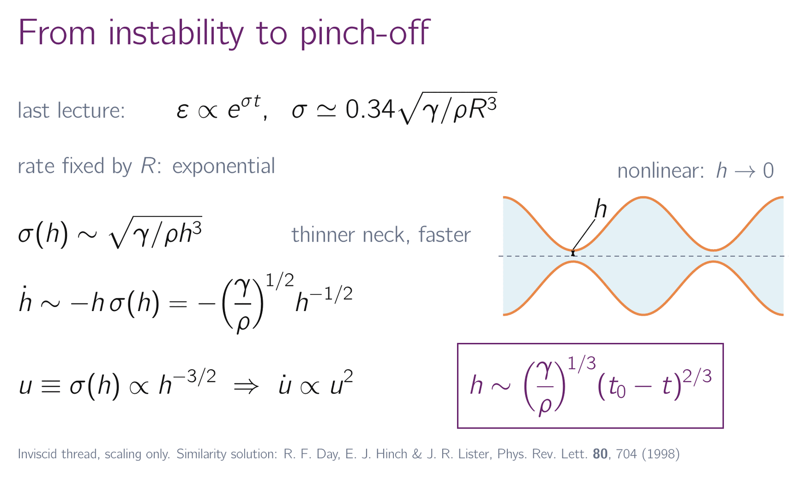

The [[Lecture-Notes/Intro-Soft-Matter/Instabilities|Instabilities]] notes left a liquid thread of radius $R$ unstable to long waves ($kR < 1$), with the fastest mode growing as $e^{\sigma t}$, $\sigma \approx 0.34\sqrt{\gamma/(\rho R^3)}$ for the fastest inviscid mode, and a wavelength of about $9R$. There $\gamma$ is the surface tension and $\sigma$ the growth rate; both keep these meanings here. In linear theory the rate is fixed by the undisturbed radius $R$. Exponential growth has no finite-time singularity: it only says that a small corrugation grows, and it stops being valid once the corrugation is comparable with $R$.

Once the neck is deep, the only length that matters near it is its own radius $h$. Use Rayleigh's capillary rate with $R$ replaced by $h$:

$$\sigma(h) \sim \sqrt{\frac{\gamma}{\rho h^3}}.$$

The thinner the neck, the faster it thins. This is a scaling argument, not a derivation: $\sigma(h)$ is the only rate that $\gamma$, $\rho$ and $h$ can form. It assumes that the neck's length along the thread also shrinks with $h$, which simulations and the similarity solution confirm. The neck shrinks by an amount of order $h$ in a time $1/\sigma(h)$:

$$\frac{dh}{dt} \sim -h\,\sigma(h) = -\left(\frac{\gamma}{\rho}\right)^{1/2} h^{-1/2},$$

equivalently $\rho\,[h/(t_0 - t)]^2 \sim \gamma/h$: inertia against capillary pressure. Now let $u \equiv \sigma(h) \propto h^{-3/2}$ be the neck's own rate. Then $du/dt = -(3/2)(u/h)\,dh/dt \propto u^2$, the blow-up equation of section 1. So $u \propto 1/(t_0 - t)$ and

$$h \sim \left(\frac{\gamma}{\rho}\right)^{1/3}(t_0 - t)^{2/3}:$$

the neck reaches zero radius at a finite time $t_0$. Linear instability starts the process; the self-accelerating nonlinear stage ends it.

**Exponent versus prefactor.** Scaling fixes the exponent, not the prefactor. The inviscid similarity solution gives $h_{\min} \approx 0.717\,[\gamma(t_0 - t)^2/\rho]^{1/3}$ asymptotically,[^dhl1998] but that value is approached extremely slowly. For water, experiments and simulations find a prefactor that wanders between about 0.4 and 0.6 and never reaches 0.717: the initial shape is forgotten slowly, and a small viscosity matters early.[^deblais2018]

**Which balance wins.** If viscosity $\eta$ dominates instead of inertia, viscous stress against capillary pressure, $\eta\,\dot h/h \sim \gamma/h$, gives

$$h \sim \frac{\gamma}{\eta}\,(t_0 - t),$$

linear in the time remaining. The characteristic viscous length is $\ell_\eta = \eta^2/(\rho\gamma)$, about 10 nm for water. The observed change of regime happens at radii well above $\ell_\eta$, and viscosity already shifts the inertial prefactor when the neck is more than a hundred times $\ell_\eta$.[^deblais2018] The prefactors again come from similarity solutions: $0.0709$ for a thread in Stokes flow[^papageorgiou1995] and $0.0304$ for the viscous–inertial solution.[^eggers1993] For a free thread whose surrounding fluid exerts negligible stress, every Newtonian neck eventually ends on the viscous–inertial solution; a thread inside a viscous outer liquid follows a different, two-fluid balance.

## 3) Pinch-off in experiments: necks, satellites and bubbles

**Mechanism.** Imagine water dripping from a faucet. Surface tension pulls the droplet neck thinner and thinner until it ruptures, separating the drop (gravity-driven) from the remaining fluid. Just before breakup, the radius of the neck approaches zero, causing the curvature (and thus capillary pressure) to skyrocket. 

In an “ideal mathematical description”, certain quantities (pressure, fluid velocity near the neck) tend toward infinity at the pinch point. This is a finite-time singularity — the equations (like Navier–Stokes) themselves remain intact, but their solution develops a blow-up (the interface develops a sharp cusp and then detaches). Importantly, very close to breakup, the shape of the neck often becomes self-similar — the fluid profile "zooms in" on a universal form regardless of the starting drop size.[^eggers1997] This means the pinch-off process has a kind of memory loss: everything but the local physics (inertia, viscosity, surface tension) washes out.

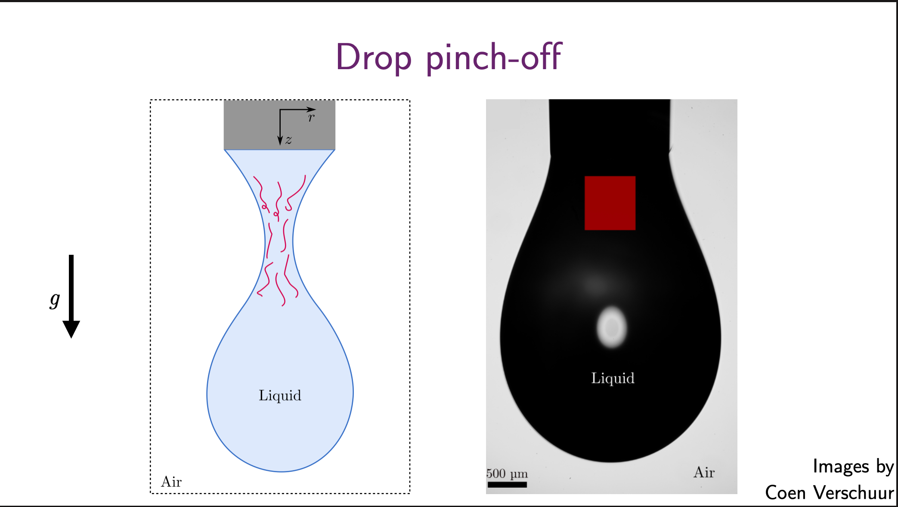

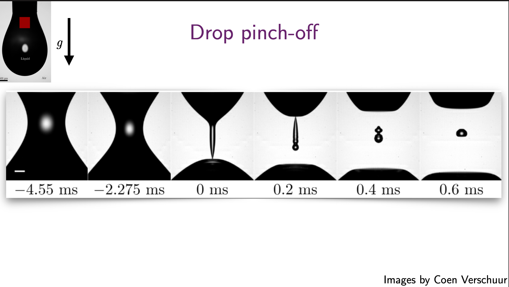

**Inertial vs viscous pinch-off.** The balance of forces sets the law. If inertia dominates (water in air), the neck follows the inertial regime of section 2, $h \sim (t_0 - t)^{2/3}$. Viscous threads (honey, glycerol) thin linearly in time, $h \sim (\gamma/\eta)(t_0 - t)$, often with a long cylindrical filament between the drops.

In either case, as the thread radius becomes extremely small, eventually some microscopic cutoff intervenes: for a Newtonian fluid this might simply be that the continuum assumption breaks at nano-scales, or impurities trigger the final break. The "singularity" is thus avoided in reality, but just barely, and the laws of motion pass through that event by producing new droplets[^eggers1997] (the Navier–Stokes solution can sometimes be continued through the singular moment in an ideal scenario).

**Satellites and universality.** Often, pinch-off leaves behind a tiny satellite drop in addition to the main drop. This satellite formation is part of a secondary break-up that can itself display self-similar behavior — a cascade of singular events. Indeed, high-speed imaging and theory show that pinch-off can produce nested sequences of singularities where each subsequent thread break is a smaller copy of the last (a form of discrete scale invariance).[^eggers1997] Near the singularity, the governing equations simplify (certain terms dominate), and we can often find scaling laws and similarity solutions that describe the dynamics universally.

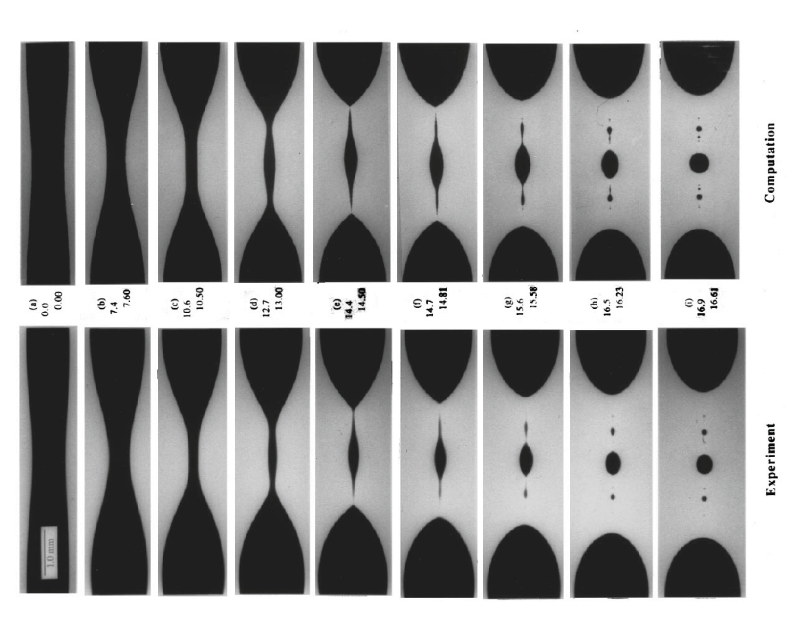
*Time evolution of a highly extended fluid suspended in another fluid. The viscosity ratio is 0.067, and the dimensionless wave number is 0.5. The times the snapshots were taken are shown in the middle.[^1]*

> [!note] Finite-time singularities are "predictable" in form
> A beautiful aspect of pinch-off events is that they forget the messy world around them. No matter if your drop comes from a pipette, faucet, or leaking roof, the final shape of the neck and the speed of breakup will tend to follow the same scaling laws (set by fluid properties like viscosity, density, surface tension). This universality means we can compare experiments, simulations, and theory on equal footing[^eggers1997] — a triumph of the singularity analysis.

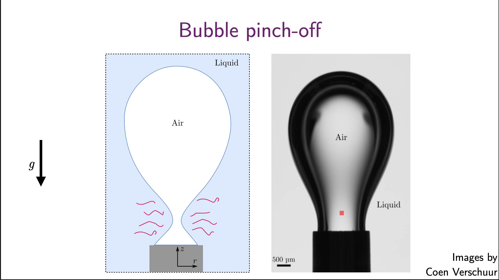

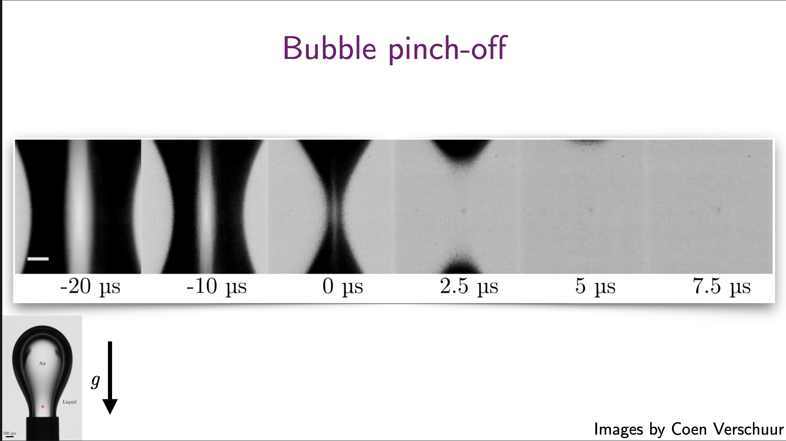

**Bubble pinch-off and Worthington jet.** A closely related singular event occurs when a bubble of air pinches off underwater (for example, an underwater air bubble rising and detaching, or the cavity behind an object closing up). The physics is analogous to drop pinch-off — the neck of the air cavity pinches to zero radius. In the case of a bubble pinch-off, however, the collapse can be so violent that the surrounding liquid rushes in along the symmetry axis and shoots upward as a fast Worthington jet. If you've seen a drop of water fall into a pool and a thin jet spike up — that's the result of a singular cavity collapse focusing energy into a jet. Here the singularity manifests as a burst of kinetic energy: extremely high speeds and even shock-like features in the liquid. In fact, the pressures in such collapse events can be enormous (cavitation collapse near a solid can even pit metal). The formation of the Worthington jet is a reminder that singularities often transmit energy across scales — focusing a large-scale motion into a very fine jet. (Interestingly, the jet itself can break into drops — another pinch-off — showing how one singularity can lead to another!)

    <iframe width="560" height="315" src="https://www.youtube-nocookie.com/embed/7HNv5cLObTY?si=kt1bMeC41jI9AHT-" 
        title="YouTube video player" frameborder="0" 
        allow="accelerometer; autoplay; clipboard-write; encrypted-media; gyroscope; picture-in-picture; web-share" 
        referrerpolicy="strict-origin-when-cross-origin" allowfullscreen>
    </iframe>

    <iframe width="560" height="315" src="https://www.youtube-nocookie.com/embed/7vN85NNXlSE?si=CDMA0blXajLpJKmF" 
        title="YouTube video player" frameborder="0" 
        allow="accelerometer; autoplay; clipboard-write; encrypted-media; gyroscope; picture-in-picture; web-share" 
        referrerpolicy="strict-origin-when-cross-origin" allowfullscreen>
    </iframe>

    <iframe width="560" height="315" src="https://www.youtube-nocookie.com/embed/t6Ddg4Kh_TA?si=JNpLuhlAK5Uw3sAN" 
        title="YouTube video player" frameborder="0" 
        allow="accelerometer; autoplay; clipboard-write; encrypted-media; gyroscope; picture-in-picture; web-share" 
        referrerpolicy="strict-origin-when-cross-origin" allowfullscreen>
    </iframe>

## 4) Singular, self-similar, universal, regularised

Every singularity in this course is examined with the same four questions:

1. **Singular?** Which quantity goes to zero or diverges, and where or when? For the thread, $h_{\min} \to 0$ at $t_0$.
2. **Self-similar?** Do rescaled profiles collapse onto one curve?
3. **Universal?** What does the local solution forget about the initial or far-field conditions?
4. **Regularised?** Which physics, absent from the equation, stops the divergence?

### A similarity solution is a fixed point

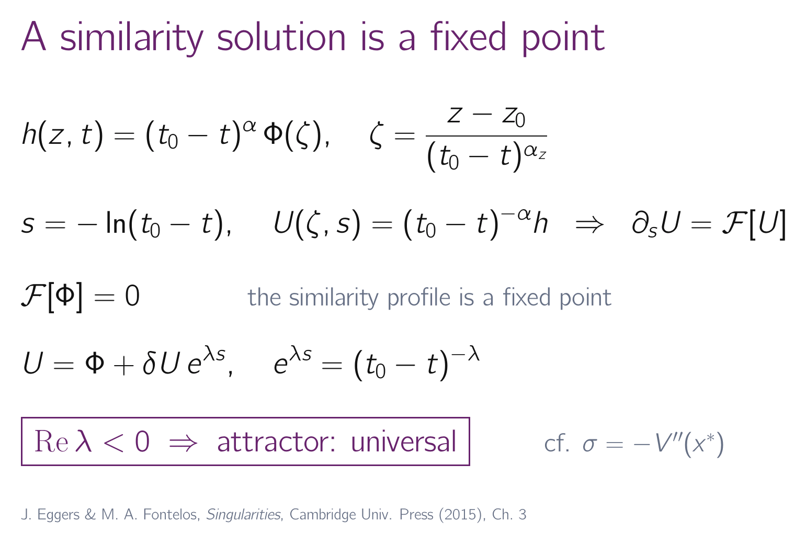

In the variables $z$ and $t$ a pinching neck never stops changing, so there is no steady state whose stability we could test. Divide out the shrinking scales and a self-similar neck *becomes* a steady state. The similarity ansatz is

$$h(z,t) = (t_0 - t)^{\alpha}\,\Phi(\zeta), \qquad \zeta = \frac{z - z_0}{(t_0 - t)^{\alpha_z}},$$

with $\alpha = \alpha_z = 2/3$ for the inertial thread. (Eggers & Fontelos write $\alpha$ and $\beta$ for the two exponents;[^ef2015] we keep $\beta$ for the magnet below.) Introduce logarithmic time, $s = -\ln(t_0 - t)$, which runs to infinity as $t \to t_0$, and rescale every field the same way. Let $U(\zeta, s)$ stand for the whole rescaled state: the profile $(t_0 - t)^{-\alpha} h$ and, for an inertial thread, the rescaled velocity field as well, because the shape alone does not determine how it moves. With the right exponents every explicit factor of $t_0 - t$ cancels and the equation becomes

$$\partial_s U = \mathcal F[U],$$

with no $s$ on the right-hand side: it is *autonomous*. A self-similar solution is then a steady state, and the operator obtained by linearising about it does not depend on $s$, so its perturbations can be sought as $e^{\lambda s}$ with constant $\lambda$, as for the bead. A similarity solution is a rescaled state $U^*$ (profile $\Phi$ together with its rescaled velocity field) that does not change in these variables, $\mathcal F[U^*] = 0$: it is a fixed point of the rescaled dynamics. Self-similar means steady in rescaled variables.

So we can ask the bead's question again. Linearise about $U^*$: perturbations of the rescaled state grow or decay as $e^{\lambda s} = (t_0 - t)^{-\lambda}$. If every non-trivial perturbation decays ($\mathrm{Re}\,\lambda < 0$), the similarity solution is a local attractor. Within its basin, and while the same dominant balance applies, the neck forgets its initial conditions and every faucet ends on the same profile. That is what universality means here.

> [!example] Worked example: $du/dt = u^2$
> Write $u = U(s)/(t_0 - t)$ with $s = -\ln(t_0 - t)$. Then
> $$\frac{dU}{ds} = U^2 - U,$$
> with no $s$ on the right. The fixed points are $U = 0$ and $U = 1$; $U = 1$ is the blow-up solution $u = 1/(t_0 - t)$. About $U = 1$, $d(U^2 - U)/dU = 2U - 1 = 1$, so $\lambda = +1$: unstable. That mode is trivial. $u = 1/(t_0 + \varepsilon - t)$ is the same blow-up a little later, which in rescaled variables reads $U \approx 1 - \varepsilon e^{s}$. Choosing $t_0$ as the actual blow-up time removes it.

The trivial unstable modes of a pinching neck are likewise just *when* and *where* pinch-off happens ($t_0$ and $z_0$), which is why pinch-off needs no fine tuning. Missing physics enters as non-autonomous terms. In the inertial scaling the viscous term carries a factor growing like $e^{s/3} \propto (t_0 - t)^{-1/3}$, the inverse of the local Reynolds number: negligible early, dominant late. That is the crossover to the viscous regime of section 2.

### Two warnings

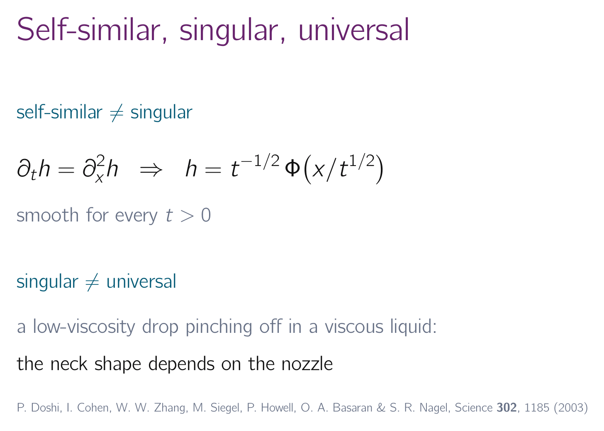

- **Self-similar is not singular.** Diffusion from a point source, $h = t^{-1/2}\Phi(x/t^{1/2})$, is self-similar and smooth for every $t > 0$.
- **Singular is not universal.** A low-viscosity drop pinching off inside a much more viscous liquid keeps a memory of the nozzle: its similarity solution is not an attractor.[^doshi2003] Universality is something to test, not to assume.

Eggers and Fontelos organise singularities by *formation* (they appear in finite time), *structure* (they persist) and *propagation* (they move).[^ef2015] A fourth kind does not happen in time at all: a response diverges as a control parameter is tuned to a critical value. That is a critical point, and its cleanest model is the Ising model.

## 5) A singularity in a parameter: the Ising model and critical points

### The model

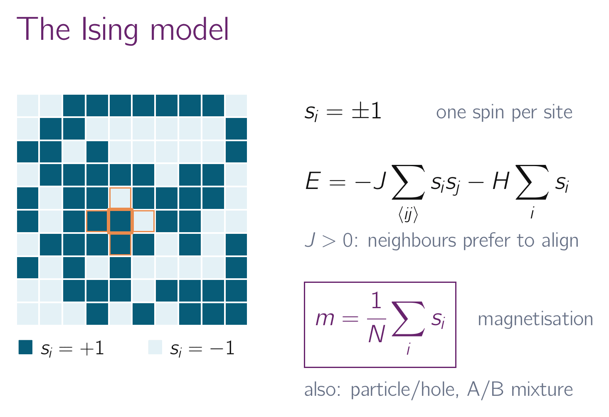

The Ising model is the simplest model with a genuine phase transition, and the reason critical points are understood. A lattice of sites each carries a variable $s_i = \pm 1$. It is called a spin for historical reasons; nothing rotates, and there are no positions or velocities. The energy of a configuration is

$$E = -J\sum_{\langle ij\rangle} s_i s_j - H\sum_i s_i,$$

where the first sum runs over nearest-neighbour pairs (four neighbours per site on the square lattice). Each pair contributes $-J$ if aligned and $+J$ if not, so $J > 0$ favours alignment. The field term lowers the energy of $s = +1$ when $H > 0$. That is the whole model (Lenz 1920; Ising solved it in one dimension in 1925 and found no transition there). The order parameter is the magnetisation, the average spin,

$$m = \frac1N\sum_i s_i,$$

with $m = 0$ for as many $+1$ as $-1$ and $m = \pm 1$ when all are aligned.

**Why soft matter cares.** Relabel the two states. Occupied/empty site gives the *lattice gas*, a model of the liquid–gas critical point. Molecule A/molecule B gives a *binary mixture* that demixes below a critical temperature. The mathematics is the same, so near the critical point the exponents are the same.

**Units.** $s_i = \pm1$ is a pure number, so $J$ and $H$ must be energies, like $k_BT$. An unlike pair costs $2J$ more than a like pair, so flipping one site inside an aligned region (four broken bonds) costs $8J$. Thermal equilibrium weights each configuration by the Boltzmann factor $e^{-E/k_BT}$, and $E/k_BT$ contains only $J/k_BT$ and $H/k_BT$. At $H = 0$ the single control parameter is therefore $J/k_BT$, which is why critical temperatures are quoted in units of $J/k_B$. In practice:

- **Magnet:** $J$ is the exchange energy between neighbouring moments; $H$ is the energy of a moment in an applied magnetic field.
- **Lattice gas:** with occupancy $n = (1 + s)/2$ and nearest-neighbour attraction $w$, $J = w/4$, and $H$ measures the chemical potential relative to its value at liquid–vapour coexistence.
- **A/B mixture:** $J = (2e_{AB} - e_{AA} - e_{BB})/4$ from the contact energies, so $J > 0$ means unlike contacts cost energy. The composition is $m = 2\phi_A - 1$, and the Flory–Huggins parameter of polymer physics equals $2qJ/k_BT$, with $q$ the number of neighbours.

### Energy against entropy

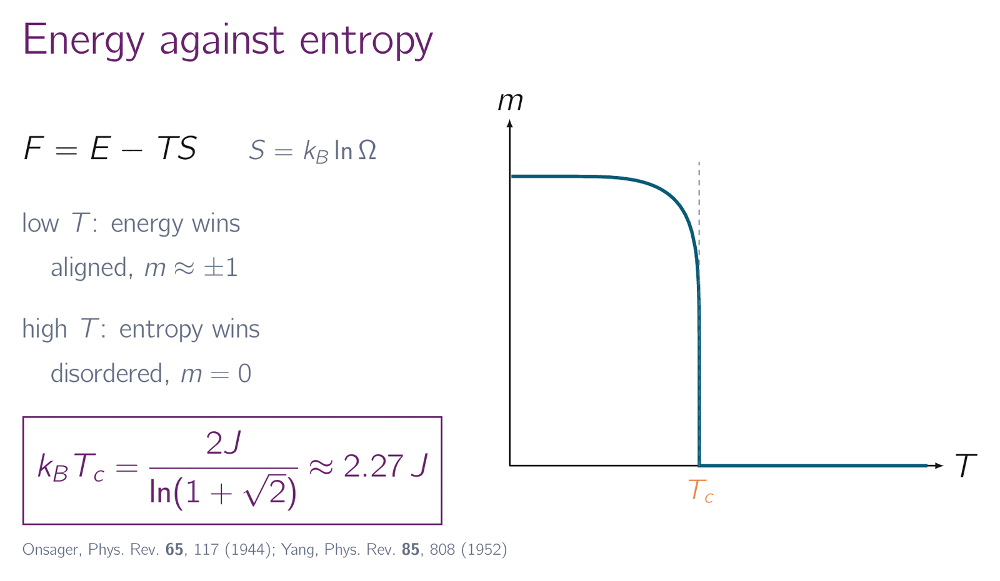

Which state wins is set by the free energy $F = E - TS$, with $S = k_B\ln\Omega$ and $\Omega$ the number of configurations. The system lowers its energy and raises its entropy, and the temperature sets the exchange rate between the two.

- **Low $T$: energy wins.** Almost all spins align, $m \approx \pm1$. There are two choices: symmetry breaking again.
- **High $T$: entropy wins.** The heat bath kicks every spin with energies of order $k_BT$, and only the bond $J$ holds a spin parallel to its neighbours. When $k_BT \gg J$ the kicks flip spins whatever their neighbours do, faster than the bonds can rebuild alignment. All configurations then become roughly equally likely, and almost all of them are disordered: for 100 spins there is one all-up configuration but $\binom{100}{50} \approx 10^{29}$ half-up ones. The system is not seeking disorder; nearly every state it can visit is disordered, so $\langle m\rangle = 0$. A single configuration still has a small magnetisation, of order $N^{-1/2}$ for independent spins.

Why $T$ multiplies $S$: when spins align, their energy falls and the released heat $Q$ goes into the bath, whose entropy rises by $Q/T$. A joule buys a lot of entropy in a cold bath and little in a hot one, so at high temperature ordering no longer pays. Melting ice is the same contest. Bonds favour the crystal, counting favours the liquid, and the melting point is where they balance, $T_m = \Delta H/\Delta S \approx (6.01\ \text{kJ mol}^{-1})/(22.0\ \text{J mol}^{-1}\,\text{K}^{-1}) \approx 273$ K.

In between there is a sharp temperature $T_c$ at which the order vanishes. For the nearest-neighbour square lattice at zero field, in the limit of an infinite lattice, the spontaneous magnetisation is known exactly:[^onsager1944][^yang1952]

$$|m^*| = \left[1 - \sinh^{-4}\!\left(\frac{2J}{k_BT}\right)\right]^{1/8} \ \ (T < T_c), \qquad m^* = 0 \ \ (T \ge T_c), \qquad k_BT_c = \frac{2J}{\ln(1 + \sqrt2)} \approx 2.269\,J,$$

one of very few exactly solved interacting many-body problems. Near $T_c$ it drops steeply, $m \propto (T_c - T)^{1/8}$.

### What it looks like

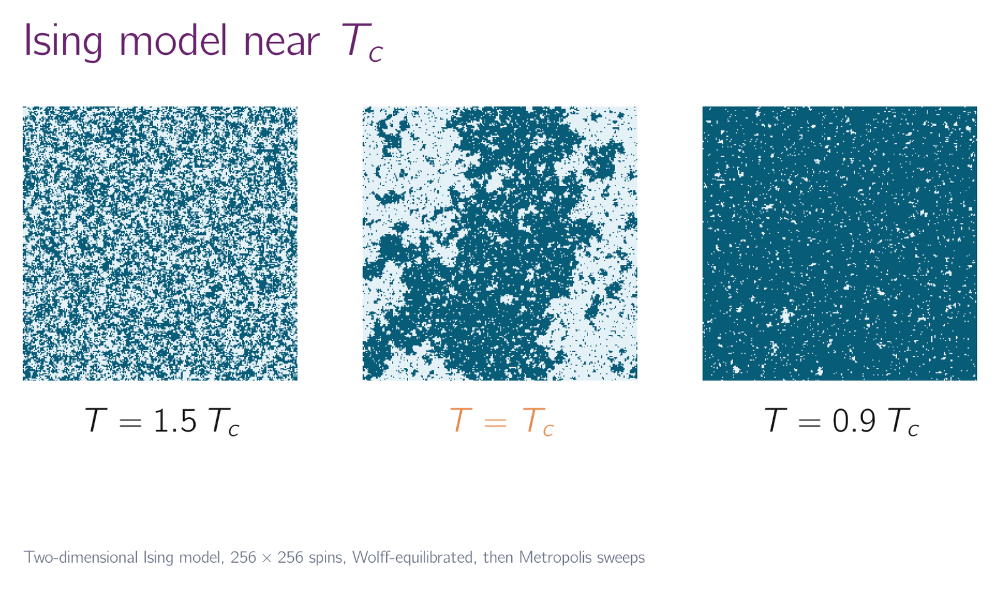

Three $256 \times 256$ lattices at zero field. At $1.5\,T_c$: salt-and-pepper disorder, $m \approx 0$, short correlations. At $0.9\,T_c$: ordered ($m \approx 0.9$), with small minority islands that appear and vanish. At $T_c$: domains of every size, from one spin to the whole box, with no typical size; the large ones change very slowly (critical slowing down, as for the soft well). Near $T_c$ the fluctuations, not the mean, carry the physics.

**How such pictures are made: Monte Carlo.** Pick a spin and propose to flip it. The energy change involves only its neighbours, $\Delta E = 2Js_i\sum_j s_j$. If the flip lowers the energy or leaves it unchanged, do it; if it raises it, do it anyway with probability $e^{-\Delta E/k_BT}$. In short, accept with probability $\min(1, e^{-\Delta E/k_BT})$ (the Metropolis rule). Thermal fluctuations are exactly these occasional uphill moves. Repeat; $N$ attempts make one sweep. After enough sweeps, configurations appear with the Boltzmann probability. It takes about twenty lines of code.

### Mean field: assume one spin and average the neighbours

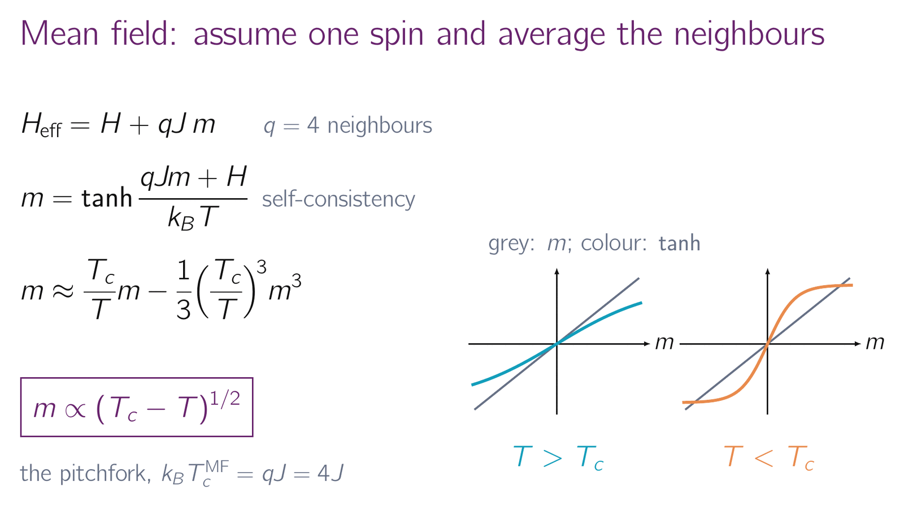

Can we predict $T_c$ and $m(T)$ without Onsager's calculation? The mean-field idea (Weiss 1907): look at one site and replace its $q$ neighbours by their average $m$. Its energy is then $-(H + qJm)s$, a single spin in an effective field $H_{\text{eff}} = H + qJm$, whose average is $\tanh(H_{\text{eff}}/k_BT)$. The average spin must reproduce $m$ itself:

$$m = \tanh\frac{qJm + H}{k_BT}.$$

Solve it graphically at $H = 0$, with $k_BT_c = qJ$. Above $T_c$ the curve $\tanh(T_c m/T)$ is less steep than the line $m$ at the origin, and only $m = 0$ solves the equation. Below $T_c$ it is steeper, and two extra solutions $\pm m^*$ appear. Expanding $\tanh x \approx x - x^3/3$ gives $(T_c/T - 1)\,m \approx \tfrac13 (T_c/T)^3 m^3$: the fixed-point condition of the amplitude equation in [[Lecture-Notes/Intro-Soft-Matter/Instabilities|Instabilities]], with $T_c - T$ as the onset parameter. So

$$m \approx \sqrt3\left(1 - \frac{T}{T_c}\right)^{1/2},$$

the pitchfork, with exponent $\beta = 1/2$. Mean field gets the picture right and the numbers wrong: on the square lattice it predicts $k_BT_c = 4J$ against the exact $2.27J$, and $\beta = 1/2$ against the exact $1/8$. It ignores the fluctuations visible in the pictures; they lower $T_c$ and change the exponents.

### Landau's landscape, response and fluctuations

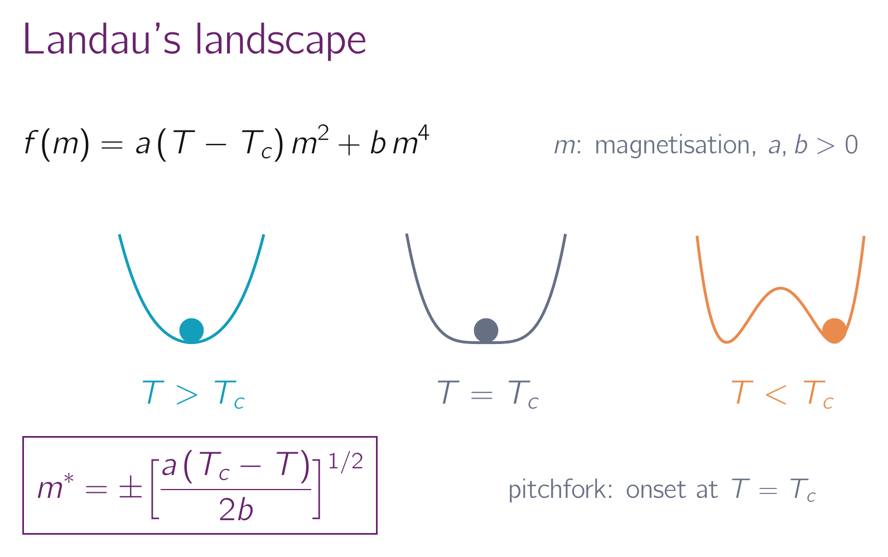

Landau wrote the same approximation as a free energy per site, a landscape in $m$. Near $T_c$, $m$ is small, so expand. Only even powers appear (the symmetry $m \to -m$, as for the ruler):

$$f(m) = a\,(T - T_c)\,m^2 + b\,m^4, \qquad a, b > 0.$$

(For the mean-field Ising model, $a = k_B/2$ and $b \approx k_BT_c/12$.) Above $T_c$ there is one well at $m = 0$; at $T_c$ the bottom is flat; below $T_c$ there are two wells and the system picks one. Minimising gives $m^* = \pm[a(T_c - T)/2b]^{1/2}$: $\beta = 1/2$ again.

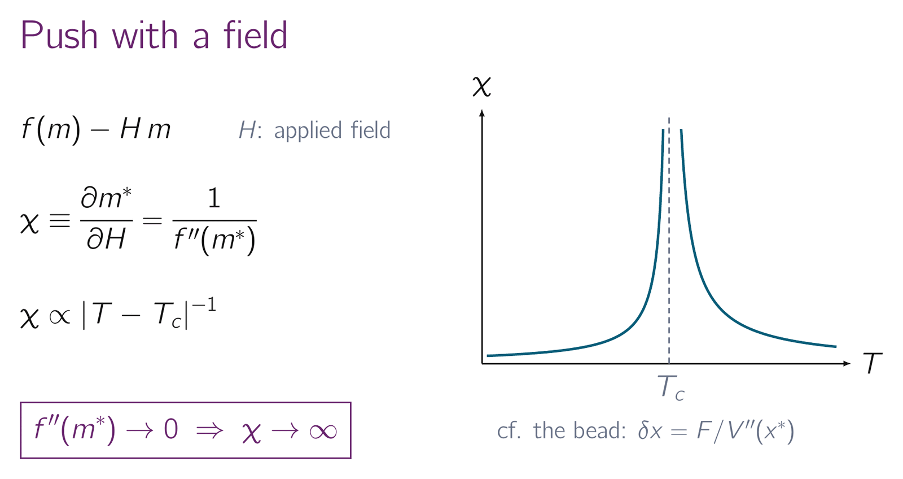

Push with a field: the free energy gains $-Hm$, which tilts the landscape exactly like the push on the bead. The *susceptibility* is the response,

$$\chi = \frac{\partial m^*}{\partial H} = \frac{1}{f''(m^*)} \propto |T - T_c|^{-1}.$$

At $T_c$ the landscape is flat and the response diverges. This is a singularity in a parameter rather than in time, with the same mathematics as $\delta x = F/V''$ for the soft well.

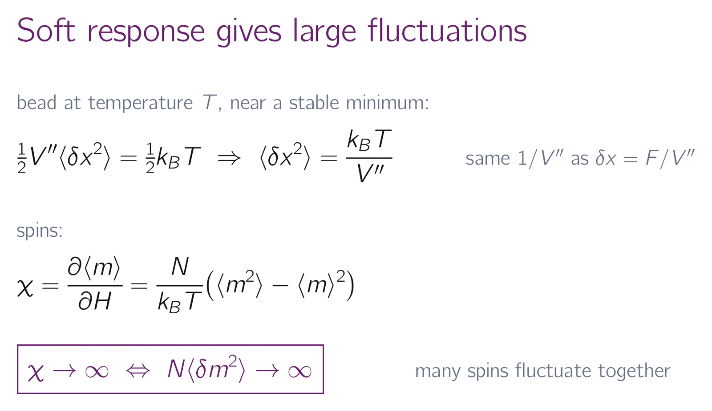

**Soft response gives large fluctuations.** The stiffness that resists a push also limits thermal jiggling. A bead at a stable minimum of $V(x)$, pushed with a force $F$, moves $\delta x = F/V''$. Left in contact with a bath at temperature $T$, it jiggles, and equipartition gives $\tfrac12 V''\langle\delta x^2\rangle = \tfrac12 k_BT$, so

$$\langle\delta x^2\rangle = \frac{k_BT}{V''}.$$

This is exact for a harmonic trap and approximate in a general well, as long as the thermal excursions stay in its quadratic part (a flat quartic well has finite fluctuations even though $V'' = 0$). Both results carry the same $1/V''$: a stiff well hardly moves when pushed and hardly jiggles; a soft well does both a lot. Optical tweezers are calibrated exactly this way: a weaker trap lets a colloidal bead wander further, and the trap stiffness is $k_BT/\langle\delta x^2\rangle$. For the spins the statement is exact (the fluctuation–response relation):

$$\chi = \frac{N}{k_BT}\left(\langle m^2\rangle - \langle m\rangle^2\right).$$

Since $m$ is bounded, what diverges with $\chi$ at $T_c$ is $N\langle\delta m^2\rangle$, roughly the number of spins that fluctuate together: the domains of every size in the pictures. Below $T_c$ the averages must be taken within one selected phase (all states near $+m^*$, say). A finite sample at exactly zero field occasionally flips between $+m^*$ and $-m^*$, and that switching would add a spurious variance of order $m^{*2}$.

### Critical exponents and universality

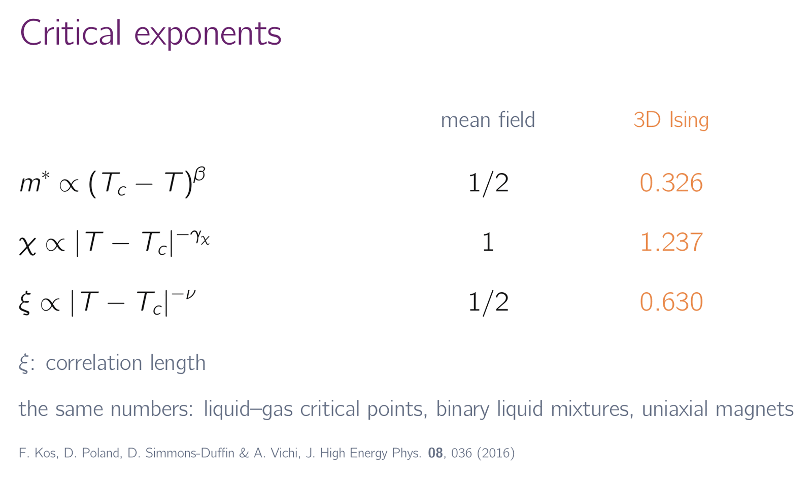

Near $T_c$, $m^* \propto (T_c - T)^\beta$, $\chi \propto |T - T_c|^{-\gamma_\chi}$ and $\xi \propto |T - T_c|^{-\nu}$. Here $\xi$ is the *correlation length*: how far apart two spins can be and still be more likely than chance to point the same way. A spin at distance $r$ from a given spin agrees with it a little more often than expected from the average magnetisation alone, and that excess (the connected correlation $\langle s_0 s_r\rangle - \langle s\rangle^2$) dies away roughly as $e^{-r/\xi}$. In the pictures, $\xi$ is the typical size of the domains: a lattice spacing or two far from $T_c$, growing without bound as $T \to T_c$.

| | $\beta$ | $\gamma_\chi$ | $\nu$ |
|---|---|---|---|
| mean field | $1/2$ | $1$ | $1/2$ |
| 2D Ising (exact) | $1/8$ | $7/4$ | $1$ |
| 3D Ising | $0.326$ | $1.237$ | $0.630$ |

The 3D values come from the conformal bootstrap[^kos2016] and agree with experiments and Monte Carlo simulations.

**Why the numbers differ from mean field.** Mean field lets each spin feel the average of its neighbours as if that average were fixed. That works if the neighbours fluctuate independently, because the average of many independent values is sharp, like a poll of independent voters. Near $T_c$ the neighbours do not fluctuate independently: they move together in patches of size $\xi$, so the field a spin feels is itself fluctuating strongly, like polling people who vote in blocs. These correlated fluctuations break up order (patches of the wrong sign keep appearing), which is why the true $T_c$ is lower than the mean-field value, and they change how $m$, $\chi$ and $\xi$ scale. Dimension sets how badly this fails. In low dimensions a spin has few neighbours and few paths to distant spins, so fluctuations are not averaged away, and 2D departs further from mean field than 3D. Above four dimensions the averaging wins and the mean-field exponents become exact (this is the Ginzburg criterion); the mean-field $T_c$ is never exact.

**Universality.** The exponents do not depend on the material. Liquid–gas critical points, binary liquid mixtures at their consolute point and three-dimensional uniaxial magnets with short-range interactions share the 3D Ising values. Near $T_c$ the lattice does not matter, just as near a stable pinch-off the faucet does not matter.

## 6) Two kinds of singularity

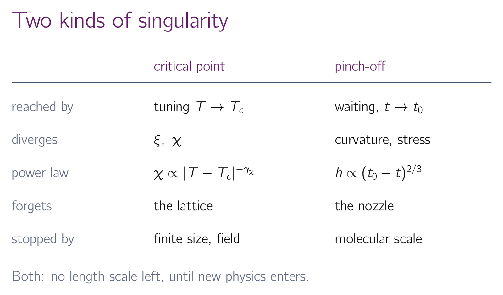

| | critical point | pinch-off |
|---|---|---|
| reached by | tuning, $T \to T_c$ | waiting, $t \to t_0$ |
| diverges | $\xi$, $\chi$ | curvature, stress |
| power law | $\chi \propto \lvert T - T_c\rvert^{-\gamma_\chi}$ | $h \propto (t_0 - t)^{2/3}$ (inertial); $h \propto t_0 - t$ (viscous) |
| forgets | the lattice | the nozzle |
| stopped by | finite size, nonzero field | molecular scale |

The pinch-off column assumes a stable similarity solution; section 4 gave a case where the nozzle is remembered. The common thread: approaching the singularity the system runs out of length scales. That is why power laws appear and details are forgotten. What fails is different. Near $T_c$ the mean-field approximation fails, while a field theory that keeps the fluctuations still works; at pinch-off the continuum description of the neck fails at molecular scales.

One difference is worth stating. A stable pinch-off happens by itself, while a critical point must be tuned. Both can be written as fixed points. For the critical point the rescaling is coarse-graining: replace blocks of spins by their majority and shrink lengths to match. At $T_c$ the picture looks the same after this step, so it is a fixed point of that map, with two genuinely unstable directions ($T - T_c$ and $H$) that the experimenter must set to zero. The stable pinch-off similarity solution has only the trivial ones, when and where.

## 7) Moving contact line: the no-slip paradox and its resolution

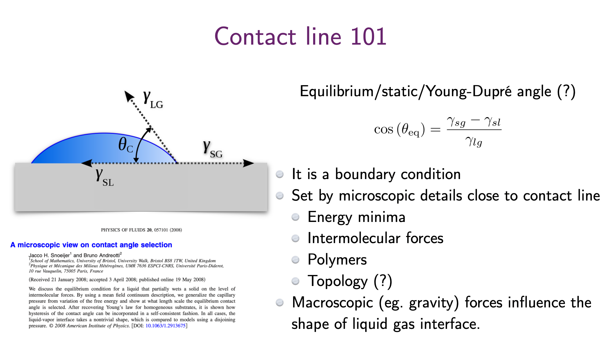

**The contact line singularity.** Consider a liquid spreading on a solid surface – for example, a drop of water advancing across glass plate. The contact line is the edge where solid, liquid, and gas meet. In equilibrium, this line sits still with a well-defined contact angle ([Young–Dupré angle](https://en.wikipedia.org/wiki/Wetting), set by surface tensions and surface chemistry). But what about a moving contact line, when the drop spreads? Classical fluid dynamics has a nasty prediction: if you assume a no-slip boundary condition (fluid at the solid sticks to it, as we learned in [[Lecture-Notes/Intro-Soft-Matter/Viscosity|viscosity]]), a moving contact line would demand the fluid velocity go to zero right at the solid, but far away it's moving — this creates a shearing in fluid all the way down to the molecular scale. The result is an integrable divergence in stress and an infinite energy dissipation rate in the vicinity of the contact line. 

> [!note] Note
> A fluid with no-slip would need infinite force to move a contact line — a nonsensical prediction known as the moving contact line paradox (first pointed out by Huh & Scriven in 1971[^2]).

**What does this singularity look like?** Mathematically, if we integrate the energy dissipation per volume,

$$\varepsilon \sim \eta \, \frac{U^2}{r}$$ 

for a flow speed $U$ at distance $r$ from the contact line, 

$$\int \eta U^2 \frac{dr}{r}$$ 

diverges as $r \to 0$ (and also as $r \to \infty$ if the disturbance extends far).[^degennes1985] Physically, the no-slip condition anchors the fluid at the wall, so any motion of the interface requires ever thinner layers of fluid shearing near the contact line — leading to a blow-up in viscous stresses. The paradox is stark: with no-slip, a contact line cannot move (or requires infinite force to do so). Yet in reality, drops do slide and spread — so what gives?

    <iframe width="560" height="315" src="https://www.youtube-nocookie.com/embed/RGlF4fiSf5g?si=G19Fof3bv36Maq-b" 
        title="YouTube video player" frameborder="0" 
        allow="accelerometer; autoplay; clipboard-write; encrypted-media; gyroscope; picture-in-picture; web-share" 
        referrerpolicy="strict-origin-when-cross-origin" allowfullscreen>
    </iframe>

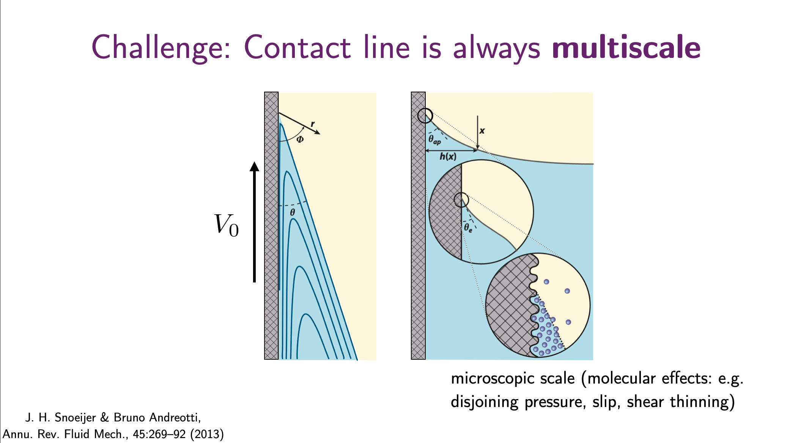

**Regularization by microscopic physics.** The resolution is that no real system has an ideal no-slip all the way down to molecular scales. Something must give at small scales to cut off the singularity. There are two classic ways to regularize (allow finite energy dissipation):

1. **Navier slip**: The fluid is allowed to slip past the solid within a tiny length $\lambda_s$ of the contact line. Essentially, replace no-slip with a boundary condition $u_{\text{fluid}} - u_{\text{solid}} = (\lambda_s/\eta)\,\tau$ relating slip velocity to shear stress (Navier condition), or think of a molecular "slide" at the wall. This slip length $\lambda_s$ might be on the order of nanometers to microns, but it relieves the infinite shear at $r=0$ by not pinning the fluid completely. Viscous dissipation no longer diverges because very close to the contact line the fluid can move.

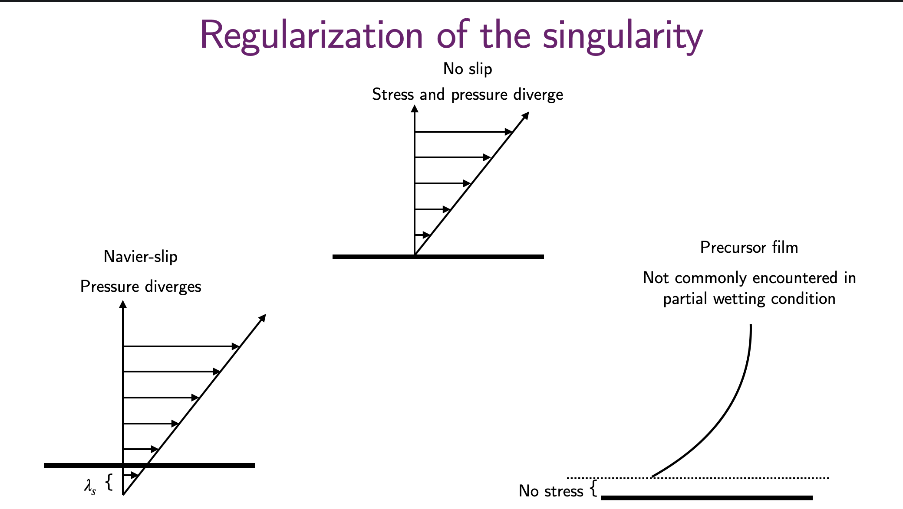

2. **Precursor film (or disjoining pressure)**: Ahead of the apparent contact line, imagine a thin film of liquid (maybe a few molecules thick) that "pre-wets" the solid. Then there is really no contact line at molecular scales — the apparent contact line is just where the film thickness goes from nanometers to macroscopically zero. A disjoining pressure (from van der Waals forces, etc.) in that thin film can allow the contact angle to adjust without a singular wedge of fluid forming.[^precursor-diagram] Essentially, the moving interface rides on a lubricating wetting film, avoiding a sharp three-phase junction.

> [!tip] Other cutoffs
> In some cases, other physics can play a role. For instance, if the liquid is a polymer melt or has some shear-thinning behavior, the effective viscosity near the contact line might drop (reducing dissipation). Or if the liquid evaporates at the contact line, a microvapor layer could ease motion. Bottom line: something must break the continuum + no-slip + sharp interface assumptions at small scale. Soft matter often involves multiple scales, and the contact line singularity is a prime example where molecular-scale details (surface chemistry, slip, etc.) impact a macroscale behavior (spreading).

**Cox–Voinov relation (apparent angle variation).** When the singularity is regularized, we can actually predict how a moving contact line behaves. One famous result is the Cox–Voinov relation: the dynamic contact angle $\theta$ (at a scale visible to the eye) is related to the contact line speed $U$ by 

$$\theta^3 = \theta_{\rm eq}^3 + 9 \, (\eta U/\gamma)\ln(L/\ell_{\text{micro}})$$ 

for a viscous wetting situation (here $\theta_{\rm eq}$ is the equilibrium angle, $\gamma$ is the surface tension coefficient and $\eta$ is the viscosity). Don't worry about the formula details, but note the $\theta^3$ dependence and the logarithm: the contact angle shifts with speed, and it does so slowly (logarithmically with the ratio of a macroscopic length $L$ to the microscopic cutoff $\ell_{\text{micro}}$). This law (derived by combining lubrication theory with either slip or precursor film models) was confirmed by experiments and simulations. It tells us that even though the true angle right at the contact line might always be $0^\circ$ for a perfectly wetting liquid (if we zoom to molecular scale, the interface is almost flat), the apparent macroscopic angle increases with speed — a dynamic effect.

In our lectures, this connects back to [[Lecture-Notes/Intro-Soft-Matter/Viscosity|viscosity]]: the no-slip condition, a cornerstone of continuum viscous flow, fails dramatically at a moving contact line. Soft matter systems often live at the intersection of continuum and molecular physics; here we must invoke molecular length scales to repair continuum theory. As de Gennes famously discussed,[^degennes1985] each decade of length scale contributes equally to the dissipation — so cutting off the last few decades ($\text{nm}$ to $\mu\text{m}$) spares us an infinite sum (but, is it physical?). Snoeijer & Andreotti (2013)[^snoeijer2013] provide a modern review of how different regimes of wetting (viscous, capillary, etc.) navigate this multiscale problem.

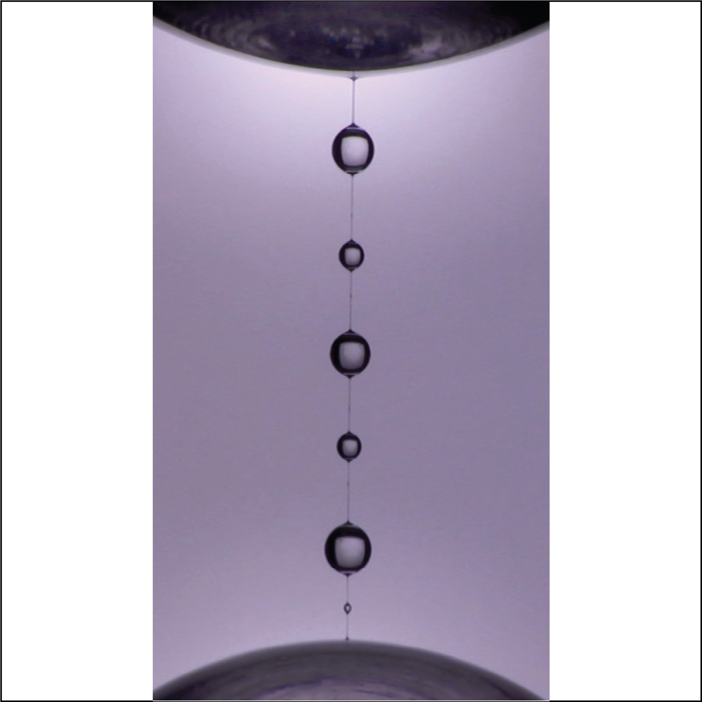
*A "beads-on-a-string" structure forming in a thinning saliva bridge, which is a viscoelastic fluid. Here, polymers in saliva (mucins) resist the capillary-driven singular pinch-off, causing a long thread to persist with droplets (beads) along it.[^saliva-image] In a Newtonian fluid like water, the thinning thread would break more quickly and cleanly. Viscoelasticity thus delays the singularity, spreading it out in time.* <a href="https://commons.wikimedia.org/wiki/File:Saliva_Thread.jpg">Bavand Keshavarz</a>, <a href="https://creativecommons.org/licenses/by/4.0">CC BY 4.0</a>, via Wikimedia Commons

**Multiscale challenge and research frontiers.** The moving contact line remains an area of active research. In partial wetting cases (nonzero equilibrium angle), one avoids true divergences in pressure (the contact line can equilibrate by forming a small precursor foot of wetting). However, when driven far from equilibrium (very fast wetting or dewetting), one can observe phenomena like contact line hysteresis (the line sticks until a threshold force is exceeded) and complex interface shapes. Modern studies, such as viscoelastic wetting,[^kansal2024] ask how polymer stresses or other rheology modify the Cox–Voinov relation — for instance, normal stresses in a non-Newtonian fluid can effectively change the microscopic contact angle and hence the spreading speed.[^kansal2024] The take-home message is that by introducing a microscopic length or physics, we remove the singularity and get finite, measurable behaviors — but we also open up a richer parameter space to explore (e.g. slip length values, disjoining pressure isotherms, polymer relaxation times, etc.). Soft matter scientists turn this "bug" into a feature: by measuring how a contact line's dynamics deviate, we infer what's happening at the nano-scale. In Week 5's lab, for example, you will examine how adding a bit of polymer to a liquid (increasing its extensional viscosity) changes the shape of a spreading drop's rim — a direct visual of singularity regularization in action.

## Summary

1. **Singularities define extreme events**: Soft matter systems can develop finite-time singularities where a normally smooth evolution leads to blow-up (e.g. droplet pinch-off, cavity collapse, moving contact line paradox). These events often dominate the material's behavior (creating new surfaces, concentrating energy) and require special consideration beyond the standard theory.

2. **The simplest blow-up**: with $u_0 > 0$, $du/dt = u^2$ reaches infinity at the finite time $t_c = 1/u_0$ because its growth rate grows with the quantity itself. When inertia balances surface tension, the capillary rate of a pinching neck obeys the same quadratic growth law, up to a constant prefactor, which gives $h \propto (t_0 - t)^{2/3}$. When viscosity balances surface tension instead, the neck thins linearly, $h \propto t_0 - t$. The Rayleigh–Plateau instability starts the process; this self-accelerating stage ends it.

3. **Self-similar means steady in rescaled variables**: dividing out the shrinking scales and using logarithmic time turns a similarity solution into a fixed point. Its stability decides universality: if the fixed point is stable the initial conditions are forgotten; if it is unstable (as for a low-viscosity drop in a viscous liquid) keeps a memory of the nozzle.

4. **Drop pinch-off is a universal breakup process**: A thinning fluid neck will often follow self-similar dynamics, with the shape and scaling of the neck independent of initial conditions.[^eggers1997] Depending on whether inertia or viscosity dominates, the thinning follows different power laws, but either way surface tension drives the process toward a singular breakup (radius $\to$ 0 in finite time). Pinch-off produces high curvature (hence high pressure), emits satellite droplets, and in some cases generates rapid jets.

5. **Bubble pinch-off and jets**: When air cavities pinch off in liquids, the collapse can focus energy into a fast Worthington jet. This illustrates how singularities can transfer energy across scales (from a large collapsing bubble to a tiny high-speed jet). Such jets and the pressures involved are important in phenomena like cavitation damage.

6. **Singularities in a parameter**: at a critical point nothing happens in finite time; instead the susceptibility $\chi$ and the correlation length $\xi$ diverge as the temperature is tuned to $T_c$. The Ising model is the cleanest example and also describes the liquid–gas critical point and demixing binary mixtures. Mean field reproduces the pitchfork of the instabilities lecture but gets $T_c$ and the exponents wrong, because near $T_c$ the fluctuations are correlated over the distance $\xi$.

7. **Two kinds, one structure**: a pinch-off is reached by waiting and a critical point by tuning, but both are power laws in the distance to the singular point, both forget microscopic details, and both are cut off by physics outside the model.

8. **Moving contact line paradox**: A fluid with a no-slip boundary cannot advance a contact line without infinite force — a classic singularity in hydrodynamics.[^degennes1985] This paradox highlights the breakdown of continuum assumptions at small scales. In reality, physics like slip at the wall or a precursor wetting film regularize the singularity, allowing finite energy dissipation and contact line motion.

9. **Role of microscopic length scales**: The cure to a singularity often lies in acknowledging a small length scale. For moving contact lines, a slip length or molecular film provides a cutoff, yielding laws like the Cox–Voinov relation for dynamic contact angles. The lesson generalizes: whenever you see a mathematical singularity, look for a missing small-scale physics (be it molecular slip, a finite polymer chain length, atomic grain size in a solid, etc.).

10. **Universal insights and design**: Studying singularities gives us universal scaling laws – e.g. how a neck radius shrinks or how a contact angle depends on speed. Engineers and scientists use these laws to predict outcomes (the size of satellite drops, the maximum recoil velocity of a jet, the critical speed before a drop starts entraining air, etc.). By harnessing singular behavior (or sometimes avoiding it), we can design better inkjet printers (controlled pinch-off), improve emulsification processes, or mitigate harmful cavitation in pumps.

## Key References for Further Reading

1. **J. Eggers**, Nonlinear dynamics and breakup of free-surface flows, Rev. Mod. Phys., 69, 865 (1997). – Comprehensive review of fluid pinch-off and singular jet dynamics. A bit advanced, but the go-to reference on drop breakup universality. [10.1103/RevModPhys.69.865](https://doi.org/10.1103/RevModPhys.69.865).

2. **J. Eggers & E. Villermaux**, Physics of liquid jets, Rep. Prog. Phys., 71, 036601 (2008). – Modern overview of liquid jet formation and breakup (how instabilities grow and lead to pinch-off, satellite drops, etc.). [DOI: 10.1088/0034-4885/71/3/036601](http://dx.doi.org/10.1088/0034-4885/71/3/036601).

3. **P. G. de Gennes**, Wetting: statics and dynamics, Rev. Mod. Phys., 57, 827-863 (1985). – A classic paper discussing the wetting process and the moving contact line dissipation paradox. Introduces the idea of a dissipation integral that diverges and the need for cutoffs. DOI: [10.1103/RevModPhys.57.827](https://doi.org/10.1103/RevModPhys.57.827).

4. **J. H. Snoeijer & B. Andreotti**, Moving Contact Lines: Scales, Regimes, and Dynamical Transitions, Annu. Rev. Fluid Mech., 45, 269-292 (2013). – An accessible review focused entirely on the moving contact line problem. Discusses slip vs precursor film models, the Cox–Voinov law, and various wetting regimes. DOI: [10.1146/annurev-fluid-011212-140734](https://doi.org/10.1146/annurev-fluid-011212-140734).

5. **M. Kansal, C. Datt, V. Bertin & J. H. Snoeijer**, Viscoelastic wetting: Cox–Voinov theory with normal stress effects, J. Fluid Mech., 985, A17 (2024). – A recent research paper extending contact line theory to polymeric (viscoelastic) liquids. Shows how adding elasticity modifies the classic wetting laws (for those curious about current research frontiers). DOI: [10.1017/jfm.2024.296](https://doi.org/10.1017/jfm.2024.296).

6. **J. Eggers & M. A. Fontelos**, *Singularities: Formation, Structure, and Propagation* (Cambridge University Press, 2015). – The book behind the blow-up ODE, similarity solutions as fixed points and the classification of singularities. [DOI: 10.1017/CBO9781316161692](https://doi.org/10.1017/CBO9781316161692).

7. **J. M. Yeomans**, *Statistical Mechanics of Phase Transitions* (Oxford University Press, 1992). – A short, readable introduction to the Ising model, mean-field theory, critical exponents and universality.

[^eggers1997]: J. Eggers, Nonlinear dynamics and breakup of free-surface flows, Rev. Mod. Phys., 69, 865 (1997). DOI: [10.1103/RevModPhys.69.865](https://doi.org/10.1103/RevModPhys.69.865).

[^dripping-image]: Image source: [Wikimedia Commons - Dripping faucet](https://commons.wikimedia.org/wiki/File:Dripping_faucet_1.jpg).

[^degennes1985]: P. G. de Gennes, Wetting: statics and dynamics, Rev. Mod. Phys., 57, 827-863 (1985). DOI: [10.1103/RevModPhys.57.827](https://doi.org/10.1103/RevModPhys.57.827).

[^precursor-diagram]: Schematic diagram from [ResearchGate](https://www.researchgate.net/figure/Schematics-of-the-contact-line-moving-models-considering-a-nonslip-condition-b-slip_fig3_385188951).

[^snoeijer2013]: J. H. Snoeijer & B. Andreotti, Moving Contact Lines: Scales, Regimes, and Dynamical Transitions, Annu. Rev. Fluid Mech., 45, 269-292 (2013). DOI: [10.1146/annurev-fluid-011212-140734](https://doi.org/10.1146/annurev-fluid-011212-140734).

[^saliva-image]: Image source: [Wikimedia Commons - Saliva Thread](https://commons.wikimedia.org/wiki/File:Saliva_Thread.jpg).

[^kansal2024]: M. Kansal, C. Datt, V. Bertin & J. H. Snoeijer, Viscoelastic wetting: Cox–Voinov theory with normal stress effects, J. Fluid Mech., 985, A17 (2024). DOI: [10.1017/jfm.2024.296](https://doi.org/10.1017/jfm.2024.296).

[^1]: M. Tjahjadi, H. A. Stone & J. M. Ottino, Satellite and subsatellite formation in capillary breakup, J. Fluid Mech., 243, 297-317 (1992). DOI: [10.1017/S0022112092002738](https://doi.org/10.1017/S0022112092002738).

[^2]: C. Huh & L. E. Scriven, Hydrodynamic model of steady movement of a solid/liquid/fluid contact line, J. Colloid Interface Sci., 35:1, 85-101 (1971). DOI: [10.1016/0021-9797(71)90188-3](https://doi.org/10.1016/0021-9797(71)90188-3).

[^ef2015]: J. Eggers & M. A. Fontelos, *Singularities: Formation, Structure, and Propagation*, Cambridge University Press (2015). DOI: [10.1017/CBO9781316161692](https://doi.org/10.1017/CBO9781316161692).

[^dhl1998]: R. F. Day, E. J. Hinch & J. R. Lister, Self-similar capillary pinchoff of an inviscid fluid, Phys. Rev. Lett., 80, 704 (1998). DOI: [10.1103/PhysRevLett.80.704](https://doi.org/10.1103/PhysRevLett.80.704).

[^deblais2018]: A. Deblais, M. A. Herrada, I. Hauner, K. P. Velikov, T. van Roon, H. Kellay, J. Eggers & D. Bonn, Viscous effects on inertial drop formation, Phys. Rev. Lett., 121, 254501 (2018). DOI: [10.1103/PhysRevLett.121.254501](https://doi.org/10.1103/PhysRevLett.121.254501).

[^papageorgiou1995]: D. T. Papageorgiou, On the breakup of viscous liquid threads, Phys. Fluids, 7, 1529 (1995). DOI: [10.1063/1.868540](https://doi.org/10.1063/1.868540).

[^eggers1993]: J. Eggers, Universal pinching of 3D axisymmetric free-surface flow, Phys. Rev. Lett., 71, 3458 (1993). DOI: [10.1103/PhysRevLett.71.3458](https://doi.org/10.1103/PhysRevLett.71.3458).

[^doshi2003]: P. Doshi, I. Cohen, W. W. Zhang, M. Siegel, P. Howell, O. A. Basaran & S. R. Nagel, Persistence of memory in drop breakup: the breakdown of universality, Science, 302, 1185 (2003). DOI: [10.1126/science.1089272](https://doi.org/10.1126/science.1089272).

[^onsager1944]: L. Onsager, Crystal statistics. I. A two-dimensional model with an order-disorder transition, Phys. Rev., 65, 117 (1944). DOI: [10.1103/PhysRev.65.117](https://doi.org/10.1103/PhysRev.65.117).

[^yang1952]: C. N. Yang, The spontaneous magnetization of a two-dimensional Ising model, Phys. Rev., 85, 808 (1952). DOI: [10.1103/PhysRev.85.808](https://doi.org/10.1103/PhysRev.85.808).

[^kos2016]: F. Kos, D. Poland, D. Simmons-Duffin & A. Vichi, Precision islands in the Ising and O(N) models, J. High Energy Phys., 08, 036 (2016). DOI: [10.1007/JHEP08(2016)036](https://doi.org/10.1007/JHEP08(2016)036).

---

> [!significance]- Metadata
> Author:: [Vatsal Sanjay](https://vatsalsanjay.com) 

> [!link] Back to main website
> [Home](https://comphy-lab.org/), [Team](https://comphy-lab.org/team), [Research](https://comphy-lab.org/research), [Github](https://github.com/comphy-lab)
>
> 📝 [Edit this page on GitHub](https://github.com/comphy-lab/CoMPhy-Lab-Blogs/blob/main/Lecture-Notes/Intro-Soft-Matter/Singularities.md)
