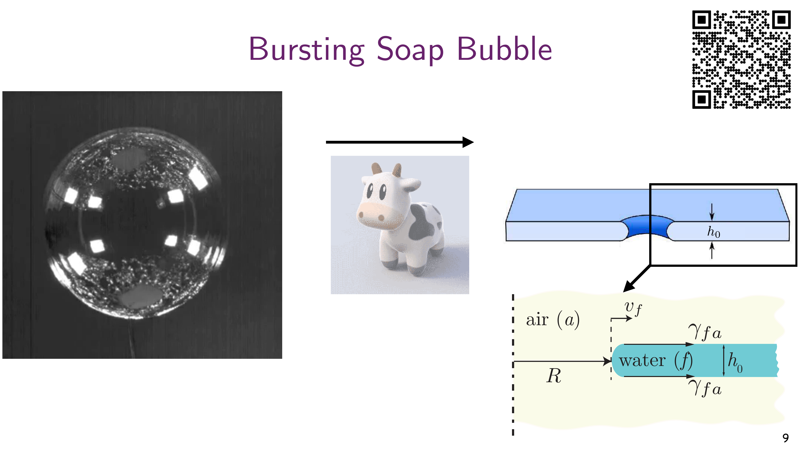
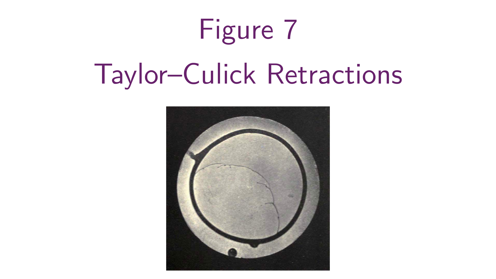
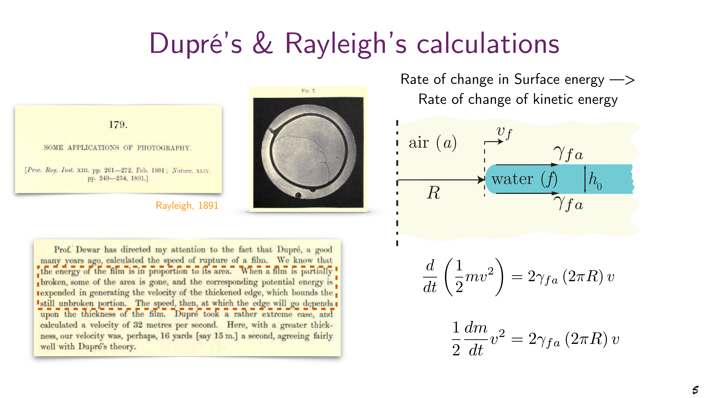
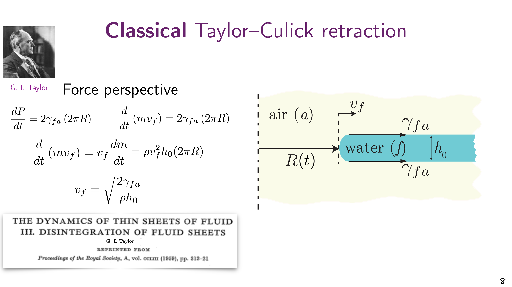
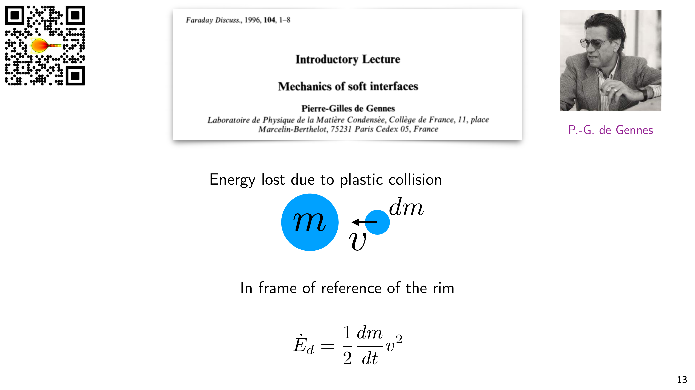
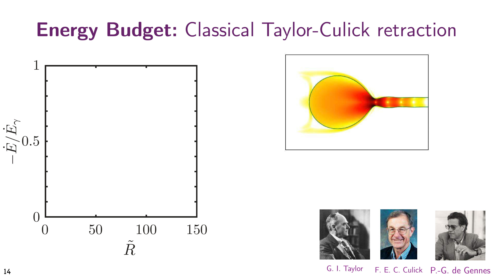
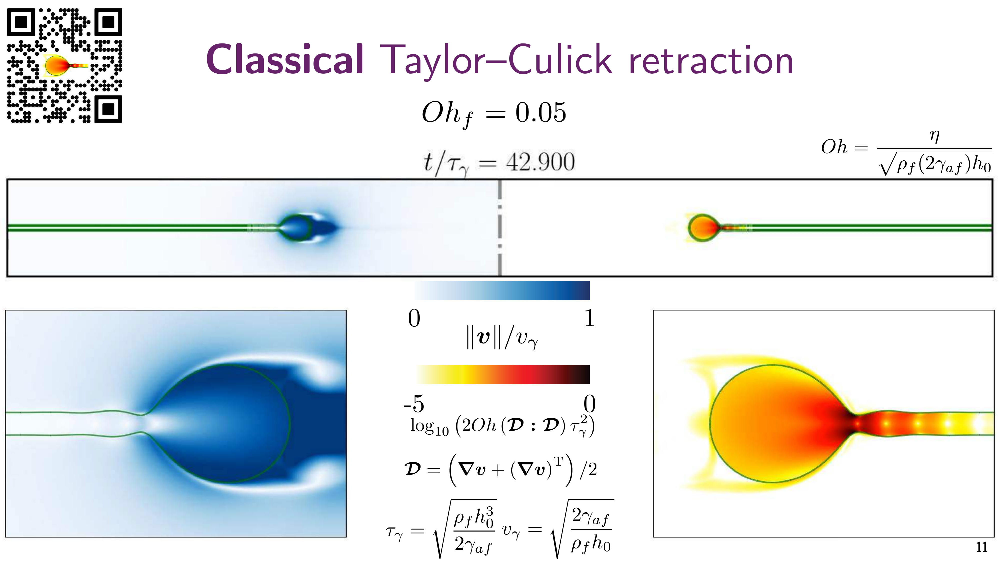
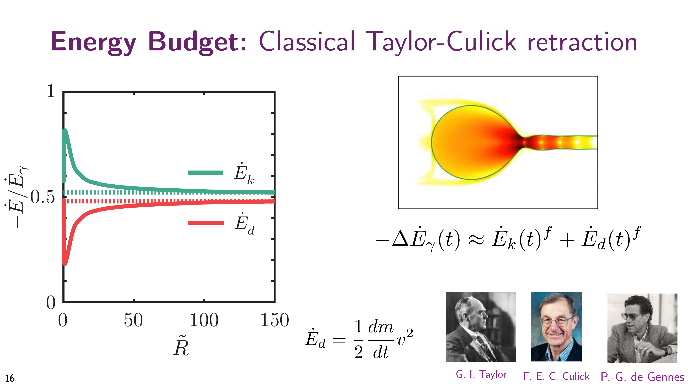
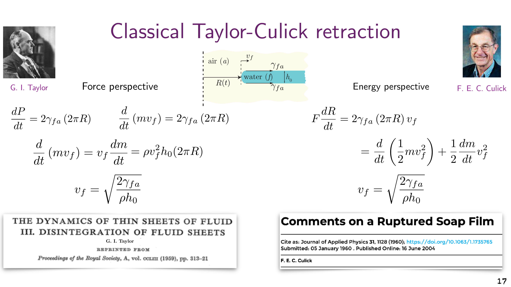
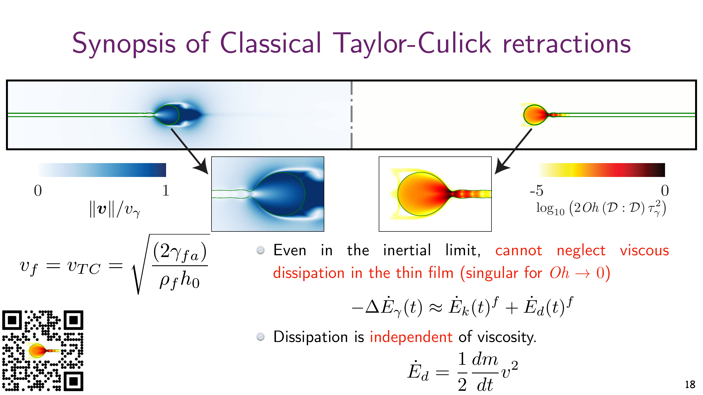

---
tags:
  - lecture
  - soft-matter
  - taylor-culick
  - conservation-laws
  - paradox-resolution
  - fluid-dynamics
status: done ✅
publish: true
---

# The Taylor–Culick Paradox

<!-- BLOG-PDF-LINK-START -->
<!-- PDF-EXPORT-IGNORE-START -->
> [!pdf] PDF version
> [[_Media/PDF/Lecture-Notes/Intro-Soft-Matter/Taylor-Culick-Paradox.pdf|Download this page as PDF]]
<!-- PDF-EXPORT-IGNORE-END -->
<!-- BLOG-PDF-LINK-END -->

Resolving the Dupré–Rayleigh paradox through momentum conservation and complete energy accounting, following on from [[Lecture-Notes/Intro-Soft-Matter/Faces-of-Soft-Matter|Faces of Soft Matter]].

---

## Introduction: The Unresolved Paradox

In the introduction, we encountered a puzzle: when a soap film is punctured, the hole expands rapidly as the film retracts away from the puncture. Yet two seemingly sound arguments gave different predictions for the retraction speed:

$$\text{Dupré–Rayleigh (naïve lossless-energy estimate):} \quad v = \sqrt{\frac{4\gamma_{fa}}{\rho h_0}} \quad \text{(too fast)}$$

$$\text{Taylor–Culick (momentum balance):} \quad v = \sqrt{\frac{2\gamma_{fa}}{\rho h_0}} \quad \text{(agrees with experiment)}$$

Question: If momentum conservation gives the right answer, why did energy conservation fail? Where did the missing energy go?

This lecture resolves the paradox. The resolution was already given by F. E. C. Culick in 1960: the film is set into motion by an inelastic process, and the mechanical energy lost in it is dissipated by viscosity.

---

## Historical Context: A Long-Standing Mystery

### Rayleigh's Pioneering Work (1891)

John William Strutt, 3rd Baron Rayleigh, used instantaneous photography to capture the dynamics of liquid jets and interfaces. In his 1891 paper, he photographed breaking jets and reported Dupré's energy-balance argument for the speed of film retraction:

> Rate of surface energy decrease = Rate of kinetic energy increase

Mathematically:
$$\frac{d}{dt}\left(\frac{1}{2}mv^2\right) = 2\gamma_{fa}(2\pi R) v$$

This yielded:
$$v_{\text{Dupré–Rayleigh}} = \sqrt{\frac{4\gamma_{fa}}{\rho h_0}}$$

### A Curious Anomaly

Despite its clean derivation, this naïve lossless-energy estimate is a factor of $\sqrt{2}$ faster than the momentum-balance speed derived by Taylor (1959) and Culick (1960), which matches the speed measured in bursting films.

---

## The Three Perspectives: Energy, Momentum, and Dissipation

### 1. The Naïve Lossless-Energy Estimate (Dupré & Rayleigh, 1891)

The energy balance assumes that all surface energy released goes into kinetic energy of the rim, i.e. that no mechanical energy is lost. We keep this estimate deliberately: its failure is the point of the paradox.

Setup: a circular hole of radius $R(t)$ opens in a flat film of thickness $h_0$, density $\rho$ and surface tension $\gamma_{fa}$ on each of its two faces. The hole grows at speed $v_f = dR/dt > 0$, and the film material it sweeps up collects in a rim at its edge. Let $R_i$ be the initial radius of the hole.

Surface energy released: two faces of area $\pi(R^2 - R_i^2)$ have disappeared, so, neglecting the surface area of the rim itself,
$$E_{\text{released}} = 2\pi\gamma_{fa}\left(R^2 - R_i^2\right), \qquad \dot{E}_{\text{released}} = 2\gamma_{fa} \cdot 2\pi R \cdot v_f$$

Mass collected in the rim:
$$m = \rho\pi h_0\left(R^2 - R_i^2\right), \qquad \frac{dm}{dt} = \rho \cdot (2\pi R) \cdot h_0 \cdot v_f$$

At constant speed the rim's kinetic energy grows only because its mass grows:
$$\dot{E}_k = \frac{d}{dt}\left(\frac{1}{2}m v_f^2\right) = \frac{1}{2}\frac{dm}{dt}v_f^2$$

If all the released surface energy became kinetic energy of the rim:
$$\frac{1}{2}\rho (2\pi R h_0) v_f^2 \cdot v_f = 4\pi \gamma_{fa} R v_f$$

$$v_f^2 = \frac{4\gamma_{fa}}{\rho h_0}$$

$$\boxed{v_f = \sqrt{\frac{4\gamma_{fa}}{\rho h_0}}} \quad \text{(naïve lossless-energy estimate)}$$

---

### 2. The Momentum Perspective (G. I. Taylor, 1959)

G. I. Taylor (1886–1975) approached the problem through momentum conservation rather than energy.

Newton's second law: Force = Rate of momentum change

Because the hole is circular, the net vector force on the entire rim vanishes by symmetry; we apply the radial momentum balance to a small angular sector $d\theta$ and sum around the perimeter ($2\pi$):

Forces on the film:
- Surface tension pulls radially outwards at both interfaces along the perimeter
- Total radial force summed around the rim: $F = 2\gamma_{fa}(2\pi R)$

Rate of radial momentum change:
The material collected in the rim moves radially outwards at speed $v_f$, carrying summed radial momentum $p = m v_f$:

$$\frac{dp}{dt} = 2\gamma_{fa}(2\pi R)$$

For initially stationary film material captured by the rim:
$$\frac{d}{dt}(mv_f) = 2\gamma_{fa}(2\pi R)$$

This gives:
$$v_f \frac{dm}{dt} + m\frac{dv_f}{dt} = 2\gamma_{fa}(2\pi R)$$

Assuming steady state ($\frac{dv_f}{dt} = 0$) and $\frac{dm}{dt} = \rho (2\pi R) h_0 v_f$:

$$v_f \cdot \rho (2\pi R) h_0 v_f = 2\gamma_{fa}(2\pi R)$$

$$\rho h_0 v_f^2 = 2\gamma_{fa}$$

$$\boxed{v_f = \sqrt{\frac{2\gamma_{fa}}{\rho h_0}}} \quad \text{(Taylor–Culick prediction)}$$

Taylor's prediction agrees with experiment, showing that the lossless energy balance misses an energy sink.

---

### 3. The Missing Link: Inelastic Capture (Culick, 1960)

F. E. C. Culick identified the missing piece in 1960, in a short comment on measurements of bursting soap films: the undisturbed film is accelerated *inelastically* up to the speed of the edge, and the mechanical energy lost in this process is dissipated by viscosity. Pierre-Gilles de Gennes (Nobel Prize 1991) later revisited bursting films in his 1996 *Faraday Discussions* introductory lecture on the mechanics of soft interfaces.

> [!important] The Key Insight
>
> The film material does not enter the retracting rim reversibly. Each element of stationary film is accelerated abruptly to the rim speed in an inelastic collision, dissipating mechanical energy as heat.

### Energy Budget with Dissipation

When the soap film retracts, material at the film edge joins the rim inelastically:

- Before capture: the film ahead of the rim is at rest
- After capture: it moves with the rim at $v_f$
- Energy dissipated: each mass element is accelerated from $0$ to $v_f$ in a perfectly inelastic collision

The energy dissipation rate from the inelastic collision is:

$$\dot{E}_{\text{dissipated}} = \frac{1}{2}\frac{dm}{dt}v_f^2$$

In the rim's frame the film arrives at $v_f$ and stops, losing $\frac{1}{2}v_f^2$ per unit mass. Half the surface energy released is dissipated this way; the other half goes into the rim's kinetic energy.

---

## Complete Energy Balance

Accounting for both kinetic energy and dissipation:

Energy released by surface tension:
$$\dot{E}_{\text{released}} = 2\gamma_{fa} \cdot 2\pi R \cdot v_f = 4\pi \gamma_{fa} R v_f$$

Energy dissipated (inelastic collision):
$$\dot{E}_{\text{dissipated}} = \frac{1}{2}\frac{dm}{dt}v_f^2 = \frac{1}{2}\rho (2\pi R h_0) v_f \cdot v_f^2 = \pi \rho R h_0 v_f^3$$

Energy conservation (with dissipation):
$$\dot{E}_{\text{released}} = \dot{E}_{\text{dissipated}} + \dot{E}_{\text{kinetic}}$$

$$4\pi \gamma_{fa} R v_f = 2\pi \rho R h_0 v_f^3$$

$$2\gamma_{fa} = \rho h_0 v_f^2$$

$$\boxed{v_f = \sqrt{\frac{2\gamma_{fa}}{\rho h_0}}} \quad \text{(Corrected energy prediction!)}$$

---

## Resolving the Apparent Contradiction

The resolution lies in the difference between momentum conservation and mechanical energy conservation:

### Why Momentum Conservation Works

Momentum balance applies directly regardless of internal dissipation:

$$\text{Force} = \frac{dp}{dt}$$

This holds whether the capture is elastic or inelastic. The surface tension force acts along the perimeter, fixing the rate of momentum gain:

$$v_f = \sqrt{\frac{2\gamma_{fa}}{\rho h_0}} \quad \checkmark$$

### Why the Original Energy Balance Failed

The Dupré–Rayleigh estimate assumed that all released surface energy becomes kinetic energy of the rim:

$$2\gamma_{fa} \cdot 2\pi R \cdot v_f = \frac{d}{dt}\left[\frac{1}{2}m v_f^2\right]$$

This omitted viscous dissipation as stationary film is swept into the moving rim. The complete energy balance is:

$$2\gamma_{fa} \cdot 2\pi R \cdot v_f = \frac{d}{dt}\left[\frac{1}{2}m v_f^2\right] + \dot{E}_{\text{dissipation}}$$

The "missing" energy, $\dot{E}_{\text{dissipation}} = \frac{1}{2}\frac{dm}{dt}v_f^2$, is lost where the stationary film is swept into the moving rim, and viscous stresses turn it into heat. Its rate is fixed by the momentum balance, not by the value of the viscosity: a less viscous film dissipates the same power in a smaller region.

---

## The Ohnesorge Number and Flow Regimes

The dynamics of film retraction depend on the balance between surface tension (driving the flow) and viscosity (resisting it).

Ohnesorge number:
$$Oh = \frac{\eta}{\sqrt{\rho \gamma_{fa} h_0}}$$

where $\eta$ is the dynamic viscosity.

- Low $Oh$ regime: a compact rim forms and reaches the Taylor–Culick speed soon after rupture
- High $Oh$ regime: viscous stresses spread the retraction over a long, gradually thickening region of the film instead of a compact rim, and the edge takes longer to reach its final speed

In both regimes, an isolated flat film with negligible resistance from the surrounding air eventually retracts at the Taylor–Culick speed $v_f = \sqrt{2\gamma_{fa}/(\rho h_0)}$: viscosity changes the transient, not the final speed (Savva & Bush, 2009). The final speed can differ only if something else enters the force balance, such as drag from a viscous surrounding medium or elastic stresses in the film. A high Ohnesorge number means a viscous film, not a viscoelastic one; elastic films are discussed in [[Lecture-Notes/Intro-Soft-Matter/Sheets-Bubbles-Drops|sheets, bubbles and drops]].

---

## Experimental Validation and Simulations

High-speed imaging and numerical simulations confirm this resolution:

Key observations:
- Bursting films retract at speeds very close to Taylor's prediction
- The velocity field accelerates sharply from rest to $v_f$ across the neck joining film to rim
- Dissipation concentrates near the retracting edge (the rim region)
- At high $Oh$, viscous stresses spread the deformation along the film instead of concentrating it in a compact rim (a viscous effect; viscoelasticity requires an elastic, for example polymeric, liquid)

Simulations show that the velocity profile is non-uniform, with steep gradients and localized viscous dissipation where the film enters the rim.

---

## Historical Timeline and Key References

| Year | Contributor | Contribution |
|------|---|---|
| 1891 | Rayleigh | Photographs bursting films; reports Dupré's energy-balance estimate |
| 1959 | G. I. Taylor | Momentum-balance approach; predicts $v_f = \sqrt{2\gamma_{fa}/(\rho h_0)}$ |
| 1960 | F. E. C. Culick | Same speed for bursting soap films; identifies the inelastic acceleration of the film and the resulting loss of mechanical energy to viscous dissipation |
| 1996 | P.-G. de Gennes | Revisits bursting films in a lecture on the mechanics of soft interfaces |
| 2009 | N. Savva & J. W. M. Bush | Viscous films reach the Taylor–Culick speed after a viscosity-dependent transient |

> [!note] On the importance of this problem
> The Taylor–Culick paradox illustrates a general principle: momentum conservation holds regardless of internal dissipation, whereas an energy balance fails unless every dissipative sink is included.

---

## Key Takeaways

1. Momentum conservation is insensitive to internal dissipation. The Taylor–Culick speed $v_f = \sqrt{2\gamma_{fa}/(\rho h_0)}$ follows directly from force balance and does not depend on the microscopic mechanism of energy loss.

2. Energy dissipation is not negligible. The naïve energy-balance approach fails because accelerating stationary film into the rim is inelastic, dissipating half of the released surface energy.

3. Complementary conservation laws. Momentum and energy balances apply to the same dynamic process, but momentum fixes the speed directly while mechanical energy requires accounting for every sink.

4. Viscosity sets the transient, not the final speed. At low $Oh$ a compact rim forms quickly; at high $Oh$ viscous stresses spread the retraction along the film and the edge takes longer to accelerate. An isolated film eventually retracts at the Taylor–Culick speed in both cases. Viscosity is not viscoelasticity: elastic films are a separate problem (see the notes on sheets, bubbles and drops).

5. Paradoxes resolve through careful accounting. Apparent contradictions between conservation laws usually signal an omitted sink or source of energy or momentum.

---

## Further Reading

### Primary Literature
- G. I. Taylor, *Proc. R. Soc. A*, 253, 313–321 (1959) — Classic momentum-balance derivation
- F. E. C. Culick, Comments on a ruptured soap film, *J. Appl. Phys.*, 31, 1128–1129 (1960) — Momentum balance, inelastic acceleration of the film and the lost mechanical energy
- P.-G. de Gennes, Introductory lecture: Mechanics of soft interfaces, *Faraday Discuss.*, 104, 1–8 (1996) — Includes the bursting of liquid films
- N. Savva & J. W. M. Bush, Viscous sheet retraction, *J. Fluid Mech.*, 626, 211–240 (2009) — Viscous films reach the Taylor–Culick speed after a viscosity-dependent transient

### Supplementary Materials
- [Dupré–Rayleigh paradox (PDF)](Lecture-Notes/Intro-Soft-Matter/2025/Dupre-Rayleigh-paradox.pdf) — Comprehensive reference document on the paradox resolution

---

## Connection to viscosity and conservation laws

The Taylor–Culick paradox sets up the continuum conservation laws developed in the notes on viscosity and conservation laws:

- Conservation of momentum → Euler and Navier–Stokes equations
- Conservation of energy → thermodynamics and viscous dissipation
- Continuum mechanics → coarse-grained descriptions of soft matter

Seeing why momentum balance succeeds when a lossless mechanical-energy balance fails prepares us for viscous and viscoelastic flows later in the course.

---

## Homework (Self-Assessed)

> [!check] Reflection Questions
>
> Q1. In the naïve lossless-energy estimate, why does neglecting dissipation lead to a speed that's $\sqrt{2}$ times faster than the Taylor–Culick speed?
>
> Q2. Explain in words why momentum conservation "just works" even though energy dissipation is important. Why is momentum balance insensitive to the details of how energy is dissipated?
>
> Q3. Consider a highly viscous film (large $\eta$, large Ohnesorge number). How does viscosity change the early retraction, and does it change the speed that an isolated flat film eventually reaches? Explain your reasoning using the momentum balance and scaling arguments.
>
> Q4. Design a thought experiment or simple calculation to estimate the fraction of released surface energy that goes into:
>    - (a) Kinetic energy of the rim
>    - (b) Dissipation (heating, deformation)

---

    <iframe width="560" height="315" src="https://www.youtube-nocookie.com/embed/qnZwoLPgHAc?si=kbBvcmcTmVhpWRn6" 
        title="YouTube video player" frameborder="0" 
        allow="accelerometer; autoplay; clipboard-write; encrypted-media; gyroscope; picture-in-picture; web-share" 
        referrerpolicy="strict-origin-when-cross-origin" allowfullscreen>
    </iframe>

---

> [!significance]- Metadata
> Author:: [Vatsal Sanjay](https://vatsalsanjay.com) 

> [!link] Back to main website
> [Home](https://comphy-lab.org/), [Team](https://comphy-lab.org/team), [Research](https://comphy-lab.org/research), [Github](https://github.com/comphy-lab)
>
> 📝 [Edit this page on GitHub](https://github.com/comphy-lab/CoMPhy-Lab-Blogs/blob/main/Lecture-Notes/Intro-Soft-Matter/Taylor-Culick-Paradox.md)

