---
tags:
  - lecture
  - soft-matter
  - viscoelasticity
  - rheology
  - material-behavior
status: done ✅
publish: true
---

# Elastic, Viscous and Viscoelastic Behaviour

<!-- BLOG-PDF-LINK-START -->
<!-- PDF-EXPORT-IGNORE-START -->
> [!pdf] PDF version
> [[_Media/PDF/Lecture-Notes/Intro-Soft-Matter/Viscoelasticity.pdf|Download this page as PDF]]
<!-- PDF-EXPORT-IGNORE-END -->
<!-- BLOG-PDF-LINK-END -->

> [!tldr] TL;DR
> A flexible polymer chain acts as an entropic spring that stiffens with temperature. Coarse-graining dumbbells in a Newtonian solvent gives Oldroyd-B: solvent viscosity plus polymer stress that grows as flow stretches the chains and relaxes over time $\lambda$. Fast relaxation gives a Newtonian liquid; no relaxation at fixed modulus gives a neo-Hookean (or Kelvin–Voigt) solid. Strong extension unravels chains and makes steady extensional viscosity diverge, while a thinning thread spans pinch-off, exponential thinning, and arrest. Impacting spheres cross from Wagner to Hertz scaling. Punctured elastic sheets arrest by logarithmic hoop tension at a radius exponential in $1/Ec$ to leading order as $Ec \to 0^+$; relaxation releases arrest.

These notes cover two sessions taught from one slide deck, **Rheology** (25 November) and **Some examples of viscoelasticity** (2 December): one continuum model derived from a single polymer chain, then tested on an impacting drop and a punctured elastic sheet.

Trace polymers alter liquid breakup: water jets pinch off with satellites, whereas aqueous polyethylene oxide (PEO) at roughly $0.003$ wt% in an inkjet filament holds a slender thread that retracts without satellites (Sen *et al.* 2021). That elasticity comes from single molecules stretched by flow.

## 1) Closing Cauchy's equation

[[Lecture-Notes/Intro-Soft-Matter/Conservation-Laws|Lecture 2]] left Cauchy's momentum equation open without body forces:

$$\rho\,\frac{D\boldsymbol{u}}{Dt} = \nabla\cdot\boldsymbol{\sigma},$$

with density $\rho$, velocity $\boldsymbol{u}(\boldsymbol{x}, t)$, material derivative $D/Dt = \partial/\partial t + \boldsymbol{u}\cdot\nabla$, and stress $\boldsymbol{\sigma}$. Only the closure for $\boldsymbol{\sigma}$ depends on the material:

- **Pressure only** ($\boldsymbol{\sigma} = -p\boldsymbol{\mathcal{I}}$): Euler's equation, $\rho\,D\boldsymbol{u}/Dt = -\nabla p$.
- **Newtonian** ([[Lecture-Notes/Intro-Soft-Matter/Viscosity|Viscosity]]): $\boldsymbol{\sigma} = -p\boldsymbol{\mathcal{I}} + 2\eta\boldsymbol{\mathcal{D}}$ with constant $\eta$ and $\boldsymbol{\mathcal{D}} = \frac{1}{2}\big(\nabla\boldsymbol{u} + (\nabla\boldsymbol{u})^{T}\big)$ ($(\nabla\boldsymbol{u})_{ij} = \partial_i u_j$) gives Navier–Stokes, $\rho\,D\boldsymbol{u}/Dt = -\nabla p + \eta\nabla^2\boldsymbol{u}$, for $\nabla\cdot\boldsymbol{u} = 0$.

For polymer solutions or soft rubber, stress depends on deformation as well as deformation rate:

$$\boldsymbol{\sigma} = -p\boldsymbol{\mathcal{I}} + 2\eta_s\boldsymbol{\mathcal{D}} + \boldsymbol{\sigma}_p,$$

with solvent viscosity $\eta_s$ and polymer stress $\boldsymbol{\sigma}_p$ to be determined.

## 2) Spring, dashpot, Maxwell element and the Deborah number

For scalar stress $\sigma$ and strain $\varepsilon$, two ideal elements set the limits:

- **Spring (elastic solid):** $\sigma = G\varepsilon$ (shear modulus $G$), storing energy reversibly and remembering its reference shape.
- **Dashpot (viscous liquid):** $\sigma = \eta\dot\varepsilon$ (viscosity $\eta$, strain rate $\dot\varepsilon = d\varepsilon/dt$), dissipating energy and forgetting its shape at once.

In series, they form the Maxwell element, sharing stress $\sigma$ while strain rates add:

$$\dot\varepsilon = \frac{\dot\sigma}{G} + \frac{\sigma}{\eta} \quad\Rightarrow\quad \sigma + \lambda\dot\sigma = \eta\dot\varepsilon,$$

with relaxation time $\lambda = \eta/G$. Under a held step strain $\varepsilon_0$ from $t = 0$ ($\dot\varepsilon = 0$ for $t > 0$), the solid keeps $\sigma = G\varepsilon_0$, the liquid gives an impulse and drops to zero, and the Maxwell element relaxes as $\sigma(t) = G\varepsilon_0\,e^{-t/\lambda}$.

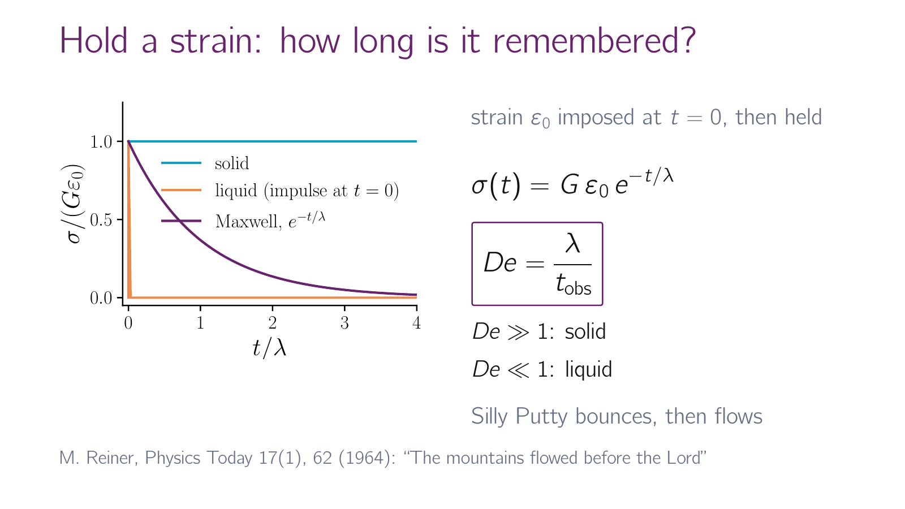
*Stress $\sigma/(G\varepsilon_0)$ against $t/\lambda$ after a held step strain $\varepsilon_0$ for an elastic solid (blue), viscous liquid (orange), and Maxwell element (purple).*

Comparing $\lambda$ with observation time $t_{\mathrm{obs}}$ defines the Deborah number, $De = \lambda/t_{\mathrm{obs}}$. The material acts as a solid for $De \gg 1$ ($t_{\mathrm{obs}} \ll \lambda$) and flows as a liquid for $De \ll 1$ ($t_{\mathrm{obs}} \gg \lambda$): Silly Putty bounces on impact yet spreads on a bench. Reiner (1964) named the group after the prophetess Deborah, whose song says "the mountains flowed before the Lord".

## 3) From a single polymer chain to Oldroyd-B

In a dilute polymer solution, $G$ and $\lambda$ follow from single-chain statistics and Stokes drag (Bird *et al.* 1987, ch. 13; Larson 1988, ch. 2).

### 3.1 A polymer is an entropic spring

A freely jointed chain of $N$ segments of length $b$ executes a three-dimensional random walk with mean-square end-to-end distance $\langle R^2 \rangle = Nb^2$. For $N \gg 1$, the end-to-end vector $\boldsymbol{R}$ is Gaussian,

$$P(\boldsymbol{R}) \propto \exp\!\left(-\frac{3R^2}{2Nb^2}\right),$$

where the factor $3$ fixes $\langle R_x^2\rangle = \langle R_y^2\rangle = \langle R_z^2\rangle = Nb^2/3$.

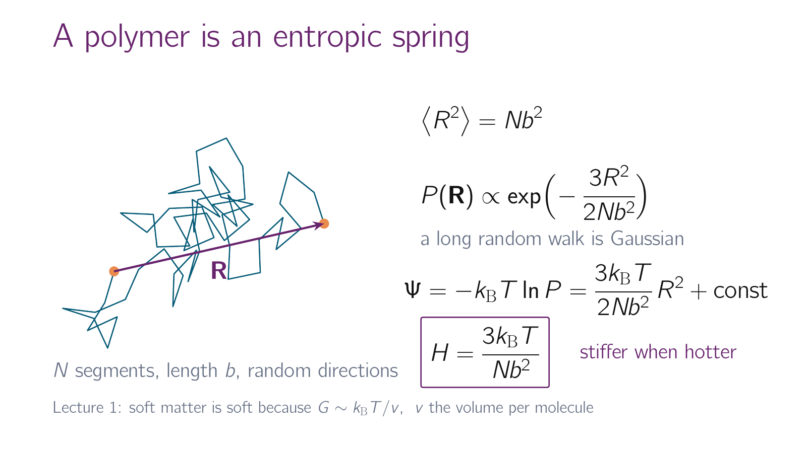
*Random-walk chain of $N$ segments of length $b$ with end-to-end vector $\boldsymbol{R}$ and its entropic spring constant.*

Separating the ends removes accessible conformations, raising the entropic free energy

$$\Psi(\boldsymbol{R}) = -k_{\mathrm{B}}T\ln P(\boldsymbol{R}) = \frac{3k_{\mathrm{B}}T}{2Nb^2}\,R^2 + \mathrm{const},$$

with Boltzmann's constant $k_{\mathrm{B}}$ and temperature $T$. The chain pulls its ends back together with Hookean restoring force $-\nabla_{\boldsymbol{R}}\Psi = -H\boldsymbol{R}$, while $+H\boldsymbol{R} = \nabla_{\boldsymbol{R}}\Psi$ is the tension needed to hold them apart, with

$$H = \frac{3k_{\mathrm{B}}T}{Nb^2}.$$

Because $H \propto T$, heating stiffens the chain: thermal agitation drives it back towards high-entropy crumpled states, matching [[Lecture-Notes/Intro-Soft-Matter/Faces-of-Soft-Matter|Lecture 1]]'s scaling $G \sim k_{\mathrm{B}}T/v$ ($v$ the volume per molecule).

### 3.2 Coarse-graining to a dumbbell

Retain only the connector vector $\boldsymbol{Q} = \boldsymbol{x}_2 - \boldsymbol{x}_1$ and model the chain as two beads at $\boldsymbol{x}_1, \boldsymbol{x}_2$, each with drag coefficient $\zeta$, joined by spring $H = 3k_{\mathrm{B}}T/(Nb^2)$.

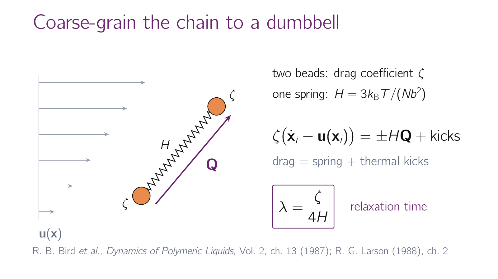
*Bead-spring dumbbell with connector $\boldsymbol{Q}$, bead drag $\zeta$, and spring constant $H$ in flow $\boldsymbol{u}(\boldsymbol{x})$.*

Neglecting bead inertia, the spring pulls bead $1$ towards bead $2$ with $+H\boldsymbol{Q}$ and bead $2$ back towards bead $1$ with $-H\boldsymbol{Q}$ (matching $-\nabla_{\boldsymbol{R}}\Psi$ in §3.1). Balancing drag against spring pull and Brownian kicks gives

$$\zeta\big(\dot{\boldsymbol{x}}_i - \boldsymbol{u}(\boldsymbol{x}_i)\big) = \pm H\boldsymbol{Q} + \text{thermal kicks}.$$

Subtracting bead $1$ from bead $2$ and expanding $\boldsymbol{u}(\boldsymbol{x}_2) - \boldsymbol{u}(\boldsymbol{x}_1) \simeq (\boldsymbol{Q}\cdot\nabla)\boldsymbol{u} = (\nabla\boldsymbol{u})^{T}\cdot\boldsymbol{Q}$ yields

$$\frac{d\boldsymbol{Q}}{dt} = (\nabla\boldsymbol{u})^{T}\cdot\boldsymbol{Q} - \frac{2H}{\zeta}\,\boldsymbol{Q} + \text{thermal kicks}.$$

In a quiescent solvent, the conditional mean of $\boldsymbol{Q}$ decays under the spring drift at rate $2H/\zeta$, while Brownian trajectories keep fluctuating. The second moment $\langle\boldsymbol{Q}\boldsymbol{Q}\rangle$ relaxes to its thermal value at twice that rate, $4H/\zeta$, giving relaxation time

$$\lambda = \frac{\zeta}{4H}.$$

### 3.3 The conformation tensor and the upper-convected derivative

Average $\boldsymbol{Q}\boldsymbol{Q}$ over dumbbells inside a fluid parcel of size $\ell$, large compared with a chain (size $a$) and small compared with the flow scale $L$ ($a \ll \ell \ll L$, [[Lecture-Notes/Intro-Soft-Matter/Conservation-Laws|Lecture 2]]), normalized so rest is the identity:

$$\boldsymbol{\mathcal{A}} = \frac{H}{k_{\mathrm{B}}T}\,\langle\boldsymbol{Q}\boldsymbol{Q}\rangle.$$

At rest, equipartition gives $\langle Q_i Q_j\rangle = (k_{\mathrm{B}}T/H)\delta_{ij}$ and $\boldsymbol{\mathcal{A}} = \boldsymbol{\mathcal{I}}$. The symmetric, positive-definite tensor $\boldsymbol{\mathcal{A}}$ encodes principal stretch directions (eigenvectors) and mean-square stretch ratios (eigenvalues).

Differentiating $\boldsymbol{Q}\boldsymbol{Q}$ via the dumbbell equation and parcel-averaging yields $\boldsymbol{\mathcal{A}}$'s evolution via the upper-convected derivative $\overset{\nabla}{\boldsymbol{\mathcal{A}}}$:

$$\overset{\nabla}{\boldsymbol{\mathcal{A}}} \equiv \frac{D\boldsymbol{\mathcal{A}}}{Dt} - (\nabla\boldsymbol{u})^{T}\cdot\boldsymbol{\mathcal{A}} - \boldsymbol{\mathcal{A}}\cdot\nabla\boldsymbol{u} = -\frac{\boldsymbol{\mathcal{A}} - \boldsymbol{\mathcal{I}}}{\lambda}.$$

We state the thermal-kick average without derivation (Bird *et al.* 1987, ch. 13): Brownian motion balances spring contraction at rest and supplies $+\boldsymbol{\mathcal{I}}/\lambda$. Since material lines obey $d(\delta\boldsymbol{x})/dt = (\nabla\boldsymbol{u})^{T}\cdot\delta\boldsymbol{x}$, the dyad $\delta\boldsymbol{x}\,\delta\boldsymbol{x}$ has zero upper-convected derivative. Thus $\overset{\nabla}{\boldsymbol{\mathcal{A}}}$ is the rate of change in a frame moving, rotating, and deforming with the fluid: flow stretches $\boldsymbol{\mathcal{A}}$ affinely while relaxation restores $\boldsymbol{\mathcal{I}}$ over $\lambda$.

### 3.4 Kramers stress and the Oldroyd-B model

Across a plane through a solution of $n$ dumbbells per unit volume, each crossing spring exerts tension $H\boldsymbol{Q}$ across separation $\boldsymbol{Q}$. Summing $\boldsymbol{Q}\,H\boldsymbol{Q}$ per unit volume and subtracting the isotropic thermal momentum flux $nk_{\mathrm{B}}T\boldsymbol{\mathcal{I}}$ present at rest gives the Kramers stress (Bird *et al.* 1987; Larson 1988),

$$\boldsymbol{\sigma}_p = n\langle\boldsymbol{Q}\,H\boldsymbol{Q}\rangle - nk_{\mathrm{B}}T\boldsymbol{\mathcal{I}} = G(\boldsymbol{\mathcal{A}} - \boldsymbol{\mathcal{I}}), \qquad G = nk_{\mathrm{B}}T,$$

matching $G = k_{\mathrm{B}}T/v$ with $v = 1/n$ ([[Lecture-Notes/Intro-Soft-Matter/Faces-of-Soft-Matter|Lecture 1]]), where chain spacing $v^{1/3} \ll \ell$.

Adding the Newtonian solvent gives Oldroyd-B (Oldroyd 1950):

$$\boldsymbol{\sigma} = -p\boldsymbol{\mathcal{I}} + 2\eta_s\boldsymbol{\mathcal{D}} + G(\boldsymbol{\mathcal{A}} - \boldsymbol{\mathcal{I}}), \qquad \overset{\nabla}{\boldsymbol{\mathcal{A}}} = -\frac{\boldsymbol{\mathcal{A}} - \boldsymbol{\mathcal{I}}}{\lambda}, \qquad \eta_p = G\lambda.$$

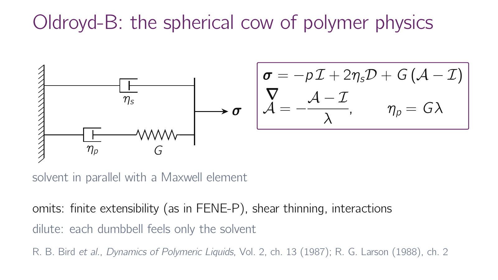
*One-dimensional mechanical analogue and constitutive equations of Oldroyd-B.*

In one dimension, solvent dashpot $\eta_s$ sits in parallel with a Maxwell branch ($\eta_p$ in series with $G$); in three dimensions, $\overset{\nabla}{\boldsymbol{\mathcal{A}}}$ ensures frame invariance. The dumbbell assumptions omit three effects:

- **Finite extensibility:** Hookean springs stretch unboundedly; FENE-P caps chain length.
- **Shear thinning:** steady simple shear gives constant viscosity $\eta_s + \eta_p$ and quadratic $N_1$ (self-check 3), fitting Boger fluids rather than shear-thinning melts.
- **Chain interactions:** each dumbbell sees only solvent (dilute limit).

## 4) Two limits and the elastic correspondence

Varying $\lambda$ moves Oldroyd-B from liquid to nonlinear elastic solid, depending on which parameter stays fixed.

### 4.1 Fast relaxation ($\lambda \to 0$ at fixed $\eta_p$): a Newtonian liquid

From $\boldsymbol{\mathcal{A}} - \boldsymbol{\mathcal{I}} = -\lambda\overset{\nabla}{\boldsymbol{\mathcal{A}}}$, expand near $\boldsymbol{\mathcal{A}} = \boldsymbol{\mathcal{I}}$. The identity tensor is not frozen in flow; its material derivative vanishes, leaving $\overset{\nabla}{\boldsymbol{\mathcal{I}}} = -(\nabla\boldsymbol{u})^{T} - \nabla\boldsymbol{u} = -2\boldsymbol{\mathcal{D}}$, so $\boldsymbol{\mathcal{A}} - \boldsymbol{\mathcal{I}} \simeq 2\lambda\boldsymbol{\mathcal{D}}$. Holding $\eta_p = G\lambda$ fixed as $\lambda \to 0$ gives

$$\boldsymbol{\sigma} \simeq -p\boldsymbol{\mathcal{I}} + 2(\eta_s + \eta_p)\boldsymbol{\mathcal{D}}.$$

Dumbbells relax before flow stretches them, adding only viscosity $\eta_p$. (Fixing $G$ instead sends $\eta_p = G\lambda \to 0$, leaving $\eta_s$; §7.1.)

### 4.2 No relaxation ($\lambda \to \infty$ at fixed $G$): the Finger tensor and neo-Hookean solids

Fixing $G$ and sending $\lambda \to \infty$ leaves $\overset{\nabla}{\boldsymbol{\mathcal{A}}} = \boldsymbol{0}$. In finite-deformation elasticity (Snoeijer, Pandey, Herrada & Eggers 2020), mapping reference coordinates $\boldsymbol{X}$ to current coordinates $\boldsymbol{x}(\boldsymbol{X}, t)$ defines the deformation gradient and Finger (left Cauchy–Green) tensor,

$$\boldsymbol{\mathcal{F}} = \frac{\partial\boldsymbol{x}}{\partial\boldsymbol{X}}, \qquad d\boldsymbol{x} = \boldsymbol{\mathcal{F}}\cdot d\boldsymbol{X}, \qquad \boldsymbol{\mathcal{B}} = \boldsymbol{\mathcal{F}}\cdot\boldsymbol{\mathcal{F}}^{T}.$$

Like $\boldsymbol{\mathcal{A}}$, $\boldsymbol{\mathcal{B}}$ is Eulerian and symmetric, with eigenvalues $\Lambda_i^2$ (squared principal stretches) and $\boldsymbol{\mathcal{B}} = \boldsymbol{\mathcal{I}}$ undeformed. For an incompressible solid ($\det\boldsymbol{\mathcal{F}} = 1$), the simplest isotropic energy linear in $\operatorname{tr}\boldsymbol{\mathcal{B}}$ is neo-Hookean:

$$W = \frac{G}{2}\left(\operatorname{tr}\boldsymbol{\mathcal{B}} - 3\right) \quad\Rightarrow\quad \boldsymbol{\sigma} = -p\boldsymbol{\mathcal{I}} + G(\boldsymbol{\mathcal{B}} - \boldsymbol{\mathcal{I}}),$$

matching $G(\boldsymbol{\mathcal{A}} - \boldsymbol{\mathcal{I}})$.

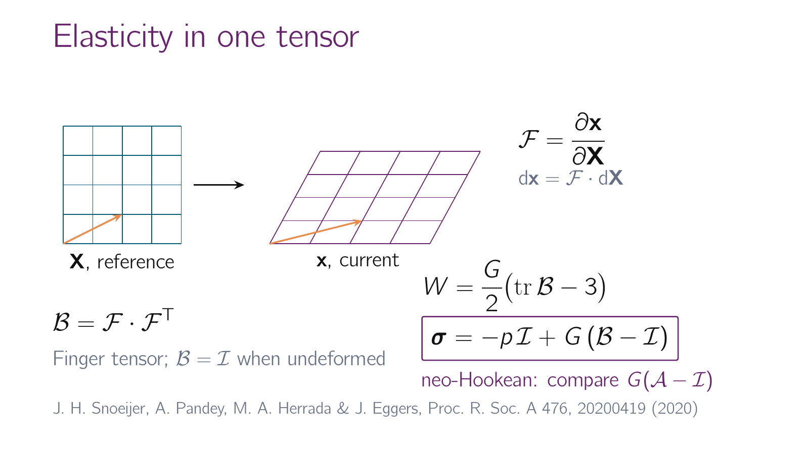
*Mapping $\boldsymbol{X} \mapsto \boldsymbol{x}$ via $\boldsymbol{\mathcal{F}}$, Finger tensor $\boldsymbol{\mathcal{B}}$, and neo-Hookean stress (after Snoeijer et al. 2020).*

The two tensors share the same kinematics. Since $\boldsymbol{u} = d\boldsymbol{x}/dt$ at fixed $\boldsymbol{X}$, $d\boldsymbol{\mathcal{F}}/dt = (\nabla\boldsymbol{u})^{T}\cdot\boldsymbol{\mathcal{F}}$, giving the exact kinematic identity

$$\frac{d\boldsymbol{\mathcal{B}}}{dt} = (\nabla\boldsymbol{u})^{T}\cdot\boldsymbol{\mathcal{B}} + \boldsymbol{\mathcal{B}}\cdot\nabla\boldsymbol{u} \quad\Rightarrow\quad \overset{\nabla}{\boldsymbol{\mathcal{B}}} = \boldsymbol{0}.$$

From a stress-free, incompressible start ($\boldsymbol{\mathcal{A}}(0) = \boldsymbol{\mathcal{B}}(0) = \boldsymbol{\mathcal{I}}$), $\overset{\nabla}{\boldsymbol{\mathcal{A}}} = \boldsymbol{0}$ implies $\boldsymbol{\mathcal{A}} = \boldsymbol{\mathcal{B}}$ for all $t \ge 0$; the reference shape enters via the initial condition. At $\eta_s = 0$, upper-convected Maxwell at $\lambda \to \infty$ is an exact neo-Hookean solid; keeping $\eta_s$ gives a Kelvin–Voigt solid,

$$\boldsymbol{\sigma} = -p\boldsymbol{\mathcal{I}} + 2\eta_s\boldsymbol{\mathcal{D}} + G(\boldsymbol{\mathcal{B}} - \boldsymbol{\mathcal{I}}),$$

which recovers its reference shape once unloaded while dissipating energy during transients (Snoeijer *et al.* 2020).

## 5) Stretching polymers, the Pipkin diagram and a thinning thread

Three flows show how relaxation and nonlinear kinematics compete in Oldroyd-B.

### 5.1 Uniaxial extension, extensional viscosity and the coil–stretch transition

Stretch an incompressible fluid element steadily along $z$ at rate $\dot\varepsilon$: $u_z = \dot\varepsilon z$, $u_r = -\frac{1}{2}\dot\varepsilon r$. At $\lambda = \infty$, material lines elongate as $e^{\dot\varepsilon t}$ and $\mathcal{B}_{zz} = e^{2\dot\varepsilon t}$. At finite $\lambda$,

$$\frac{d\mathcal{A}_{zz}}{dt} = 2\dot\varepsilon\,\mathcal{A}_{zz} - \frac{\mathcal{A}_{zz} - 1}{\lambda}.$$

The Weissenberg number $Wi = \lambda\dot\varepsilon$ governs the outcome:

- **$Wi < 1/2$:** relaxation wins and $\mathcal{A}_{zz}$ saturates at $1/(1 - 2Wi)$.
- **$Wi > 1/2$:** flow beats relaxation and $\mathcal{A}_{zz} \sim e^{(2\dot\varepsilon - 1/\lambda)t}$ grows exponentially.

Past $Wi = 1/2$, chains unravel in the coil–stretch transition.

In steady uniaxial extension ($Wi < 1/2$), combining that steady $\mathcal{A}_{zz}$ with $\mathcal{A}_{rr} = 1/(1 + Wi)$ yields the steady extensional viscosity (Bird *et al.* 1987, ch. 13),

$$\eta_E = \frac{\sigma_{zz} - \sigma_{rr}}{\dot\varepsilon} = 3\eta_s + \frac{3\eta_p}{(1 - 2Wi)(1 + Wi)}.$$

As $Wi \to 0$, $\eta_E$ recovers Trouton's $3(\eta_s + \eta_p)$; as $Wi \to 1/2^-$, it diverges, with no steady state beyond $Wi = 1/2$ because Hookean dumbbells stretch without limit (finitely extensible models such as FENE-P cap $\eta_E$).

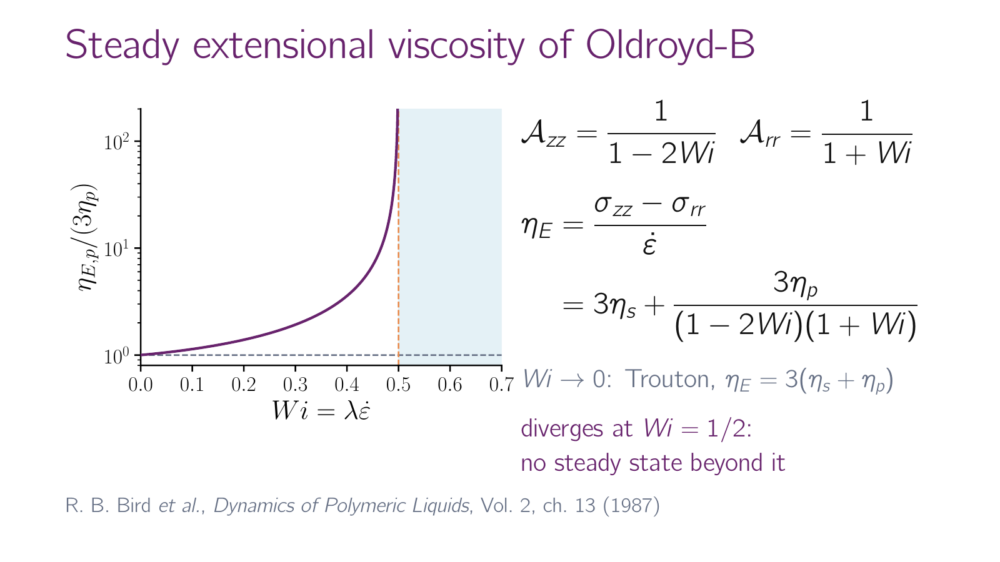
*Dimensionless steady polymeric extensional viscosity $\eta_{E,p}/(3\eta_p)$ (with $\eta_{E,p} = \eta_E - 3\eta_s$) against $Wi = \lambda\dot\varepsilon$ in Oldroyd-B, showing the Trouton limit at $Wi \to 0$, divergence at $Wi = 1/2$, and the shaded band $Wi > 1/2$ with no steady state (Bird et al. 1987, ch. 13).*

### 5.2 The Pipkin diagram

In start-up simple shear at rate $\dot\gamma$ from rest ($\boldsymbol{\mathcal{A}}(0) = \boldsymbol{\mathcal{I}}$), comparing $\lambda$ with observation time $t$ and shear time $1/\dot\gamma$ gives

$$De = \frac{\lambda}{t}, \qquad Wi = \lambda\dot\gamma,$$

whose ratio is the accumulated strain, $Wi/De = \dot\gamma t$.

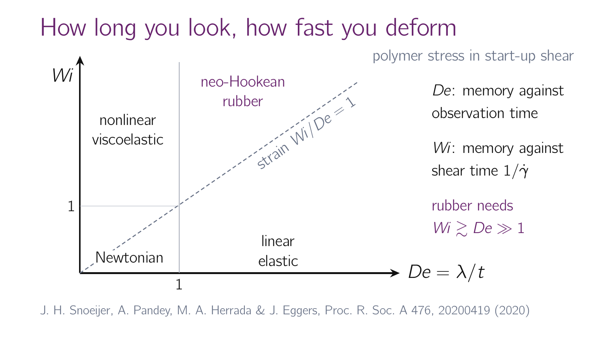
*Pipkin diagram for the polymer stress $\boldsymbol{\sigma}_p$ in start-up shear; the dashed line $Wi/De = 1$ separates small and large strain (adapted from Snoeijer et al. 2020).*

Four corners appear for $\boldsymbol{\sigma}_p$:

- **$De \ll 1$, $Wi \ll 1$ (Newtonian):** slow, steady shear adding only viscosity.
- **$De \ll 1$, $Wi \gg 1$ (nonlinear viscoelastic):** steady shear generating normal-stress differences.
- **$De \gg 1$, $Wi/De \ll 1$ (linear elastic):** fast probing at small strain.
- **$Wi \gtrsim De \gg 1$ (neo-Hookean rubber):** large strain reached before relaxation acts.

Two caveats apply (Snoeijer *et al.* 2020): the rubber corner ($Wi \gtrsim De \gg 1$) exists only for affine models like Oldroyd-B (non-affine slip models such as Johnson–Segalman oscillate under shear and lack an elastic limit), and the map tracks $\boldsymbol{\sigma}_p$ alone, whereas $2\eta_s\boldsymbol{\mathcal{D}}$ can dominate during rapid probing.

### 5.3 One model from liquid to solid: a thinning thread

A capillary thread of initial radius $R_0$, scaled in time by $\tau = \sqrt{\rho R_0^3/\gamma}$, displays all three regimes of Oldroyd-B (Snoeijer *et al.* 2020):

- **$\lambda = 0$:** Newtonian finite-time pinch-off ([[Lecture-Notes/Intro-Soft-Matter/Singularities|Soft Matter Singularities]]).
- **Finite $\lambda$:** strong neck extension forms a uniform filament with $\dot h_{\mathrm{thr}}/h_{\mathrm{thr}} = -\dot\varepsilon/2$, so $h_{\mathrm{thr}} \propto e^{-\dot\varepsilon t/2}$. Balancing capillary pressure $\gamma/h_{\mathrm{thr}} \propto e^{\dot\varepsilon t/2}$ against polymer stress $G\mathcal{A}_{zz} \propto e^{(2\dot\varepsilon - 1/\lambda)t}$ selects $\dot\varepsilon\lambda = 2/3$ and
  $$h_{\mathrm{thr}} \sim e^{-t/(3\lambda)}$$
  (Entov & Hinch 1997; Snoeijer *et al.* 2020). In the Oldroyd-B model's late elastocapillary regime, polymer stress replaces finite-time pinch-off with exponential thinning.
- **$\lambda = \infty$:** thinning arrests where neo-Hookean stress balances capillarity.

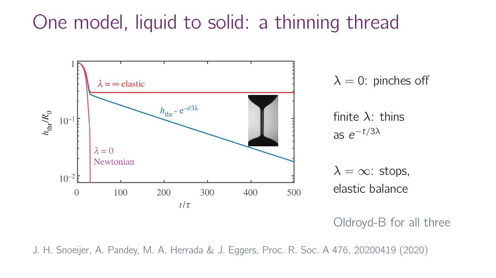
*Thread radius $h_{\mathrm{thr}}/R_0$ against $t/\tau$ ($\tau = \sqrt{\rho R_0^3/\gamma}$) in Oldroyd-B for $\lambda = 0$, finite $\lambda$, and $\lambda = \infty$, with an experimental inset of a dilute polymer filament (adapted from Snoeijer et al. 2020, Fig. 2, CC BY 4.0; inset courtesy A. Deblais and D. Bonn).*

## 6) Example 1: a drop hits a wall

Compare a liquid drop ($Ec = 0$) and a soft elastic bead ($De \to \infty$) of radius $R_0$ and density $\rho$ hitting a rigid wall at speed $V_0$, with $Ec = GR_0/\gamma$ and $We = \rho V_0^2 R_0/\gamma$. Only the constitutive law changes, from Newtonian to Kelvin–Voigt:

- **Liquid drop (Wagner):** contact grows as $r \sim \sqrt{3V_0 R_0 t}$ and, at large $We$, inertia controls the first force peak, $F \sim \rho V_0^2 R_0^2$, while low $We$ carries a capillary contribution (Zhang, Sanjay *et al.* 2022). At fixed $We$, this first peak varies weakly with viscosity over $Oh = \eta/\sqrt{\rho\gamma D_0} = 0.0025$–$0.2$ ($D_0 = 2R_0$; Sanjay, Zhang, Lv & Lohse 2025).
- **Soft solid (Hertz):** compression $\delta(t)$ gives $r \sim \sqrt{R_0\delta}$ and stored energy $\sim GR_0^{1/2}\delta^{5/2}$. Balancing kinetic energy $\sim \rho R_0^3 V_0^2$ fixes $\delta \sim R_0(\rho V_0^2/G)^{2/5}$ and $F \sim GR_0^{1/2}\delta^{3/2} \sim (GR_0^2)^{2/5}(\rho V_0^2 R_0^2)^{3/5}$.

The peak force normalized by $\rho V_0^2 R_0^2$ in large-$We$ simulations at $Oh = \eta_s/\sqrt{\rho\gamma R_0} = 0.01$ (radius-based) collapses onto one curve against $El = G/(\rho V_0^2) = Ec/We$ (Jana, Kolinski, Lohse & Sanjay 2026). At small $El$, it sits on the Wagner plateau (capillarity lifts low-$We$ points); at large $El$, impact gives a single Hertz pulse whose normalized peak grows as $El^{2/5}$ (prefactor $5.27$ in theory, $5.25$ in simulations). See [[Lecture-Notes/Intro-Soft-Matter/Sheets-Bubbles-Drops|Sheets, Bubbles and Drops]] §3 for force histories and the $(We, Ec)$ map.

## 7) Example 2: a hole in an elastic sheet

Consider a circular hole opening in a free sheet of thickness $h_0$, density $\rho$, and surface tension $\gamma$ per face. The elastic-sheet results in §§7.2–7.6 are from V. Bertin, V. Sanjay, C. Datt, A. T. Oratis & J. H. Snoeijer (in preparation).

### 7.1 Taylor–Culick recap and sheet dimensionless groups

In a Newtonian sheet ([[Lecture-Notes/Intro-Soft-Matter/Taylor-Culick-Paradox|the Taylor–Culick paradox]]), capillarity pulls with $2\gamma$ per unit rim length. For a straight rim gathering mass per unit length $m = \rho h_0 \ell$ ($\dot\ell = U$), $d(mU)/dt = 2\gamma$ gives $\rho h_0 U^2 = 2\gamma$ at steady speed, selecting $U = V_{\mathrm{TC}} = \sqrt{2\gamma/(\rho h_0)}$ (Taylor 1959; Culick 1960); this balance carries over to a circular hole once $R \gg h_0$. Even as $Oh \to 0$, half the released surface-energy power per unit rim length ($2\gamma U$) is dissipated: in the rim frame, incoming mass $dm$ arrives at speed $U$ and stops inelastically, giving dissipation power per unit rim length $\dot E_d = \frac{1}{2}\dot m U^2 = \gamma U$ (de Gennes 1996; Sanjay *et al.* 2022).

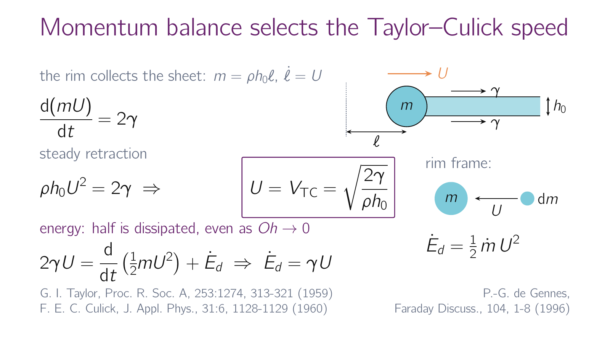
*Straight-rim schematic, momentum balance, and rim-frame capture for a Newtonian sheet (Taylor 1959; Culick 1960; de Gennes 1996).*

Polymers alter this retraction: puncturing a blown polymeric bubble leaves a small hole at low blowing rate but bursts it at high blowing rate (Tammaro *et al.* 2018). Can elasticity stop a hole from opening?

Scaling lengths by $h_0$, time by $\tau_\gamma = \sqrt{\rho h_0^3/\gamma}$, velocity by $\sqrt{\gamma/(\rho h_0)}$ ($V_{\mathrm{TC}} = \sqrt{2}$), and stress by $\gamma/h_0$ leaves

$$Oh = \frac{\eta_s}{\sqrt{\rho\gamma h_0}}, \qquad Ec = \frac{Gh_0}{\gamma}, \qquad De = \frac{\lambda}{\sqrt{\rho h_0^3/\gamma}},$$

$$\boldsymbol{\sigma} = -p\boldsymbol{\mathcal{I}} + 2Oh\,\boldsymbol{\mathcal{D}} + Ec(\boldsymbol{\mathcal{A}} - \boldsymbol{\mathcal{I}}), \qquad \overset{\nabla}{\boldsymbol{\mathcal{A}}} = -\frac{\boldsymbol{\mathcal{A}} - \boldsymbol{\mathcal{I}}}{De}.$$

Here $Ec$ uses $h_0$ rather than $R_0$. Either $Ec = 0$ or $De = 0$ gives a Newtonian sheet: $Ec = 0$ advects $\boldsymbol{\mathcal{A}}$ without stress, while $De \to 0$ at fixed $Ec$ sends $\eta_p = G\lambda \to 0$ (unlike §4.1 at fixed $\eta_p$), leaving $\eta_s$. At $De = \infty$, $Ec \to 0^+$ recovers the Newtonian sheet only at fixed $t$, not for $t \to \infty$ (§7.5).

### 7.2 No relaxation ($De \to \infty$): slowing and arrest

Take $De \to \infty$, giving a Kelvin–Voigt sheet with $\boldsymbol{\mathcal{A}} = \boldsymbol{\mathcal{F}}\cdot\boldsymbol{\mathcal{F}}^{T}$. Runs below fix $Oh = \sqrt{2}$ and a rounded-edge hole of radius $R_0 = h_0$, varying $Ec$ (Bertin *et al.*, in preparation).

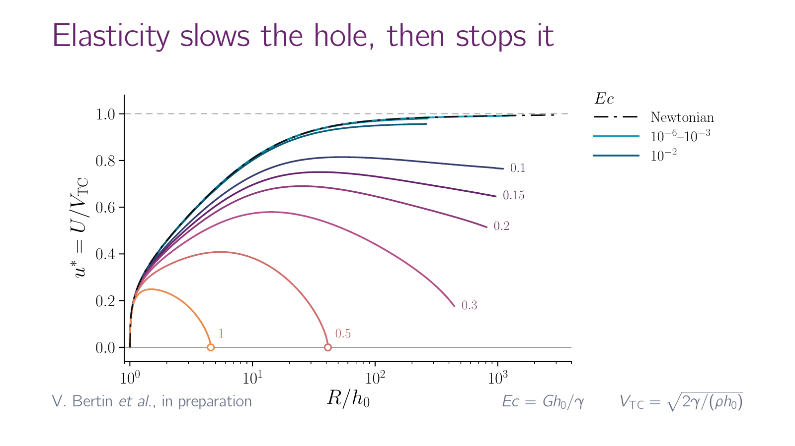
*Opening speed $u^* = U/V_{\mathrm{TC}}$ against $R/h_0$ at $De \to \infty$, $Oh = \sqrt{2}$, $R_0 = h_0$, with Newtonian reference (dash-dotted) and first stops $U = 0$ (open circles) at $Ec = 0.5, 1$ (V. Bertin et al., in preparation).*

- **$Ec = 0$:** $\boldsymbol{\mathcal{A}}$ stretches at the tip without stress; $u^* \to 1$.
- **$Ec = 10^{-6}$–$10^{-3}$:** curves follow the Newtonian reference; $Ec = 10^{-2}$ lies slightly below.
- **$Ec = 0.1, 0.15, 0.2, 0.3$:** speed peaks below $V_{\mathrm{TC}}$ and falls; at $Ec = 0.1$, the rim stretches long and flat.
- **$Ec = 0.5, 1$:** the hole stops ($U = 0$, open circles). At $Ec = 1$, no bulbous rim forms; the edge overshoots slightly, recoils, and rests.

### 7.3 Hoop stretch, the elastic mapping and the logarithmic force

A material ring starting at radius $\xi$ and moving to $r > \xi$ acquires hoop stretch $\Lambda_\theta = r/\xi$. In the neo-Hookean limit, $\mathcal{A}_{\theta\theta} = \Lambda_\theta^2$, giving polymer hoop stress

$$\sigma_{p,\theta\theta} = G(\mathcal{A}_{\theta\theta} - 1) \simeq G\Lambda_\theta^2 \qquad (\Lambda_\theta \gg 1),$$

with the isotropic part absorbed into $p$. Since the tip remains the original edge ($\xi = R_0$), $\mathcal{A}_{\theta\theta}^{\mathrm{tip}} = (R/R_0)^2$ exactly.

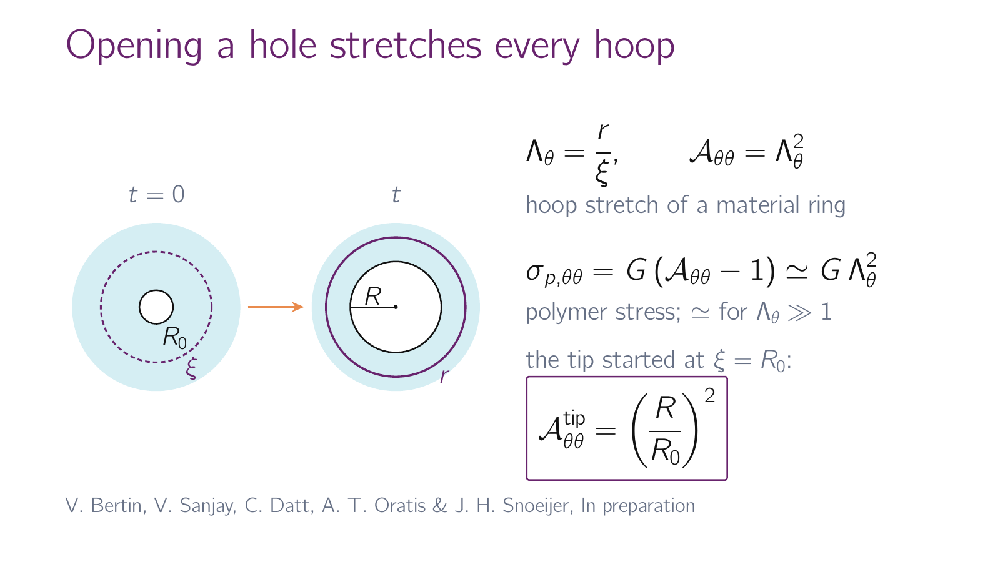
*Expansion of a material ring from initial radius $\xi$ to current radius $r$ around an opening hole (V. Bertin et al., in preparation).*

If vertical columns stay vertical in an incompressible flat sheet with sharp edge $R_0$, volume conservation defines an elastic mapping from thickness $h(s, t)$ alone back to $\xi(r, t)$ (Snoeijer *et al.* 2020; Bertin *et al.*, in preparation):

$$h_0\left(\xi^2 - R_0^2\right) = 2\int_R^{r} h(s, t)\,s\,ds \;\Rightarrow\; \xi(r, t), \qquad \mathcal{A}_{\theta\theta}(r, t) = \left(\frac{r}{\xi(r, t)}\right)^2.$$

Gather all rings between $R_0$ and $R$ into a narrow rim at $r \simeq R$, where $\Lambda_\theta = R/\xi$ and $\sigma_{p,\theta\theta} \simeq GR^2/\xi^2$. By volume conservation, ring volume $2\pi\xi h_0\,d\xi$ occupies cross-section $\xi h_0\,d\xi/R$ in the rim, contributing hoop tension $dN_\theta = \sigma_{p,\theta\theta}(\xi h_0\,d\xi/R) = Gh_0 R\,d\xi/\xi$. Hoop tension $N_\theta$ pulls radially inwards with $N_\theta/R$ per unit rim length, so for $R \gg R_0$,

$$F_{\mathrm{el}} \simeq Gh_0 \int_{R_0}^{R} \frac{d\xi}{\xi} = Gh_0 \ln\frac{R}{R_0}$$

per unit rim length: every $e$-fold in radius adds the same force $Gh_0$.

### 7.4 Arrest radius, rim-shape corrections and the regular small-$Ec$ variable

At rest, the rim-gathering balance against $2\gamma$ gives, to leading order as $Ec \to 0^+$,

$$Gh_0\ln\frac{R_\infty}{R_0} \simeq 2\gamma \quad\Rightarrow\quad \ln\frac{R_\infty}{R_0} \sim \frac{2}{Ec}, \qquad R_\infty \approx R_0\,e^{2/Ec} \quad (Ec \to 0^+),$$

diverging faster than any power of $1/Ec$.

Any $O(1)$ shift in the exponent multiplies $R_\infty$ by an $O(1)$ factor: at $Ec = 1$, $R_0 e^{2/Ec} \approx 7.4 R_0$, whereas full static equilibrium gives $R_\infty = 4.24 R_0$. That shift comes from the rim shape. Treating the sheet as a depth-averaged neo-Hookean membrane in dimensionless radial tension $\mathcal{T} = N_{rr}/(Gh_0)$, logarithmic hoop stretch $y = \ln(r/\xi)$, and stretch ratio $k = \Lambda_r/\Lambda_\theta$ yields (Bertin *et al.*, in preparation)

$$\frac{d\mathcal{T}}{dy} = -(1 + k).$$

Integrating from the undisturbed far field ($y = 0$, $\mathcal{T} = 0$) to the hole edge ($y = Y \equiv \ln(R_\infty/R_0)$, where compressive elastic stress cancels $2\gamma$ so $\mathcal{T} = -2/Ec$) gives

$$-\frac{2}{Ec} = -Y - \int_0^{Y} k\,dy \quad\Rightarrow\quad \ln\frac{R_\infty}{R_0} = \frac{2}{Ec} - \int_0^{Y} k\,dy.$$

Three choices of $k(y)$ give the small-$Ec$ (large-radius, $Y \to \infty$) asymptotes:

- **Rim gathering ($r \simeq R$, $k \to 0$):** $2/Ec$.
- **Constant thickness ($\Lambda_z = 1$):** incompressibility ($\Lambda_r\Lambda_\theta\Lambda_z = 1$) gives $k = \Lambda_\theta^{-2} = e^{-2y}$, whose integral over $[0, \infty)$ is $1/2$, giving $2/Ec - 1/2$ as $Ec \to 0^+$.
- **Depth-averaged neo-Hookean sheet:** $k(y)$ follows one universal trajectory as $Y \to \infty$, giving $C = \int_0^\infty k\,dy = 0.4725$ and $2/Ec - C$ as $Ec \to 0^+$ (and edge thickening $h/h_0 \sim Ec^{-1/3}$).

A rounded initial edge adds a smaller opposite shift $D_{\mathrm{cap}} = 0.0972$, yielding

$$\ln\frac{R_\infty}{R_0} = \frac{2}{Ec} - C + D_{\mathrm{cap}} + o(1) \qquad (Ec \to 0^+).$$

Dynamic runs reaching rest sit on the static equilibrium curve.

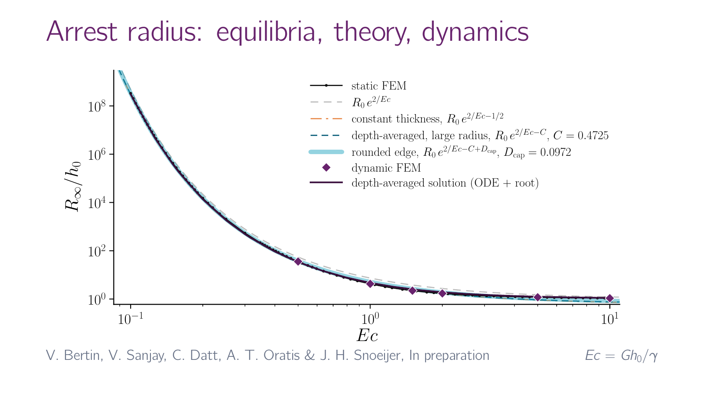
*Arrest radius $R_\infty/h_0$ against $Ec$ ($R_0 = h_0$): static equilibria (black curve with dots), dynamic simulations (purple diamonds), leading-order $R_0 e^{2/Ec}$ (grey dashed), constant-thickness $-1/2$ (orange dash-dotted), depth-averaged $-C$ (dark blue dashed), rounded-edge $-C + D_{\mathrm{cap}}$ (cyan band), and full depth-averaged solution (solid purple) (V. Bertin et al., in preparation).*

While $R_\infty$ is singular as $Ec \to 0^+$, the combination $Ec\ln(R_\infty/R_0)$ is regular and approaches $2$ from below with slope $-(C - D_{\mathrm{cap}})$:

$$Ec\ln\frac{R_\infty}{R_0} = 2 - Ec(C - D_{\mathrm{cap}}) + o(Ec).$$

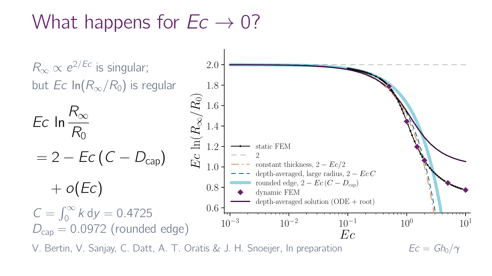
*Regularized arrest quantity $Ec\ln(R_\infty/R_0)$ against $Ec$: static equilibria (black curve with dots), dynamic simulations (purple diamonds), small-$Ec$ asymptotes, and full depth-averaged solution (V. Bertin et al., in preparation).*

### 7.5 Two limits that do not commute

At $De = \infty$, the order of $t \to \infty$ and $Ec \to 0^+$ matters:

- **Fix $t$, then $Ec \to 0^+$:** elastic stress vanishes on $[0, t]$, recovering Newtonian $U \to U_N(t) \to V_{\mathrm{TC}}$ as $t \to \infty$.
- **Fix $Ec > 0$, then $t \to \infty$:** hoop stress balances capillarity, giving $U \to 0$ and $R \to R_\infty(Ec)$.

Thus

$$\lim_{t\to\infty}\lim_{Ec\to 0^+} U = V_{\mathrm{TC}} \;\neq\; 0 = \lim_{Ec\to 0^+}\lim_{t\to\infty} U.$$

Since $\ln(R_\infty/R_0) = 2/Ec - C + D_{\mathrm{cap}} + o(1)$, $R_0/R_\infty \sim e^{C - D_{\mathrm{cap}}} e^{-2/Ec}$ is smaller than any power of $Ec$ as $Ec \to 0^+$: all derivatives vanish at $Ec = 0^+$, so no power series in $Ec$ detects arrest. At $Ec = 0.1$, $R_\infty/R_0 \approx 3 \times 10^8$ (beyond what real elastomers survive), and quasi-steady arrival scales as $t_{\mathrm{qs}} \sim (R_\infty/V_{\mathrm{TC}})(2\pi/Ec)^{1/2}$, growing exponentially as $Ec$ falls. Small-$Ec$ arrest is therefore a property of the idealized neo-Hookean model, and rest states at small $Ec$ must come from the static problem.

### 7.6 Finite relaxation releases the arrest

Restoring finite $De$ in Oldroyd-B ($Ec = 1$, $Oh = \sqrt{2}$) removes permanent arrest at $R_\infty = 4.24 R_0$, and every finite-$De$ case shown keeps opening (Bertin *et al.*, in preparation).

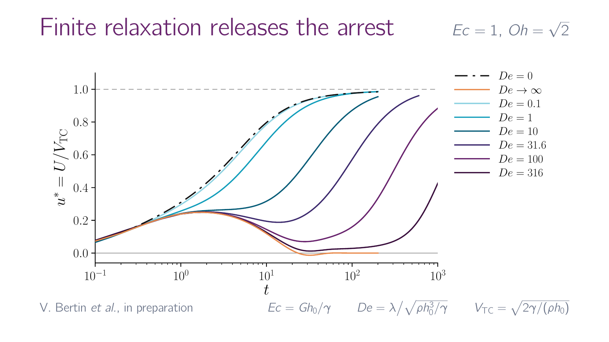
*Opening speed $u^* = U/V_{\mathrm{TC}}$ against dimensionless time $t$ at $Ec = 1$, $Oh = \sqrt{2}$ for $De = 0$ (dash-dotted), $De \to \infty$ (orange), and finite $De = 0.1$–$316$ (V. Bertin et al., in preparation).*

- **Fast to moderate relaxation ($De = 0.1, 1, 10$):** speed rises throughout, with a shoulder at $De = 10$. At $De = 1$, stretch builds at the tip and then relaxes, so the hole opens near $V_{\mathrm{TC}}$.
- **Slow relaxation ($De = 31.6, 100, 316$):** for $t \ll De$, speed follows the arrested Kelvin–Voigt curve and dips; once stress relaxes, speed climbs back towards $V_{\mathrm{TC}}$ ($De = 31.6$ nears $V_{\mathrm{TC}}$ by the end of its run; $De = 100$ and $316$ are still climbing at the end of theirs).

## Summary

1. **Constitutive closure:** polymer stress $\boldsymbol{\sigma}_p$ extends the Newtonian closure of Cauchy's equation.
2. **Entropic spring and dumbbell:** a random-walk chain ($N$ segments of length $b$) has $H = 3k_{\mathrm{B}}T/(Nb^2)$ (stiffer when hotter); for two beads of drag $\zeta$ in a quiescent solvent, the mean of $\boldsymbol{Q}$ decays at rate $2H/\zeta$ while $\langle\boldsymbol{Q}\boldsymbol{Q}\rangle$ relaxes on $\lambda = \zeta/(4H)$.
3. **Oldroyd-B:** $\boldsymbol{\mathcal{A}} = (H/k_{\mathrm{B}}T)\langle\boldsymbol{Q}\boldsymbol{Q}\rangle$ yields $\boldsymbol{\sigma} = -p\boldsymbol{\mathcal{I}} + 2\eta_s\boldsymbol{\mathcal{D}} + G(\boldsymbol{\mathcal{A}} - \boldsymbol{\mathcal{I}})$ ($G = nk_{\mathrm{B}}T$) and $\overset{\nabla}{\boldsymbol{\mathcal{A}}} = -(\boldsymbol{\mathcal{A}} - \boldsymbol{\mathcal{I}})/\lambda$, omitting finite extensibility, shear thinning, and chain interactions.
4. **Two limits:** $\lambda \to 0$ at fixed $\eta_p = G\lambda$ gives a Newtonian liquid ($\eta_s + \eta_p$); $\lambda \to \infty$ at fixed $G$ from a stress-free start gives $\boldsymbol{\mathcal{A}} = \boldsymbol{\mathcal{B}} = \boldsymbol{\mathcal{F}}\cdot\boldsymbol{\mathcal{F}}^{T}$, a neo-Hookean solid (Kelvin–Voigt with $\eta_s$).
5. **Extensional flows and regimes:** uniaxial extension triggers coil–stretch and diverging $\eta_E$ at $Wi = 1/2$; the Pipkin map locates neo-Hookean rubber response in the large-strain, high-$De$ corner ($Wi \gtrsim De \gg 1$), which exists only for affine models; a thinning thread spans pinch-off ($\lambda = 0$), $e^{-t/(3\lambda)}$ thinning (finite $\lambda$), and arrest ($\lambda = \infty$).
6. **Drop impact:** peak force crosses from Wagner $F \sim \rho V_0^2 R_0^2$ to Hertz $F \sim (GR_0^2)^{2/5}(\rho V_0^2 R_0^2)^{3/5}$ on $El = G/(\rho V_0^2) = Ec/We$ (Hertz prefactor $5.27$ from theory; simulations give $5.25$).
7. **Elastic sheet:** hoop stretch $\Lambda_\theta = r/\xi$ gives $F_{\mathrm{el}} \simeq Gh_0\ln(R/R_0)$. At $De \to \infty$, $\ln(R_\infty/R_0) = 2/Ec - C + D_{\mathrm{cap}} + o(1)$ as $Ec \to 0^+$ ($C = 0.4725$, $D_{\mathrm{cap}} = 0.0972$), $t \to \infty$ and $Ec \to 0^+$ do not commute, and finite $De$ releases arrest.

## Self-check questions

1. Impose constant step stress $\sigma_0$ ($t > 0$) on a Maxwell element ($\dot\varepsilon = \dot\sigma/G + \sigma/\eta$) and a Kelvin–Voigt element ($\sigma = G\varepsilon + \eta_s\dot\varepsilon$). Find $\varepsilon(t)$ for both and state how long-time creep separates liquid from solid.
2. In a quiescent solvent ($\nabla\boldsymbol{u} = \boldsymbol{0}$), the deterministic dumbbell equation reduces to $d\boldsymbol{Q}/dt = -(2H/\zeta)\boldsymbol{Q}$. Differentiate $\boldsymbol{Q}\boldsymbol{Q}$ to verify the factor of two between the decay rates $2H/\zeta$ of $\boldsymbol{Q}$ and $4H/\zeta$ of $\boldsymbol{Q}\boldsymbol{Q}$ (giving $\lambda = \zeta/(4H)$), and find how $\lambda$ scales with $N$ at fixed $\zeta$ and $T$.
3. Solve $\overset{\nabla}{\boldsymbol{\mathcal{A}}} = -(\boldsymbol{\mathcal{A}} - \boldsymbol{\mathcal{I}})/\lambda$ in steady simple shear $\boldsymbol{u} = (\dot\gamma y, 0, 0)$ to verify viscosity $\eta_s + \eta_p$ and $N_1 = \sigma_{xx} - \sigma_{yy} = 2\eta_p\lambda\dot\gamma^2$.
4. For finite simple shear $x = X + \gamma_s Y$, $y = Y$, $z = Z$ in a neo-Hookean solid ($\lambda \to \infty$), compute $\boldsymbol{\mathcal{F}}$ and $\boldsymbol{\mathcal{B}} = \boldsymbol{\mathcal{F}}\cdot\boldsymbol{\mathcal{F}}^{T}$ to find $\sigma_{xy}$ and $N_1 = G\gamma_s^2$, and connect to the $Wi \gtrsim De \gg 1$ Pipkin corner.
5. Solve steady Oldroyd-B in planar extension ($u_x = \dot\varepsilon x$, $u_y = -\dot\varepsilon y$, $u_z = 0$) for $\mathcal{A}_{xx}$, $\mathcal{A}_{yy}$, and $\eta_{E,\mathrm{planar}} = (\sigma_{xx} - \sigma_{yy})/\dot\varepsilon$; compare its low-$Wi$ Trouton ratio and divergence with uniaxial extension (§5.1).
6. For fixed $G$ and $R_0$ at large $We$, use $El = G/(\rho V_0^2)$ to find the speed $V_0$ separating Hertz ($El \gg 1$) and Wagner ($El \ll 1$) impact, and compare the $V_0$-scaling of peak force on each side.
7. In the constant-thickness approximation ($k = e^{-2y}$ from §7.4), keep $Y = \ln(R_\infty/R_0)$ finite rather than taking $Y \to \infty$. Show that $\int_0^Y e^{-2y}\,dy = (1 - e^{-2Y})/2$ and solve $Y = 2/Ec - (1 - e^{-2Y})/2$ numerically at $Ec = 1$ (verifying $Y \approx 1.52$, $R_\infty \approx 4.6 R_0$). Compare this with the value from the same approximation when the upper limit of the integral is taken to infinity ($R_0 e^{3/2} \approx 4.5 R_0$), the leading-order estimate $R_0 e^{2} \approx 7.4 R_0$, and the static equilibrium $4.24 R_0$; identify whether the remaining gap to $4.24 R_0$ comes from truncating $Y$ or from the rim shape $k(y)$.

## References

1. R. B. Bird, C. F. Curtiss, R. C. Armstrong & O. Hassager, *Dynamics of Polymeric Liquids*, Vol. 2: *Kinetic Theory*, 2nd edn (Wiley, New York, 1987), ch. 13.
2. R. G. Larson, *Constitutive Equations for Polymer Melts and Solutions* (Butterworths, 1988), ch. 2.
3. J. G. Oldroyd, On the formulation of rheological equations of state, *Proc. R. Soc. Lond. A* **200**, 523–541 (1950). [doi:10.1098/rspa.1950.0035](https://doi.org/10.1098/rspa.1950.0035)
4. M. Reiner, The Deborah number, *Phys. Today* **17**(1), 62 (1964). [doi:10.1063/1.3051374](https://doi.org/10.1063/1.3051374)
5. V. M. Entov & E. J. Hinch, Effect of a spectrum of relaxation times on the capillary thinning of a filament of elastic liquid, *J. Non-Newtonian Fluid Mech.* **72**, 31–53 (1997). [doi:10.1016/S0377-0257(97)00022-0](https://doi.org/10.1016/S0377-0257(97)00022-0)
6. J. H. Snoeijer, A. Pandey, M. A. Herrada & J. Eggers, The relationship between viscoelasticity and elasticity, *Proc. R. Soc. A* **476**, 20200419 (2020). [doi:10.1098/rspa.2020.0419](https://doi.org/10.1098/rspa.2020.0419)
7. U. Sen, C. Datt, T. Segers, H. Wijshoff, J. H. Snoeijer, M. Versluis & D. Lohse, The retraction of jetted slender viscoelastic liquid filaments, *J. Fluid Mech.* **929**, A25 (2021). [doi:10.1017/jfm.2021.855](https://doi.org/10.1017/jfm.2021.855)
8. B. Zhang, V. Sanjay, S. Shi, Y. Zhao, C. Lv, X.-Q. Feng & D. Lohse, Impact forces of water drops falling on superhydrophobic surfaces, *Phys. Rev. Lett.* **129**, 104501 (2022). [doi:10.1103/PhysRevLett.129.104501](https://doi.org/10.1103/PhysRevLett.129.104501)
9. V. Sanjay, B. Zhang, C. Lv & D. Lohse, The role of viscosity on drop impact forces on non-wetting surfaces, *J. Fluid Mech.* **1004**, A6 (2025). [doi:10.1017/jfm.2024.982](https://doi.org/10.1017/jfm.2024.982)
10. S. Jana, J. Kolinski, D. Lohse & V. Sanjay, Impacting spheres: from liquid drops to elastic beads, *Soft Matter* **22**, 2226–2236 (2026). [doi:10.1039/D5SM01078K](https://doi.org/10.1039/D5SM01078K)
11. G. I. Taylor, The dynamics of thin sheets of fluid. III. Disintegration of fluid sheets, *Proc. R. Soc. Lond. A* **253**, 313–321 (1959). [doi:10.1098/rspa.1959.0196](https://doi.org/10.1098/rspa.1959.0196)
12. F. E. C. Culick, Comments on a ruptured soap film, *J. Appl. Phys.* **31**, 1128–1129 (1960). [doi:10.1063/1.1735765](https://doi.org/10.1063/1.1735765)
13. P.-G. de Gennes, Mechanics of soft interfaces, *Faraday Discuss.* **104**, 1–8 (1996). [doi:10.1039/FD9960400001](https://doi.org/10.1039/FD9960400001)
14. V. Sanjay, U. Sen, P. Kant & D. Lohse, Taylor–Culick retractions and the influence of the surroundings, *J. Fluid Mech.* **948**, A14 (2022). [doi:10.1017/jfm.2022.671](https://doi.org/10.1017/jfm.2022.671)
15. D. Tammaro, R. Pasquino, M. M. Villone, G. D'Avino, V. Ferraro, E. Di Maio, A. Langella, N. Grizzuti & P. L. Maffettone, Elasticity in bubble rupture, *Langmuir* **34**, 5646–5654 (2018). [doi:10.1021/acs.langmuir.8b00520](https://doi.org/10.1021/acs.langmuir.8b00520)
16. V. Bertin, V. Sanjay, C. Datt, A. T. Oratis & J. H. Snoeijer, in preparation.

---

> [!significance]- Metadata
> Author:: [Vatsal Sanjay](https://vatsalsanjay.com) 

> [!link] Back to main website
> [Home](https://comphy-lab.org/), [Team](https://comphy-lab.org/team), [Research](https://comphy-lab.org/research), [Github](https://github.com/comphy-lab)
>
> 📝 [Edit this page on GitHub](https://github.com/comphy-lab/CoMPhy-Lab-Blogs/blob/main/Lecture-Notes/Intro-Soft-Matter/Viscoelasticity.md)
