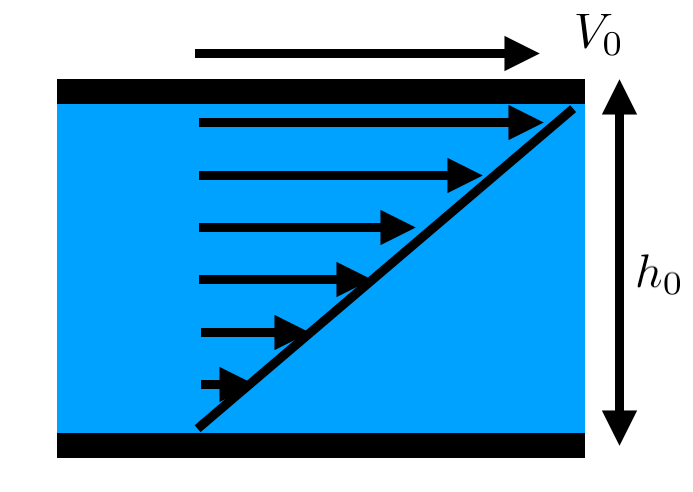
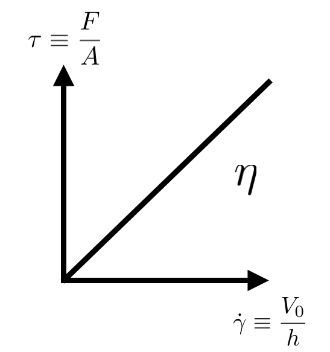
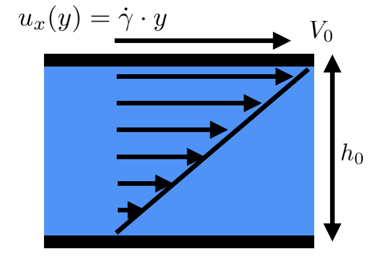
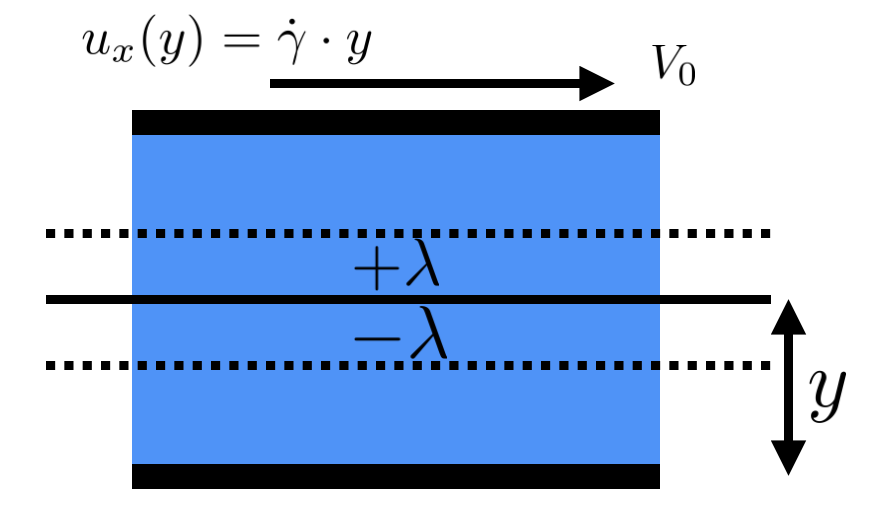
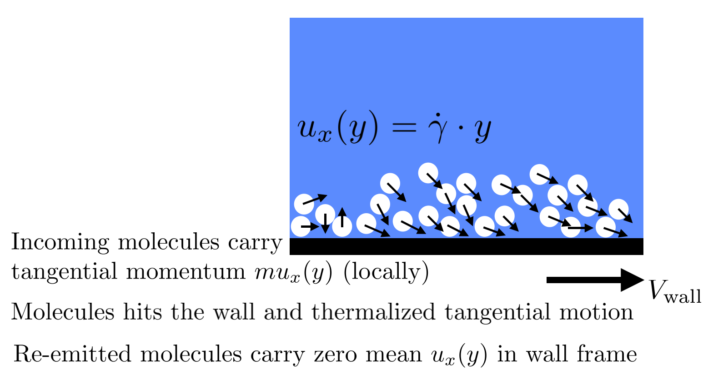

---
tags:
  - lecture
  - soft-matter
  - viscosity
  - momentum-diffusion
  - kinetic-theory
  - rheology
  - no-slip-condition
status: done ✅
publish: true
---

# Viscosity and Momentum Diffusion

<!-- BLOG-PDF-LINK-START -->
<!-- PDF-EXPORT-IGNORE-START -->
> [!pdf] PDF version
> [[_Media/PDF/Lecture-Notes/Intro-Soft-Matter/Viscosity.pdf|Download this page as PDF]]
<!-- PDF-EXPORT-IGNORE-END -->
<!-- BLOG-PDF-LINK-END -->

Understanding viscosity as an emergent transport property arising from molecular collisions and free flights—the diffusion of tangential momentum through a fluid. This lecture bridges [[Lecture-Notes/Intro-Soft-Matter/Taylor-Culick-Paradox|the Taylor–Culick paradox]] with the continuum mechanics needed to model soft matter flows.

---

## Learning Objectives

By the end of this lecture, you should understand these five core concepts:

1. What viscosity is: a transport coefficient governing the *diffusion of tangential momentum*
2. Where it comes from (kinetics): molecular collisions and free flights over the mean free path $\lambda$
3. Why no-slip emerges: wall collisions randomize tangential momentum, creating a momentum sink and a velocity gradient
4. Two key scalings:
   - $\eta \sim \frac{1}{3}\rho \bar{c} \lambda$ (dynamic viscosity; angle-averaged kinetic estimate)
   - $\nu = \eta/\rho \sim \frac{\bar{c}\lambda}{3}$ (kinematic viscosity = momentum diffusivity)
5. Later connections: the Newtonian stress law in continuum mechanics and the relaxation-function picture in rheology

---

## Part A: Empirical Starting Point — Newton's Law

We begin with Newton's law of viscosity, the defining relation of a Newtonian fluid:

$$\boxed{\tau_{xy} = \eta \dot{\gamma} = \eta \frac{\partial u_x}{\partial y}}$$

Shear stress is proportional to shear rate, with a proportionality constant—the dynamic viscosity $\eta$—that depends on the material and temperature, and not on how fast the fluid is sheared.

### Key Definitions

- Shear stress $\tau_{xy}$ (Pa = N/m$^2$): force per unit area acting tangentially on a fluid layer
- Strain rate $\dot{\gamma} = \partial u_x / \partial y$ (s$^{-1}$): the spatial gradient of velocity across the shear layer
- Viscosity $\eta$ (Pa$\cdot$s): the transport coefficient coupling shear rate to shear stress
- Kinematic viscosity $\nu = \eta/\rho$ (m$^2$/s): the momentum diffusivity (setting the time $L^2/\nu$ for shear to diffuse across a distance $L$)

> [!important] Distinguishing Newtonian vs. Non-Newtonian Fluids
>
> A Newtonian fluid has constant $\eta$ at fixed temperature, independent of shear rate. Water, air and simple oils are Newtonian. Ketchup, blood and polymer solutions are *non-Newtonian*, with $\eta$ varying with $\dot{\gamma}$; these behaviours appear later in the course (viscoelasticity and free-surface flows).

Viscosity represents internal friction: the resistance of a fluid to shearing motion.

---

## Part B: First Principles — Kinetic Theory Derivation

### The Fundamental Concept

Viscosity arises because molecules carry momentum across planes during free flights between collisions. When the flow is sheared, molecules from faster and slower regions exchange places, diffusing tangential momentum down the velocity gradient.

---

### Setup: Simple Couette Flow

Consider a steady shear flow where:
1. Velocity varies linearly: $u_x(y) = \dot{\gamma} \cdot y$
2. Mean free path: $\lambda$
3. Mean molecular speed: $\bar{c} = \sqrt{8 k_B T / (\pi m)}$ (Maxwell–Boltzmann distribution for molecules of mass $m$)
4. Number density: $n$

Molecules at height $y$ have mean $x$-velocity $u_x(y)$, but they arrive there after travelling a distance $\sim \lambda$ since their previous collision. The $x$-momentum they carry reflects the mean velocity roughly a distance $\lambda$ away, which is how the velocity gradient enters.

---

### Step 1: Molecular Flux Across a Plane

For an isotropic gas, the number of molecules crossing a plane (per unit area per unit time) is:

$$\boxed{J = \frac{1}{4} n \bar{c}}$$

The factor of $1/4$ comes from two geometric factors:
1. Half the molecules move upwards and half downwards (factor of $1/2$)
2. Of those moving upwards, the average normal velocity component is $\bar{c}/2$, because the hemisphere average of $\cos\theta$ is $1/2$ ($\cos 60^\circ$)

Therefore $\langle v_y^+ \rangle = (1/2) \times (1/2)\bar{c} = \bar{c}/4$, giving $J = n\bar{c}/4$.

#### Alternative Derivation

Integrating over the hemisphere of upward directions gives:

$$\langle v_y^+ \rangle_{\text{dir}} = \frac{1}{4\pi} \int_{\text{hemisphere}} c \cos\theta \, d\Omega = \frac{1}{4\pi} \int_0^{2\pi} d\phi \int_0^{\pi/2} c\cos\theta \sin\theta \, d\theta = \frac{c}{4}$$

Averaging over the Maxwellian speed distribution yields $J = n \bar{c}/4$.

---

### Step 2: Momentum Transport

A molecule crossing the plane upwards last collided near $y - \lambda$ and carries the mean $x$-momentum from that height. Likewise, a molecule crossing downwards carries momentum from near $y + \lambda$.

---

### Step 3: Net Momentum Flux

The momentum fluxes are:

Downward momentum flux (from above):
$$\Phi_{x}^{\text{down}} \approx \frac{n\bar{c}}{4} \cdot m \cdot u_x(y+\lambda)$$

Upward momentum flux (from below):
$$\Phi_{x}^{\text{up}} \approx \frac{n\bar{c}}{4} \cdot m \cdot u_x(y-\lambda)$$

Net downward flux (down minus up):
$$\Phi_{x}^{\text{net}} = \frac{nm\bar{c}}{4}\left[ u_x(y+\lambda) - u_x(y-\lambda) \right]$$

For small $\lambda$, we can linearize the velocity:
$$u_x(y\pm\lambda) \approx u_x(y) \pm \lambda \frac{\partial u_x}{\partial y}$$

Therefore:
$$u_x(y+\lambda) - u_x(y-\lambda) \approx 2\lambda \frac{\partial u_x}{\partial y}$$

Substituting:
$$\boxed{\Phi_{x}^{\text{net}} \approx \frac{nm\bar{c}}{4} \cdot 2\lambda \frac{\partial u_x}{\partial y} = \frac{1}{2} \rho \bar{c} \lambda \frac{\partial u_x}{\partial y}}$$

where $\rho = nm$ is the mass density.

---

### Step 4: Identifying Shear Stress and Viscosity

Critical Relationship: The *shear stress* in the continuum description is the net downward flux of $x$-momentum (equivalently, minus the upward flux). Momentum carried down from the faster layer above is the force per unit area that the upper fluid exerts on the lower fluid, which is $\tau_{xy}$ on a plane with normal $+\hat{\boldsymbol{y}}$.

$$\tau_{xy} = \Phi_{x}^{\text{net}} = \frac{1}{2} \rho \bar{c} \lambda \frac{\partial u_x}{\partial y}$$

Comparing with Newton's law:
$$\tau_{xy} = \eta \frac{\partial u_x}{\partial y}$$

We obtain:

$$\boxed{\eta \sim C \, \rho \, \bar{c} \, \lambda, \quad\text{where } C = \mathcal{O}(1)}$$

Accounting for oblique crossing angles replaces the vertical step $\lambda$ with its flux-weighted average $\frac{2}{3}\lambda$, giving $C = 1/3$. With the standard hard-sphere mean-free-path convention $\lambda = 1/(\sqrt{2}\pi n d^2)$, the more detailed Chapman–Enskog theory gives $C = 5\pi/32 \approx 0.491$ (and $0.499$ at higher order). Across all of these approximations, the scaling $\eta \sim \rho \bar{c} \lambda$ is unchanged.

---

### Step 5: Kinematic Viscosity as Momentum Diffusivity

The kinematic viscosity is:

$$\boxed{\nu = \frac{\eta}{\rho} \sim C \, \bar{c} \, \lambda}$$

The kinematic viscosity $\nu$ is the diffusivity of momentum: just as thermal diffusivity $\alpha$ sets how fast heat spreads, $\nu$ sets how fast shear (tangential momentum) spreads through a fluid.

Dimensional check: $[\bar{c}][\lambda] = \text{(m/s)} \times \text{(m)} = \text{m}^2/\text{s}$ ✓

---

## Part C: Boundary Condition — Where Does No-Slip Come From?

### The Wall Picture

### Physical Mechanism

> [!summary] Momentum Accommodation at Walls
> When a gas molecule collides with a stationary wall, the wall randomizes (thermalizes) its tangential velocity component. The molecule re-emits with zero mean tangential velocity in the wall frame. This process is called diffuse reflection with full tangential momentum accommodation.

The wall acts as a sink of $x$-momentum. Every molecule that hits the wall loses its mean tangential velocity, creating a deficit in $u_x$ adjacent to the wall relative to the interior.

---

### Interior Response: Momentum Balance

In steady state, the viscous flux from the interior must feed the momentum sink at the wall.

Rate of momentum removal at the wall (per unit area):
$$\text{Removal rate} \sim \underbrace{\left(\frac{1}{4}n\bar{c}\right)}_{\text{collision rate}} \times \underbrace{m u_x(0^+)}_{\text{momentum per molecule}}$$

where $u_x(0^+)$ is the fluid velocity just outside the wall.

Rate of momentum supply via viscous diffusion:
$$\text{Supply rate} = \tau_{xy}\big|_{\text{wall}} = \eta \frac{\partial u_x}{\partial y}\bigg|_{\text{wall}}$$

Steady-state balance:
$$\eta \frac{\partial u_x}{\partial y}\bigg|_{\text{wall}} \sim \frac{1}{4}n\bar{c} \, m \, u_x(0^+)$$

Substituting $\eta \sim \rho \bar{c} \lambda = n m \bar{c} \lambda$ gives $u_x(0^+) \sim \lambda \, (\partial u_x / \partial y)\big|_{\text{wall}}$. Over a macroscopic length $L$ with flow speed $U$, the ratio $u_x(0^+)/U \sim \lambda/L = \text{Kn}$ vanishes when $\lambda \ll L$, forcing $u_x(0^+) \to u_{\text{wall}} = 0$.

Result:

$$\boxed{u_{\text{fluid}}(\text{wall}) = u_{\text{wall}} \quad\text{(no-slip condition)}}$$

---

### When Does Slip Appear?

No-slip is the leading-order continuum limit, valid when the Knudsen number $\text{Kn} = \lambda/L \ll 1$ for diffuse walls (more generally $b/L \ll 1$, with the slip length $b$ defined below).

When $\text{Kn}$ is small but nonzero (the slip-flow regime, as in moderately rarefied gases or microchannels), the first-order boundary condition for the extrapolated continuum velocity at the wall is the Maxwell slip law:

$$u_{\text{slip}} = u_{\text{fluid}}(0) - u_{\text{wall}} = b \frac{\partial u_x}{\partial y}\bigg|_{\text{wall}}$$

where the slip length $b$ is proportional to $\lambda$, with a slip coefficient set by the tangential momentum accommodation coefficient $\alpha_t \in (0, 1]$:

$$\boxed{b \approx C_{\text{acc}} \lambda, \quad C_{\text{acc}} \approx \frac{2-\alpha_t}{\alpha_t}}$$

Full diffuse accommodation ($\alpha_t = 1$) gives $C_{\text{acc}} = 1$, typical surfaces with $\alpha_t \approx 0.7\text{–}1$ give $C_{\text{acc}} \approx 1\text{–}2$, and incomplete accommodation ($\alpha_t < 1$) increases $b$. When $b/L \ll 1$, this condition reduces to no-slip at leading order.

---

### Connecting Bulk Viscosity to Wall Shear

The same interior shear viscosity $\eta$ that governs momentum diffusion in the bulk (not the dilatational bulk viscosity $\zeta$ introduced in [[Lecture-Notes/Intro-Soft-Matter/Conservation-Laws|conservation laws]]) also sets the wall shear stress:

$$
\boxed{\tau_{\text{wall}} = \eta \frac{\partial u_x}{\partial y}\bigg|_{\text{wall}} = \text{rate at which wall removes } x\text{-momentum}}
$$

---

## Part D: Continuum View — Momentum Diffusion Equation

### Stokes' First Problem (Impulsive Start)

Physical Setup: A semi-infinite fluid initially at rest; at $t=0$, a plate at $y=0$ suddenly moves with velocity $U$.

Initial and Boundary Conditions:
- $u_x(y, 0) = 0$ for all $y > 0$
- $u_x(0, t) = U$ for $t > 0$

Governing Equation (momentum diffusion):

$$\boxed{\frac{\partial u_x}{\partial t} = \nu \frac{\partial^2 u_x}{\partial y^2}}$$

where $\nu = \eta/\rho$ is the kinematic viscosity (momentum diffusivity).

### Scaling Analysis

The momentum penetrates into the fluid over a diffusion layer of thickness:
$$\boxed{\delta(t) \sim \sqrt{\nu t}}$$

This equation has the exact form of heat diffusion or dye diffusion, with kinematic viscosity $\nu$ playing the role of thermal or mass diffusivity. This confirms the kinetic picture: $\nu$ is the diffusivity of momentum.

> [!link] Full derivation
> Head to [[Impulsively-started-plate]] for the derivation. 

---

### Visual Representation

    <iframe width="560" height="315" src="https://www.youtube-nocookie.com/embed/cJWlouRJUNU?si=iWYa8eQIgSscSFBo"
        title="YouTube video player" frameborder="0"
        allow="accelerometer; autoplay; clipboard-write; encrypted-media; gyroscope; picture-in-picture; web-share"
        referrerpolicy="strict-origin-when-cross-origin" allowfullscreen>
    </iframe>

---

### Non-Newtonian Fluids

The Newtonian law $\tau = \eta \dot{\gamma}$ holds when:
1. The fluid has no internal structure that deforms under shear
2. Or that structure relaxes much faster than the flow timescale

For polymer solutions, suspensions or emulsions:
1. Microstructure (chains, particles, droplets) deforms and aligns under shear
2. The viscosity depends on shear rate: $\eta(\dot{\gamma})$
3. This produces shear-thinning or shear-thickening

The kinetic derivation above shows why Newtonian behaviour is natural for a dilute gas. Soft-matter systems depart from it because their microstructure evolves on the timescale of the flow.

---

### Reynolds Number: Viscous vs. Inertial Effects

$$\boxed{\text{Re} = \frac{U L}{\nu}}$$

1. $U L$: characteristic scale of *advection* (inertial effects)
2. $\nu$: characteristic scale of *momentum diffusion* (viscous effects)

Physical Interpretation:
1. High $\text{Re}$: inertia dominates → boundary layers, jets, turbulence
2. Low $\text{Re}$: viscosity dominates → creeping flow, microfluidics
3. Intermediate $\text{Re}$: inertial and viscous forces compete directly (for instance in vortex shedding and the transition to turbulence)

---

## Summary

$$\boxed{\text{Newton's Law:} \quad \tau_{xy} = \eta \dot{\gamma}}$$

$$\boxed{\text{Kinetic Picture:} \quad \eta \sim \frac{1}{3} \rho \bar{c} \lambda, \quad \nu = \frac{\eta}{\rho} \sim \frac{\bar{c} \lambda}{3}}$$

$$\boxed{\text{Wall Physics (No-Slip):} \quad u_{\text{fluid}}(\text{wall}) = u_{\text{wall}}}$$
No-slip is the leading-order condition when $b/L \ll 1$ (which reduces to $\text{Kn} = \lambda/L \ll 1$ for diffuse walls, since $b/\lambda \approx (2-\alpha_t)/\alpha_t$). When $\text{Kn}$ is small but nonzero, wall momentum balance gives Maxwell slip as the first-order correction; this slip-flow description fails once $\text{Kn}$ is no longer small.

$$\boxed{\text{Continuum Picture:} \quad \frac{\partial u_x}{\partial t} = \nu \frac{\partial^2 u_x}{\partial y^2} \quad \Rightarrow \quad \delta(t) \sim \sqrt{\nu t}}$$

---

## Conceptual Takeaway

> Viscosity is to momentum what diffusivity is to dye: it smooths out gradients in tangential velocity by spreading momentum from fast to slow regions. At the wall, the same microscopic physics—collisional randomization of tangential momentum—produces the no-slip condition in the continuum limit, and predicts slip when the mean free path is not negligible.

---

## Temperature Scaling

Gases and liquids show opposite temperature trends:

Dilute gases: In $\eta \sim \rho \bar{c} \lambda$, the density cancels because $\lambda \propto 1/(n d^2)$ (where $d$ is the molecular diameter), leaving $\rho \lambda \sim m/d^2$ independent of pressure in the dilute-gas regime. Viscosity therefore increases with temperature primarily because molecular speed grows as $\bar{c} \propto T^{1/2}$ (and slightly faster in real dilute gases as the effective collision cross-section shrinks at higher impact speeds).

Liquids: Viscosity typically decreases with temperature because molecules move past neighbours by thermally activated cage-breaking rather than dilute free flights.

---

## References & Further Reading

### Primary Literature

- Chapman & Cowling (1970): *The Mathematical Theory of Non-Uniform Gases.* (Classic kinetic theory; Sections 2–4 for viscosity.)
- Reif (1965): *Fundamentals of Statistical and Thermal Physics.* (Kinetic theory of transport.)
- Bird, Stewart & Lightfoot (2007): *Transport Phenomena.* (Chapter 1: connection between kinetic theory and continuum viscosity.)

### Supplementary Materials

- [What is Viscosity (PDF)](Lecture-Notes/Intro-Soft-Matter/2025/whatIsViscosity.pdf) — Comprehensive reference document on kinetic theory foundations

### Foundational Texts
- de Gennes, P.-G. (1979). *Scaling Concepts in Polymer Physics*. Cornell University Press. — Soft matter perspective on viscosity
- Landau & Lifshitz (1987). *Fluid Mechanics* (2nd ed.). Pergamon. — Classical continuum mechanics with kinetic theory foundations

### Advanced Topics
- Evans & Searles (2002). "The fluctuation theorem." *Advances in Physics*, 51(7), 1529–1585. — Non-equilibrium statistical mechanics
- Kremer & Grest (1990). "Dynamics of entangled linear polymer melts." *The Journal of Chemical Physics*, 92(8), 5057–5086. — Polymer rheology from kinetic theory

### Application Areas
- Doi, M. & Edwards, S. F. (1986). *The Theory of Polymer Dynamics*. Oxford University Press. — Viscoelasticity and non-Newtonian viscosity

---

## Connection to instabilities

Viewing viscosity as momentum diffusion carries directly into soft-matter instabilities and singularities. In the notes on instabilities, surface tension and viscosity compete to amplify or damp interfacial perturbations, as in Rayleigh–Plateau breakup.

---

## Key Takeaways

1. Viscosity is momentum diffusion: shear spreads through a fluid by the same diffusive mechanism as heat or a solute.

2. Kinetics links to continuum mechanics through $\eta \sim \rho \bar{c} \lambda$, bridging molecular collisions and macroscopic stress.

3. Tangential momentum accommodation at the wall gives no-slip as the leading-order condition when $b/L \ll 1$ (which reduces to $\text{Kn} = \lambda/L \ll 1$ for diffuse walls). When $\text{Kn}$ is small but nonzero, the same wall momentum balance gives Maxwell slip as the first-order correction, with the slip coefficient set by wall accommodation.

4. Gases and liquids respond oppositely to heating: dilute-gas viscosity rises with $T$ (faster molecular speeds, with $\rho\lambda$ independent of pressure in the dilute regime), whereas liquid viscosity usually falls (thermally activated cage-breaking).

5. The Reynolds number $\text{Re} = UL/\nu$ compares advection with momentum diffusion, separating creeping flows ($\text{Re} \ll 1$) from inertia-dominated flows ($\text{Re} \gg 1$).

6. For an impulsively started plate, $\partial u_x/\partial t = \nu\,\partial^2 u_x/\partial y^2$ is the simplest form of the Navier–Stokes momentum equation; it gives a momentum boundary layer $\delta(t) \sim \sqrt{\nu t}$ and identifies $\nu$ as momentum diffusivity.

---

> [!significance]- Metadata
> Author:: [Vatsal Sanjay](https://vatsalsanjay.com) 

> [!link] Back to main website
> [Home](https://comphy-lab.org/), [Team](https://comphy-lab.org/team), [Research](https://comphy-lab.org/research), [Github](https://github.com/comphy-lab)
>
> 📝 [Edit this page on GitHub](https://github.com/comphy-lab/CoMPhy-Lab-Blogs/blob/main/Lecture-Notes/Intro-Soft-Matter/Viscosity.md)
